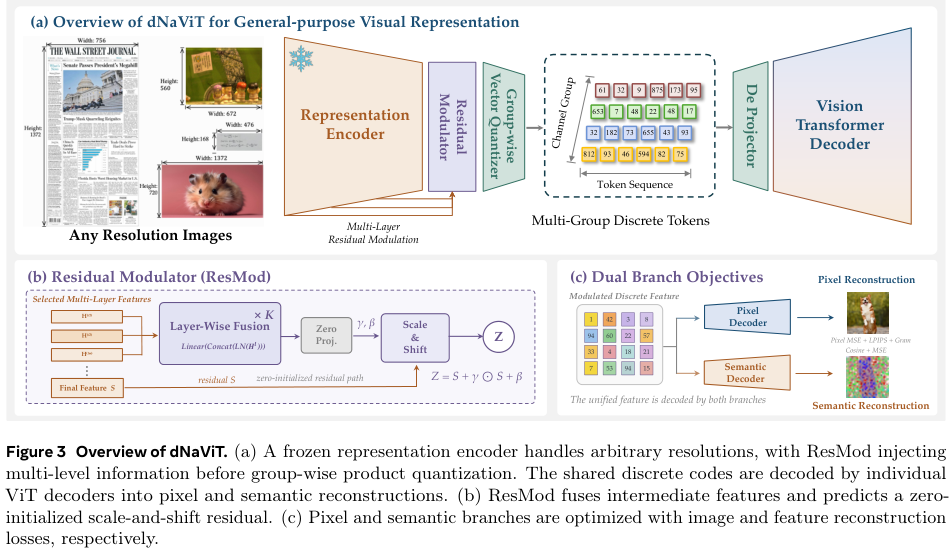
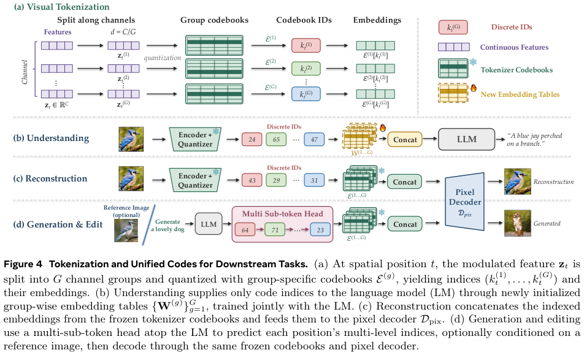
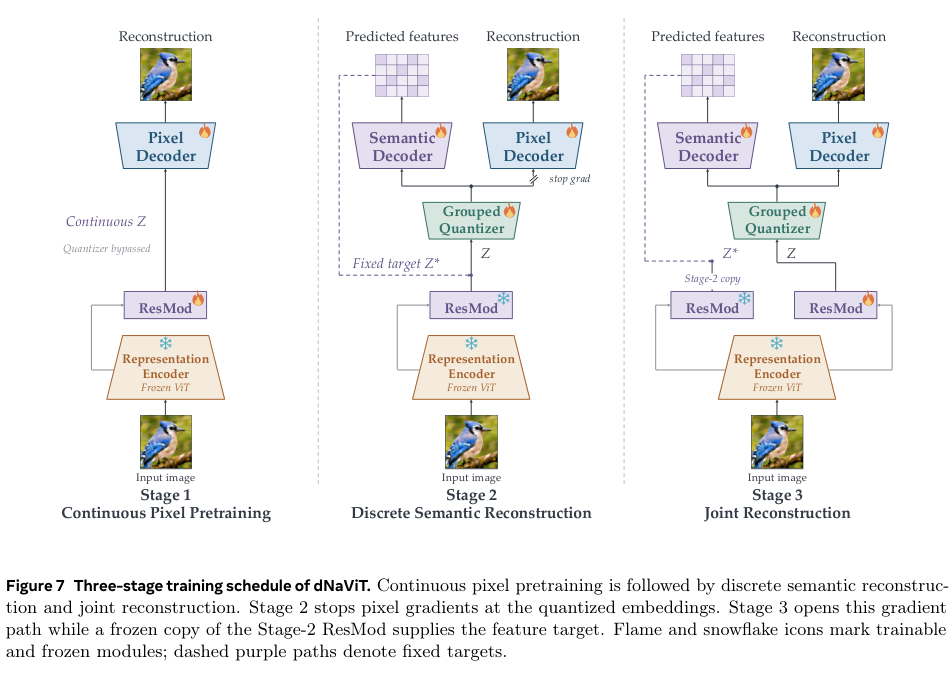
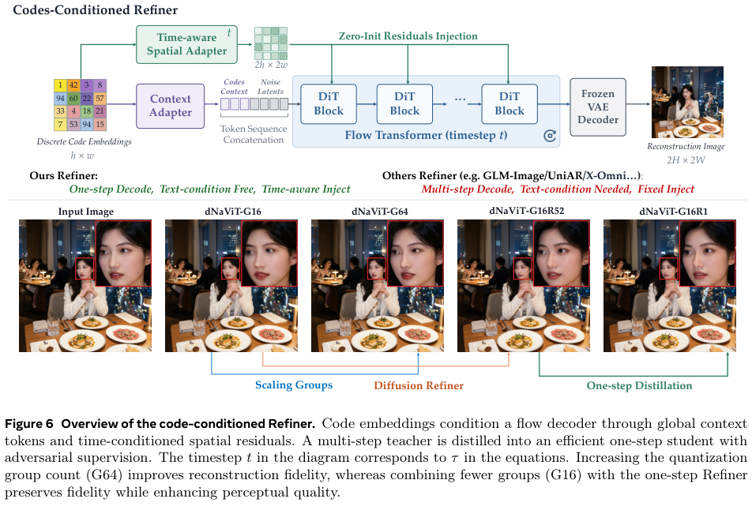
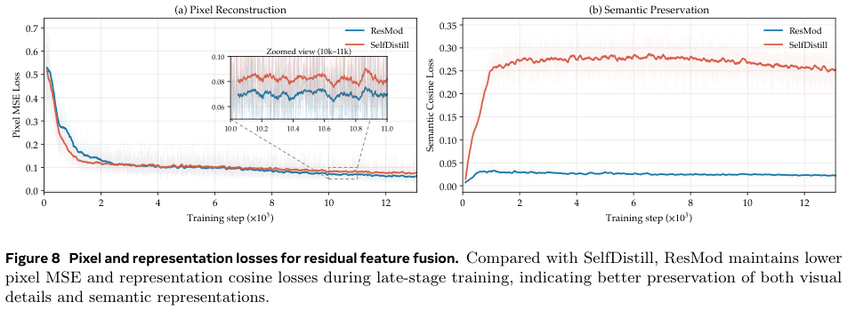
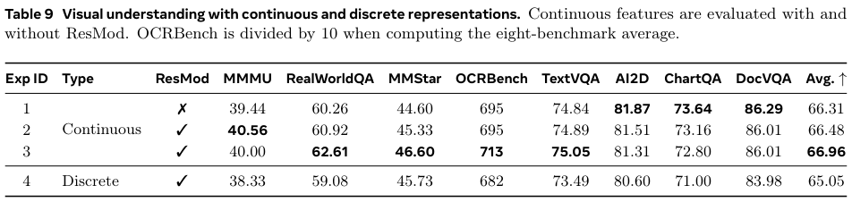

---
tags:
  - paper
  - collection/multimodal-understanding
  - domain/model-systems
  - status/deep-review
  - topic/visual-tokenization
  - method/grouped-product-quantization
document_type: paper
domain: multimodal_understanding
collection: Multimodal Understanding
review_status: deep-review
canonical: true
---

# dNaViT：一套离散视觉码能否兼顾理解与生成？

> [!info] 文档关系
> - 文档类型：Paper
> - 领域入口：[README](../README.md)
> - 上位索引：[Paper Index](../evidence/paper-index.md)
> - 跨域关联：[视觉生成 Survey](../../multimodal_generation/surveys/multimodal-diffusion-infra.md)
> - 证据资产：`../assets/papers/dnavit/`
> - 相关文档：[Figure inventory](../evidence/dnavit-figure-inventory.md)

## 资料与修订

PDF 首页作者署名为机构「Meituan LongCat Team」。论文为美团 LongCat 团队的 *dNaViT: Discrete Codes are General-Purpose Visual Representations*，arXiv:2611.12426v1，2026-11-09 提交。本文核对官方 32 页 PDF 与 HTML，物理页码按 PDF 首页为 1 计。作者署名为机构「Meituan LongCat Team」，PDF 首页另列联系邮箱；不从邮箱推断个人作者或通讯作者身份。项目页、GitHub 与模型链接出现于论文首页，但本文没有核验代码提交、权重内容与可复现性。

当前修订：`rev-dnavit-initial-20261124`，文档版本 `1.0.0`，2026-11-24，类型 `initial`。首次建立方法、公式、结果、图表与证据边界解读。

## 从具体任务看问题

设想一张同时有街景、路牌小字和人物表情的图片。视觉问答希望把「路牌写了什么、人物在哪里」编码成便于语言模型读取的语义；图像编辑却需要保留文字笔画、纹理、颜色与布局。本文构造的说明例，不是论文实验。传统语义编码器常对局部像素变化保持不敏感；单纯面向重建训练的离散码则未必保留语言模型可用的抽象含义。若先把语义特征量化为少数码字，细小差异可能合并；若只增加码字而不改变输入特征和训练目标，也不能保证多出来的容量用于有用细节。论文的目标是在**同一套视觉码**里保留两类信息，让编码后的索引既可供理解模型读取，也可用于重建、生成与编辑。这里的“同一套”指视觉 tokenizer 的共享码本，不代表下游语言模型和生成模型权重也完全相同。论文引言与 §2.1–2.2 给出这个问题设定。

Figure 3 给出完整路径：冻结预训练视觉编码器；从不同深度取特征，经过残差调制；按通道分组量化；相同离散码同时进入语义特征与像素重建分支。

## 方法：先保留信息，再分配码本容量

### 1. 冻结语义编码器，学习残差调制

主编码器是约 400M 参数的 Qwen3-VL ViT，训练 tokenizer 时冻结；约 100M 参数的 ResMod 从早期与深层特征取信息，先融合，再生成每个位置的缩放 $\gamma$ 和偏移 $\beta$（§2.3、§3.1）。其关键更新是：

$$
Z=S+\gamma\odot S+\beta.
$$

$S$ 是最终语义特征在量化网格上的表示，$Z$ 是送往量化器的新特征，$\odot$ 为逐元素乘法。生成 $\gamma,\beta$ 的末层零初始化，初始时 $Z=S$；学习后可以在保留主干语义锚点的同时暴露中间层的局部信息。这个式子说明的是**可学习的逐位置仿射修正**，并不数学保证语义始终无损；这种保留程度须看后续对照实验。作者在 §2.3 将其概括为重新组织特征几何。

### 2. 每个空间位置使用多个码本

在一个位置，$Z$ 的 $C$ 个通道被分成 $G$ 组，每组从大小为 $K$ 的独立码本选择最近向量（§2.4，Eq. 3–4）：

$$
k_t^{(g)}=\arg\min_{1\leq k\leq K}\|z_t^{(g)}-e_k^{(g)}\|_2^2,\qquad
B_{\mathrm{position}}=G\log_2 K.
$$

$t$ 是空间位置，$g$ 是通道组，$z_t^{(g)}$ 是待量化特征，$e_k^{(g)}$ 是码本向量；$B_{\mathrm{position}}$ 是名义每位置比特预算。例如 $G=16$ 时，每个位置会有 16 个离散索引，**不是一个普通词表 token**。组合空间为 $K^G$，但实现只存 $G$ 个各含 $K$ 项的码本；$G$ 增大不会增加图像网格位置数，却会增加需预测的索引数。名义容量也不等于实测熵或保真度。若图像为 $512\times512$ 且空间下采样因子 $f=32$，网格有 $16\times16=256$ 个位置；G16 对应 4096 个组索引，G64 对应 16384 个组索引。这个计数忽略特殊符号、传输格式与压缩，不能据此声称自回归推理成本不变。

Figure 4 区分了接口：理解模型只接收离散索引并学习新的组嵌入表；重建使用 tokenizer 冻结码本向量；生成模型通过多子 token 预测头产生每位置的组索引，再使用同一码本解码。因此统一的是**可复用视觉码接口**，不是所有任务的同一计算图或同一解码损失。

### 3. 双分支约束与三阶段训练

离散码同时送入语义解码器与像素解码器。前者用余弦距离加特征均方误差逼近冻结的 ResMod 输出 $Z^\star$；后者以 $L_1$、像素均方误差、LPIPS、ConvNeXt-S 感知损失和 Gram 纹理损失重建图像（§2.5，Eq. 5–9）：

$$
L_{\mathrm{sem}}=1-\cos(\hat Z,\operatorname{sg}(Z^\star))
+\lambda_{\mathrm{MSE}}^{\mathrm{sem}}\|\hat Z-\operatorname{sg}(Z^\star)\|_2^2,
\qquad L_{\mathrm{dual}}=\lambda_{\mathrm{sem}}L_{\mathrm{sem}}+\lambda_{\mathrm{pix}}L_{\mathrm{pix}}.
$$

$\hat Z$ 是由码重建的特征，$\operatorname{sg}$ 表示停止目标端梯度，$L_{\mathrm{pix}}$ 是上述五种像素与感知误差的加权和；各 $\lambda$ 为训练权重。余弦项约束方向，均方项约束绝对数值；作者指出仅用余弦项可能被特征共同均值掩盖。两种任务目标在同一码上施加约束，但不意味着单独量化损失就能自动形成通用表征。

训练顺序解决目标冲突：①不经过量化，先训练 ResMod 与像素解码器提取细节；②冻结 ResMod，训练量化器和语义解码器，像素分支接收停止梯度的码，避免早期像素目标改写码；③保留冻结的第二阶段 ResMod 作为语义教师，训练学生 ResMod 与量化器，允许像素梯度经过离散码。冻结的 ViT 始终不变。这里不能把三阶段收益拆为独立贡献，因为论文没有逐阶段、同预算的完整下游消融（§3.1）。

### 4. 高保真解码器是额外组件

直接 ViT 像素解码可能平滑文字与纹理。Refiner 用预训练生成先验，以离散码为条件，分别提供全局上下文和随流时间变化的空间残差；先训练多步 flow teacher，再蒸馏成一步 student（§2.6）。它**替代**像素解码器用于高感知质量，不改变前面的离散码。改进的视觉观感因此不能全部归因于码本。

## 实验告诉了我们什么

| 问题 | 论文数字 | 合理读法 |
|---|---|---|
| 同一离散码能重建吗？ | Table 1：$512^2$、$f=32$ 时 G16 为 25.47 dB / 0.71 SSIM，G64 为 28.12 dB / 0.81；$1024^2$ 时 G64 为 32.90 dB / 0.91 | 组数与输入分辨率都有影响；表中跨来源基线协议不完全一致，不宜作严格同条件排名 |
| 小字恢复如何？ | Table 2：TokBench $512^2$ 下 G16/G64 的文字准确率 33.58% / 51.69%；$1024^2$ 下为 45.05% / 63.08% | 改善显著，但小目标仍难：Table 3 的 $512^2$ 小实例 G64 仅 12.18% |
| 离散特征是否保留识别信息？ | Table 5：ImageNet-1K 线性探测，原 QwenViT 80.45%，dNaViT-G16 离散码 79.47% | 在这一冻结表征探测设置下接近；不能推断所有分布与下游任务无损 |
| 理解表现如何？ | Table 4/6：dNaViT-8B 的 MMMU 70.7、OCRBench 885、DocVQA 96.2；Qwen3-VL-8B 为 69.6、896、96.1 | 多模型训练数据、图像分辨率、提示与评测协议可能不同；不是仅替换 tokenizer 的控制实验 |
| 生成和编辑如何？ | Table 7/8：GenEval2 49.5、Qwen-Image-Bench 52.17；GEdit-Bench Overall 7.30 | 支持这套系统可用于生成/编辑；编辑分数低于表中 Qwen-Image-Edit 7.56 和 Emu3.5 7.59 |

理解模型用冻结 G16 tokenizer 搭配 Qwen3-8B，alignment/pretraining/mid-training/SFT 分别约 70B/150B/60B/30B token（§4.3）；tokenizer 本身在混合图像语料上训练数千亿 token（§3.2）。因此“用较小数据预算获得通用能力”的表述需要按具体基线与数据口径理解，不能从表格直接归因于结构效率。生成/编辑报告使用 G16-R，也包含 Refiner。

Figure 8 对照 SelfDistill：ResMod 后期像素 MSE 和语义余弦损失更低，直接支持这一训练路径更好兼顾两个代理指标。Table 9（论文 §5.1）在相同 Qwen3-1.7B 理解设置下进一步隔离表征：连续、无 ResMod 平均 66.31；连续、有 ResMod 且重新训练为 66.96；离散、有 ResMod 为 65.05。数字表明 ResMod 并未完全抵消量化损失，离散与较强连续配置仍差 1.91 分；论文关于“相当”的结论应按具体指标和规模解释。

## 判断与边界

此工作的贡献是把**冻结语义编码器、可学习细节残差、分组量化、双分支训练**连接成可用于理解和生成的视觉码接口；其最有说服力的证据是 Table 1/2 的重建取舍、Table 5/9 的冻结表征对照和 Figure 8 的训练曲线。工程上，空间位置数、每位置组索引数、码本查找、语言模型组嵌入与多子 token 预测头必须分别核算；$f=32$ 只描述空间网格，不给出完整码率或生成延迟。

本文没有复现代码或推理吞吐测试，也没有足够证据证明相同训练预算下它全面优于连续视觉表示。Refiner 可从生成先验补充视觉细节；重建分数不能单独证明所有信息由离散码精确保留。论文本身在 Figure 1 使用“losslessly”图中文字；实际量化是有损的，需按 PSNR、文字准确率和下游指标评估，而不能按字面理解为无损编码。

## 术语与来源

| 术语/符号 | 本文含义与歧义 | 论文位置 |
|---|---|---|
| ResMod、$S$、$Z$ | 冻结语义特征上的可训练仿射残差；$Z$ 是量化前特征，非码本索引 | §2.3，Eq. 1–2 |
| $G,K,N_q$ | 组数、每组码本大小、空间位置数；$N_q$ 不含组维度 | §2.4，Eq. 3–4 |
| $Z^\star,\hat Z,\operatorname{sg}$ | 固定教师特征、离散码重建特征、停止梯度；第三阶段教师与学生 ResMod 分离 | §2.5，§3.1 |
| G16、G64、G16-R | 分别为 16/64 组直接像素解码，以及 16 组加 Refiner；分数不得混用 | §4.1，Figure 6 |
| 原始证据 | [arXiv:2611.12426v1](https://arxiv.org/abs/2611.12426)、PDF 物理页 1–32、[图表清单](../evidence/dnavit-figure-inventory.md) | 2026-11-24 核验 |

后续最值得验证的是：在**同一数据、计算量与语言模型**下替换连续/离散 tokenizer；逐阶段关掉 ResMod、双分支及 Refiner；实测每图索引数、熵编码比特率、生成延迟和显存。
