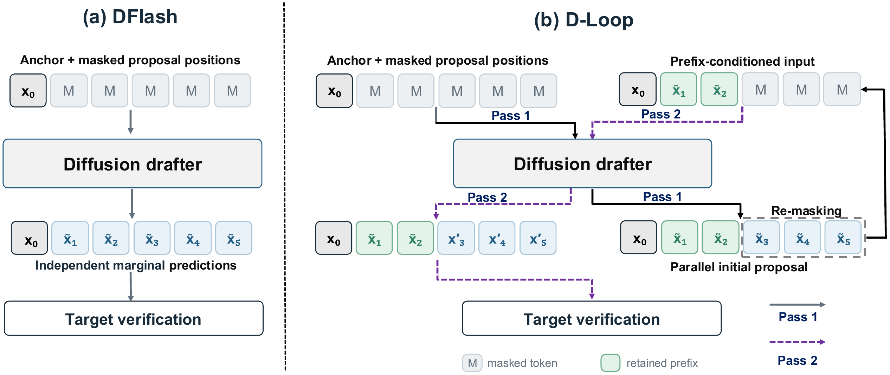

---
tags:
  - paper
  - collection/speculative-decoding
  - domain/model-systems
  - status/deep-review
  - topic/block-diffusion-drafting
  - method/prefix-conditioned-diffusion
---

# D-Loop: Looped Diffusion Drafting for Speculative Decoding 精读分析

> [!info] 文档关系
> - 文档类型：Paper
> - 领域入口：[README](../README.md)
> - 上位汇总：[投机推理方法演进](../surveys/evolution.md)
> - 证据资产：`../assets/papers/d-loop/`

## 修订信息
- 当前文档版本：`1.0.0`；当前修订 ID：`rev-d-loop-initial-20261008`；当前修订时间：`2026-10-08T21:00:00+08:00`；替代版本：无。

## 0. 资料与配图索引
- 论文：[arXiv:2610.06011](https://arxiv.org/abs/2610.06011)，PDF/source v1。
- 配图：[D-Loop framework](../assets/papers/d-loop/fig1-framework.png)，原始 source figure 转 PNG，单一 Figure 1，原分辨率 QA 已完成。
- 代码/公开评审：论文未给出可核验 commit，未发现公开 OpenReview 评审。

## 0.1 术语与符号解释
### 0.1.1 术语表
| 术语 | 本文含义 | 不等于 | 证据 |
|---|---|---|---|
| marginal prediction | 每个块位置只看 anchor/context 的边际预测 | 条件生成 | §1–2 |
| repetition trap | 相邻位置重复同一 token，浪费候选槽位 | target 真重复 | Table 1 |
| prefix-conditioned refinement | 选定前缀后并行重生成后缀 | 再训练一个 drafter | §3 |
| prefix–suffix loss | 同一 backbone 同时学 anchor-only 和 revealed-prefix 两种视图 | 两套参数 | §3.2 |
### 0.1.2 符号表
| 符号 | 含义 | 来源 |
|---|---|---|
| $K$ | 候选/后缀位置数 | §3 |
| $p_i$ | 第 $i$ 个位置的 token 分布 | Eq. (1) |
| $\tau$ | 平均提交 token 数 | Table 3–5 |
| $\beta,\tau_s,\gamma$ | 训练权重与位置衰减尺度 | §3.2 |

## 0.2 AI 生成算法分析示意图
使用原论文 Figure 1 作为算法总览，未另生成 AI 图。

## 1. 论文基本信息
- 标题：D-Loop: Looped Diffusion Drafting for Speculative Decoding。
- 作者：Kecheng Chen, Yuyang He, Cheng Gong, Hui Liu, Guoping Long, Jiajun Li, Shi Wu, Suiyun Zhang, Haoliang Li, Ziru Liu, Rui Liu；通讯作者标记为 Ziru Liu、Rui Liu，Huawei Research。第一作者 Kecheng Chen，City University of Hong Kong；其余机构还包括 CUHK、Huawei Research。
- 核心问题：block diffusion 的边际预测看不到块内已选 token，导致重复与短 accepted prefix。

## 2. 研究动机与问题—方案闭环
### 2.1 出发点与背景痛点
在 DFlash 式块草稿中，位置 1 预测“the”，位置 2 也只能看同一个 anchor/context，可能再次预测“the”；target 只接受连续前缀，于是重复占据的位置让后续正确 token 无法提交。论文把这种现象命名为 repetition trap，并在 Table 1 量化。成功方案要保持一次 forward 的块并行，同时让后缀看到可信前缀。
### 2.2 现有方案为何不够
| 旧做法 | 失败 | 根因 | 简单补丁不足 | 证据 |
|---|---|---|---|---|
| vanilla full-mask diffusion | 相邻重复，accepted length 短 | 位置间无因果信息 | 只增大块会放大重复 | §2/Table 1 |
| 额外 causal head/refiner | 质量改善但参数与目标增加 | 需要第二组件/训练目标 | 受显存与维护成本限制 | Related Work |
### 2.3 论文计划解决的问题与成功标准
在不增加组件和第二套权重的情况下引入块内条件化；成功标准是 accepted length 与 speedup 超过 DFlash/DSpark，代价是额外 loop pass 可被收益抵消前仍要净加速。
### 2.4 核心方案如何解决并优化问题
首轮生成完整 block；选出 prefix 后，第二轮把 prefix 显式 reveal，平行重生成 suffix；两轮共享 backbone。prefix–suffix loss 让同一模型学会两种输入视图。
| 设计 | 改变 | 预期指标 | 证据 |
|---|---|---|---|
| looped shared backbone | suffix 条件从 anchor 变为 selected prefix | 减少重复、提高 $\tau$ | Fig.1, Table 3 |
| prefix–suffix objective | 训练分布覆盖两种 pass | 保持首轮 proposal 与二轮 refinement | Table 5 |
| selected prefix rule | 仅 reveal 可信前缀 | 避免错误 token 污染 suffix | §3, Algorithm 1 |
### 2.5 完整因果链与证据闭环
边际预测缺少块内依赖 → repetition trap → prefix-conditioned second pass → suffix 更符合上下文 → accepted length 上升 → 即使 draft time 约翻倍仍可能 speedup 更高。该链由 Table 1/2、Table 3–6 和消融直接支持；普适最佳性未被证明，Alpaca 是反例。

## 3. 核心贡献与创新点
1. 明确 repetition trap 的理论与实证模式。
2. 用共享参数循环把 intra-block causal conditioning 引入原 drafter。
3. 以单一互补目标训练初始 proposal 与 refinement。

## 4. 研究方法
### 4.1 方法总览

图注：原论文 Figure 1，DFlash 的一次边际预测与 D-Loop 的 prefix reveal + suffix regeneration。
### 4.2 组件级设计动机与具体问题映射
共享 backbone 的动机是避免新增 refiner 的参数和部署分支；代价是同一参数要兼容两个状态分布。prefix–suffix loss 不是装饰：仅用 full-mask loss 会使第二轮输入成为训练外分布，论文 Table 5 显示完整目标提升均值接受长度。selected-prefix 策略通过只暴露已选前缀避免错误传播，但其选择阈值/规则仍依赖实现细节。
| 设计项 | 依据 | 证据强度 |
|---|---|---|
| looped shared parameters | author-stated §3 | 直接机制+主结果 |
| prefix–suffix loss | author-stated §3.2 | 直接消融 |
| intra-block conditioning | inferred from Fig.1/Algorithm 1 | 与重复率和接受长度相关，非独立理论证明 |
### 4.3 模型/系统架构
输入 anchor/context → pass-1 block proposal → 选择 prefix → pass-2 suffix regeneration → target parallel verification → longest prefix commit。
### 4.4 关键公式
$$\mathcal L=\mathcal L_{\mathrm{prefix}}+\beta\mathcal L_{\mathrm{suffix}}$$
**这条公式在算什么？** 共享 drafter 的联合训练损失。
**怎么读？** 同时要求首轮预测 prefix 和看到 prefix 后的 suffix 正确。
**输入与输出。** 输入是两种 mask/revealed-prefix 视图，输出是标量 loss。
**变量在这里各做什么？** $\beta$ 控制 suffix 目标权重，两个子损失分别覆盖两种 pass。
**直觉。** 只训练 suffix 会损害首轮 proposal；联合优化让同一模型兼顾两阶段。
**边界。** $\beta$ 与位置衰减是经验超参，不代表概率守恒。
**小例子。** 若 prefix loss=1、suffix loss=0.5、$\beta=0.7$，总 loss=1.35。
### 4.5 训练/实验/部署设计
Qwen3-4B/8B，8 个 math/code/chat benchmark，报告 greedy 与 sampling，Qwen3-8B greedy 平均 speedup 约 5.06×、sampling 4.11×；Table 6 给出额外 pass 与 verification latency。

## 5. 关键结论
### 5.1 主结果
D-Loop 在八个数据集上通常超过 DFlash/DSpark；Qwen3-8B 的平均接受长度约 8.11（greedy）/6.37（sampling）对应约 5.67×/4.45×（Table 5）。
### 5.2 消融和机制证据
| 技术点 | 对照 | 结论 |
|---|---|---|
| repetition trap | DFlash 统计 | 相邻重复率与短接受长度相关 |
| loop pass | DFlash/DSpark | 额外 draft 成本换取更长 prefix |
| full objective | suffix-only | 接受长度与 speedup 小幅提升 |
### 5.3 是否验证了假设
块内依赖能提升 accepted prefix 得到支持；“额外 pass 总能净加速”被 Alpaca 反例否定。
### 5.4 收益来源归因
收益来自 acceptance length，而非单次 draft latency；Table 6 证明 draft time 增加，故不能把提升归给 kernel 优化。

## 6. Related Work 对比
| 方法 | 核心机制 | 代价 | D-Loop 差异 |
|---|---|---|---|
| DFlash | 一次边际 block diffusion | 重复 trap | 增加 looped prefix conditioning |
| DSpark | causal head/refiner | 额外参数/目标 | 共享原 backbone |
| D2SD | 独立 prefix-conditioned drafter | 第二套权重 | 单模型参数共享 |

## 7. OpenReview 公开评审 × 论文内容交叉核验
未发现公开 OpenReview 评审。

## 8. Infra 需求分析
### 8.1 算力
draft forward 近似由 1 次变 2 次；只有 $\Delta\tau$ 足以摊薄额外计算时才加速。
### 8.2 显存与存储
不增加 drafter 参数，但需要保存两轮中间状态；峰值 activation 上升。
### 8.3 Data Types / 数值格式
论文未给出量化实验，dtype 细节不足。
### 8.4 带宽、互联与高效利用
共享 backbone 提高权重重用，但两轮读写增加 HBM 流量；没有 bytes/有效带宽报告。
### 8.5 CPU/GPU/NPU 异构执行
两轮 pass 可在同一 GPU；跨设备拆分会放大 prefix 状态传输。
### 8.6 调度/Serving/自定义算子
需要 backend 支持 prefix reveal、suffix mask 和可变块长度；源码未取得。

## 9. 开源代码对照
论文 source 可核验算法与公式，未取得可复现 runtime commit；checkpoint 配置未验证。
### 9.1 开源权重/配置对照
无公开权重元数据，容量差异按论文配置待复核。

## 10. 优点、局限与风险
### 优点
不增加 refiner；机制直指 repetition trap；训练目标和推理流程一致。
### 局限
额外 pass 使低接受率任务可能变慢；prefix 选择错误仍会污染 suffix；理论解释没有覆盖所有采样温度。
### 可改进之处
用边际收益 gate 决定是否进入第二 pass，并报告峰值显存和尾延迟。

## 11. 研究启发
块扩散的真正瓶颈不是并行预测本身，而是缺乏块内状态；D-Loop 与 DLoop 的“验证频率优化”可以正交叠加。
## 12. 解读问题/待验证清单
1. 二轮 prefix 选择能否由 target 校准？
2. 额外 pass 在高并发 serving 是否被 batch 摊薄？
3. repetition rate 与 accepted length 的因果关系能否通过固定候选池实验隔离？
4. 与 D2SD 在相同参数/延迟预算下是否公平？
## 13. 一句话总结
D-Loop 用共享参数的“首轮提议、前缀条件化重生成”修复块扩散的 repetition trap；它以额外草稿计算换取更长接受前缀，收益边界由负载决定。
## 14. 冻结前发布审计
- Markdown 渲染器：`markdown-it`；结果 passed。
- Figure/Table 邻近性：Figure 1 紧邻方法总览；passed。
- 临时标记扫描：clean；审计证据为过程侧 checklist/manifest。
