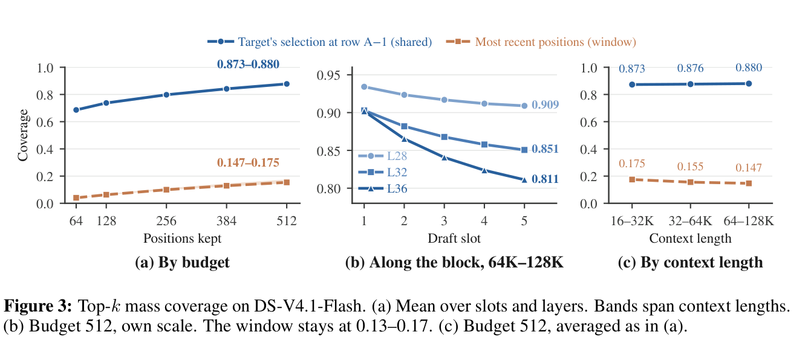
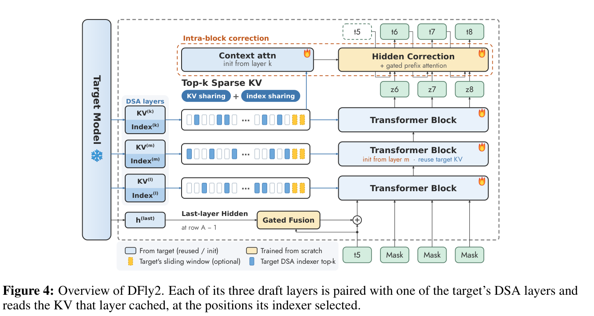
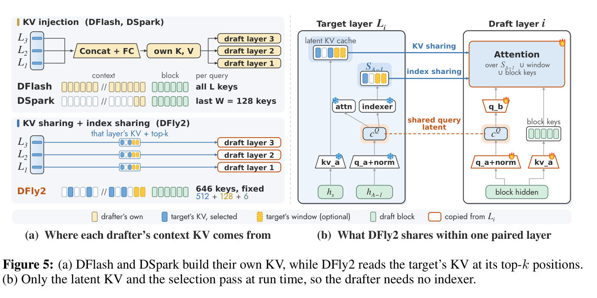

---
tags:
  - paper
  - collection/speculative-decoding
  - domain/model-systems
  - status/deep-review
  - topic/long-context-speculative-decoding
  - method/target-sparsity-sharing
document_type: paper
domain: speculative_decoding
collection: Speculative Decoding
review_status: deep-review
canonical: true
---

# DFly2：长上下文草稿器借用目标模型已经选好的位置

> [!info] 文档关系
> - 文档类型：Paper
> - 领域入口：[Speculative Decoding README](../README.md)
> - 上位汇总：[Speculative Decoding evolution](../surveys/evolution.md)
> - 证据资产：../assets/papers/dfly2/
> - 相关文档：[DFly2 figure inventory](../evidence/dfly2-figure-inventory.md)

## 修订信息

- 当前版本：1.0.0；修订 ID：rev-dfly2-initial-20261127；时间：2026-11-27；类型：initial；前一修订：无。
- 来源版本：arXiv:2611.34776v1，2026-11-25；本次建立首次完整分析。

## 问题从哪里来

设想一个服务正在处理 64K token 的代码库问答。大模型已经把历史上下文存入自己的键值缓存，并且每次生成时只从中选择少量相关位置。投机解码让一个较小的草稿器先提议五个后续 token，大模型再一次验证它们；验证规则仍决定最终输出，因此提议错误不会改变目标模型的生成分布。问题是：旧草稿器通常又为这 64K 上下文建立自己的缓存，或者只保留最近一小段。前者在请求进入服务时多做投影、占内存并削弱前缀复用；后者可能看不到很早之前的相关代码。这个场景是依据论文 §1、§3.1 重构的说明，不是独立实验案例。

论文的关键观察很朴素：稀疏目标模型已经做了两件事——保存可读的上下文缓存，以及为当前查询选出要读的位置。草稿器若能借用两者，就无需再为每个上下文 token 保存自己的缓存，也无需自己扫描全上下文挑位置。作者把这个三层、块并行的草稿器命名为 DFly2；这里的核心计算是**读取目标模型已有缓存中、目标模型上一轮已选中的位置**。（论文 §3–4）

## 为什么上一轮的位置还能用于下一块

草稿器一次猜多个 token 时，手中只有上一轮目标验证留下的索引；未来各 token 本来可能关注不同位置。作者在 DS-V4.1-Flash 的 158,638 个长上下文块上，比较上一轮选出的 top-512 与未来各位置自己会选出的 top-512。论文 Eq. (5) 的覆盖率为：

$$
\mathrm{Cov}(t)=\frac{\sum_{s\in S_{A-1}}p_t(s)}{\sum_{s\in S_t}p_t(s)}.
$$

这里 $p_t(s)$ 是未来位置 $t$ 的索引器给历史位置 $s$ 的分数质量，$S_{A-1}$ 是块开始前已选的位置，$S_t$ 是该未来位置自己选的前 512 个。分母是同样 512 个名额下的最佳分数质量；分子问“旧名单接住了多少”。这是**索引分数覆盖率**，不是草稿 token 接受率。图中旧名单平均覆盖约 0.87–0.88，而同样 512 个最近位置仅约 0.15–0.18；随着块内位置后移，覆盖逐渐下降。（论文 §3.3、Figure 3）

*原论文 Figure 3；完整原 caption 随图保留。图像 QA、PDF 页码和裁剪范围见 [inventory](../evidence/dfly2-figure-inventory.md)。*

这个测量先检验“位置能否跨块沿用”，并没有直接证明借用位置的草稿器会接受更多 token。后者需要训练和消融实验。作者还观察到仅把前一步查询的位置编码移到后续位置而不改变内容时，72 个检查单元的 top-512 完全不变；其关于低频位置编码与内容缓慢变化的解释属于机制分析，证据仅覆盖所测目标模型。（论文 §3.3）

## 草稿器实际借用了什么

目标模型完成一轮验证后，每个被配对的稀疏注意力层都留下了缓存和刚算出的索引。DFly2 的三个草稿层分别配一个目标层：草稿层 $i$ 取目标层 $L_i$ 已缓存的位置向量 $c_s^{L_i}$，读取位置集合是

$$
R_i=S_{A-1}^{(L_i)}\cup N.
$$

$S_{A-1}^{(L_i)}$ 是配对目标层在块起点前选出的前 $k$ 个位置；$N$ 是该目标层单独维护的近邻窗口，若目标模型的 top-k 已可覆盖它便不用额外加。草稿层用**自己的可训练投影矩阵**把这些目标缓存向量变成注意力键和值。共享的是运行时的缓存内容与位置索引，**不是把目标层全部权重直接作为共享参数**；配对层的部分权重只在训练开始时复制过去，随后由草稿器训练。（论文 Eq. (6)–(10)、Figure 4–5）

*原论文 Figure 4，展示目标层与草稿层的配对；完整原 caption 随图保留。*

*原论文 Figure 5，对照运行时数据来源；完整原 caption 随图保留。*

| 目标模型 | 配对目标层 | 目标选择 | 额外近邻窗口 | 每步读取位置数 |
| --- | --- | --- | ---: | ---: |
| DS-V4.1-Flash | 28、32、36 | 512 个位置 | 128 | 646 |
| GLM-5.3-Flash | 35、39、43 | 512 组，每组 4 个位置 | 无 | 2,054 |
| Hy4 flash | 33、37、41 | 2,048 个位置 | 无 | 2,054 |

每步位置数含块内六行，不能把 GLM 的“512 组”误读为 512 个 token；这是论文 Table 4 的三层配置。由于读取数量由目标模型的固定预算决定，草稿阶段的上下文注意力不随前缀长度增长；但缓存读取和索引传递仍有常数成本。对于 DS-V4.1，配对不同索引器的层可看到不同位置；改配相邻的 37–39 层，在 Table 11 的三组平均接受长度由 3.57/3.62/3.75 降到 3.36/3.47/3.61，因为这些层重复使用同一组索引。（论文 §4、§5.4）

仅有历史位置还不足以处理正在生成的这一块。DFly2 在块内仍保留小规模、按槽位的隐藏状态，并顺序做一次修正：结合上一槽刚预测的 token、目标缓存中的上下文以及块内已生成槽位。目标最后一层隐藏状态没有进入上述缓存，作者因此把它与块起点 token 的嵌入融合后注入首槽。块并行骨干只跑一次，顺序修正是额外步骤；Table 11 中去掉修正注意力读取，三组接受长度分别降到 3.47/3.51/3.65；去掉首槽隐藏注入则降到 3.51/3.56/3.68。论文称两次读取在其 TP8 引擎中少于一步解码时间的 1%，但未证明所有部署条件都如此。（论文 Eq. (11)、§4、§5.4）

训练只更新草稿器，目标模型冻结。训练时没有服务验证产生的“上一轮索引”，因此用冻结的目标索引器重算相应位置；推理时直接接收验证阶段留下的索引。损失按块内槽位加权，结合分布匹配与总变差项，权重反映早期槽位通过后对后续接受长度的贡献。（论文 Eq. (12)、§4）

## 成本账：缓存、接受数与速度

对三层草稿器，论文 Table 2 按 bf16 模型配置计算每个上下文 token 的缓存增量：

| 目标模型 | 目标缓存 | 旧草稿器自有缓存 | 两者合计/目标单独 |
| --- | ---: | ---: | ---: |
| DS-V4.1-Flash | 4.4 KiB | 3.4 KiB | 1.76× |
| GLM-5.3-Flash | 11.7 KiB | 3.0 KiB | 1.26× |
| Hy4 flash | 17.2 KiB | 3.4 KiB | 1.20× |

这说明目标缓存越省，旧草稿器的缓存占比越明显。Table 3 根据配置估算 DS-V4.1 在 32K 时移除草稿缓存可使同一内存池的并发请求上限相对全量自有缓存达 1.73×；**这是容量估算，不是实测吞吐倍率**。窗口缓存也接近这一上限，却只能读 32K 前缀的最近 0.4%–1.6%；借用目标缓存则可按索引触及全前缀。（论文 §3.1、Table 2–3）

正式实验用三个稀疏目标模型；作者把 DFlash、限制到同样窗口的 DFlash†、DSpark 与 DFly2 按同一数据、目标、步数重新训练。各草稿器都是三层、128 个路由专家；DFly-SFT 有 989,861 条对话、7.42B token；训练序列最长 32K，三轮、全局批量 256。推理块长五个草稿 token，主表为关闭思考、最多生成 2K 的聊天模式；比较贪心与随机采样（Hy4 随机温度 0.9，其余 1）。除特别注明外用 H20。接受长度取最后三次运行平均；单请求速度相对各自**不使用草稿器的目标模型**，并分“仅解码 / 含预填充的端到端”。因此接受长度比例不等于速度比例。（论文 §5.1）

| 目标 | 一般任务平均接受长度：DSpark → DFly2 | 长上下文平均：DSpark → DFly2 | 代理任务平均：DSpark → DFly2 |
| --- | --- | --- | --- |
| DS-V4.1 | 3.81/3.51 → 4.12/3.88 | 3.23/2.79 → 3.74/3.32 | 3.35/3.08 → 4.06/3.75 |
| GLM-5.3 | 3.68/3.35 → 3.96/3.69 | 3.05/2.64 → 3.85/3.36 | 3.10/2.99 → 4.03/3.68 |
| Hy4 | 3.81/3.73 → 3.96/3.95 | 3.20/3.01 → 3.63/3.46 | 3.16/2.95 → 4.11/3.88 |

每格是贪心/随机采样下**每轮平均提交的 token 数**，不是百分比。一般任务来自论文 Table 6，长上下文与代理任务来自 Table 7；长上下文含 32K、64K、128K，代理任务另含 64K SWE。较强基线的相对接受长度增益从一般任务 3.9%–10.5% 扩大至长上下文和代理任务的 10.0%–31.5%。三种目标都出现这个方向，但这是作者复训和指定负载上的证据，不意味着任何稀疏目标都可直接复用。

速度也要单看。Table 8 的一般任务平均“仅解码/端到端”加速，DS-V4.1 的 DSpark 为 2.93×/2.80×、DFly2 为 3.14×/2.97×；GLM 为 2.45×/2.32× 对 2.50×/2.36×；Hy4 为 3.20×/3.06× 对 3.34×/3.19×。Table 9 的长上下文平均分别是 DS-V4.1 2.47×/1.91× 对 2.87×/2.11×，GLM 2.07×/1.49× 对 2.45×/1.64×，Hy4 2.70×/1.98× 对 3.06×/2.12×。这些是相对目标单独运行的倍率，不是 DFly2 相对 DSpark 的倍率；分子分母与预填充是否计入必须同时说明。

在更高并发下，Figure 7 对 DS-V4.1 做了另一种对照：**匹配每个用户的解码速度**，再比较整个部署的 token 吞吐。DFly2 相对 DSpark 在短文本、CodeSpan 64K、SWE 64K 分别多 28%、62%、81%；图中的吞吐包括全部预填充和解码实例，不能把差值单独归因于索引借用。长任务使用八个预填充实例配一个解码实例；吞吐比较不是单卡孤立草稿层的微基准。（论文 §5.1、§5.3）

*原论文 Figure 7；完整原 caption 随图保留。*

## 哪项改动解释了收益，哪里仍有边界

Table 10 的消融最能分清两种共享的角色。DS-V4.1 的 DFly2 在一般/长上下文/代理任务平均接受长度是 3.57/3.62/3.75；**去掉目标 top-k** 后降为 3.14/2.76/2.95；只去掉近邻窗口为 3.45/3.50/3.63。GLM 去掉 top-k 后由 3.56/3.67/3.91 降为 3.42/3.10/3.34；Hy4 由 3.36/3.46/3.76 降为 3.31/3.12/3.13。这更直接支持“目标选的位置提高草稿接受效果”，尤其长上下文；**借用 KV** 的主要证据则是缓存、预填充和部署资源成本，而非它单独提高接受长度。消融一次只改一个部件，整体部署仍受目标结构、训练分布和服务实现影响。（论文 §5.4）

有三个实际限制。第一，必须有可供草稿器读取的稀疏目标缓存和可复用索引；普通稠密注意力目标没有这套现成接口。第二，索引来自块前一步，若目标的注意位置随块迅速变化，Figure 3 的覆盖率可能无法迁移。第三，长于 32K 的结果是在本论文训练语料和指定任务上的泛化证据，不是任意 128K 工作负载的保证。论文 §5.5 表明增加历史行或跨层索引并集还可提高覆盖率和部分接受长度，说明默认 top-k 方案不是普适最优；其价值在于保持读取预算固定、实现简洁。

官方 AngelSpec 仓库在 commit e02ea36e65d44e6e165c4ba73c139d500e12f2d9 包含 DFly2 说明、配置和草稿实现：angelspec/models/draft/mtp.py 的 dsa_index_share 分支接收预计算索引，目标适配位于 angelspec/models/target/。这验证了代码入口与运行时共享设计的存在；本次没有在 H20 上独立训练或复测论文倍率。

## 来源与版本

- 论文：Hong Liu 等，*DFly2: Turbocharging Long-Context Speculative Decoding by Sharing the Target's Sparsity*，arXiv:2611.34776v1，2026-11-25；依据 PDF §1–5、Eq. (5)–(12)、Figure 3–5/7、Table 2–4/6–11。
- 作者与机构：Hong Liu、Rui Cen、Junhan Shi、Lin Niu、Runzhi Fan、Zhaojing Zhou、Haodi Lei、Jiebin Zhang、Saiyong Yang、Junqiang Zheng、Zhenghai Xue、Guanghua Yu、Jianchen Zhu；论文首页统一标注 Tencent Inc.，Hong Liu 为第一作者，Guanghua Yu 以星号标明通讯作者；首页脚注写“Corresponding author”。
- 代码：Tencent/AngelSpec，固定 commit e02ea36e65d44e6e165c4ba73c139d500e12f2d9；本文只核对源码路径与设计分支。
- 图表裁剪、完整 caption 与逐图 QA：[DFly2 figure inventory](../evidence/dfly2-figure-inventory.md)。
