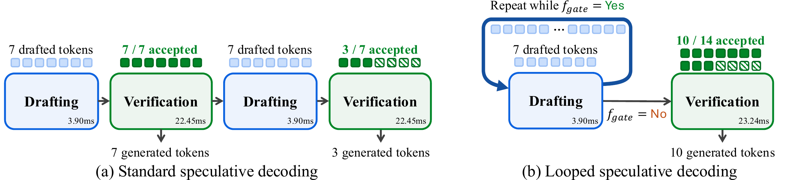

---
tags:
  - paper
  - collection/speculative-decoding
  - domain/model-systems
  - status/deep-review
  - topic/verification-frequency
  - method/looped-speculative-decoding
---

# DLoop: Looped Speculative Decoding 精读分析

> [!info] 文档关系
> - 文档类型：Paper
> - 领域入口：[README](../README.md)
> - 上位汇总：[投机推理方法演进](../surveys/evolution.md)
> - 证据资产：`../assets/papers/dloop/`

## 修订信息
- 当前文档版本：`1.0.0`
- 当前修订 ID：`rev-dloop-initial-20261008`
- 当前修订时间：`2026-10-08T21:00:00+08:00`
- 替代版本：无

## 0. 资料与配图索引
- 论文：[arXiv:2610.07659](https://arxiv.org/abs/2610.07659)，PDF/source 已核验，v1。
- 开源代码：论文称将发布 `naver-ai/DLoop`；本次未取得 commit，代码结论标为未验证。
- 配图：[方法流程图](../assets/papers/dloop/fig2-pipeline.png)。原始 source figure 转 PNG；单一 Figure 2，原分辨率 QA 已完成。

## 0.1 术语与符号解释
### 0.1.1 术语表
| 术语 | 本文含义 | 易混项 | 证据 |
|---|---|---|---|
| drafting stage | drafter 一次提出一段 token 的阶段 | target verification | §1–3 |
| confidence gate | 根据刚生成 token 的 log-probability 决定是否继续草稿 | 质量保证；它不改变 target 裁决 | §3.2 |
| loop-aware training | 训练 drafter 看到未验证 token 的自身 hidden state | 普通 teacher forcing | §3.3 |
| lossless | 最终仍使用 target 接受-拒绝规则，保持 target 分布 | draft token 全部正确 | §3.1 |

### 0.1.2 符号表
| 符号 | 含义 | 来源 |
|---|---|---|
| $k$ | 每个 drafting stage 的 token 数 | §3 |
| $S$ | 一次 verification 覆盖的 drafting stage 数 | §3.2 |
| $\tau$ | 每次验证平均提交 token 数（含 bonus token） | §4 |
| $T_d,T_v$ | drafting 与 target verification 时间 | Eq. (1) |

## 0.2 AI 生成算法分析示意图
本文使用原论文 Figure 2 作为读者可用的算法总览；未另生成 AI 图。

## 1. 论文基本信息
- 标题：DLoop: Looped Speculative Decoding
- 作者：Geonmo Gu, Byeongho Heo, HeeJae Jun, Yoohoon Kang, Sangmin Lee, Sangdoo Yun, Dongyoon Han。
- 第一作者：Geonmo Gu，NAVER AI Lab；通讯作者：论文标题页未标个人通讯 marker，记为 not-stated。其余机构：NAVER AI Search Platform、Korea University、NAVER AI Lab。
- 领域：lossless speculative decoding；核心问题是减少并行 drafter 场景中不必要的 target verification。

## 2. 研究动机与问题—方案闭环
### 2.1 出发点与背景痛点
一个并行 drafter 每轮一次生成 4 个 token；若 4 个都被 target 接受，现有流程仍立即启动下一次完整 target forward。对长回答而言，target 验证成为主要延迟，而轻量 drafter 其实可以继续工作。该场景按论文 Figure 1/§1 重述：旧流程的失败不是 token 错，而是“全接受后仍重复验证”。成功方案要保持 target 的最终裁决，同时减少验证次数。
### 2.2 现有方案为何不够
| 方案 | 可观察失败 | 根因 | 为什么简单修补不够 | 证据 |
|---|---|---|---|---|
| 固定每轮验证 | 全接受轮仍调用 target | 验证边界固定 | 只增大 $k$ 会降低接受率 | §1, Fig.1 |
| 自回归 adaptive length | 能按 token 停止，但并行 drafter 一次 forward 成本已付出 | 并行块不能中途截断 | 需要处理未验证 token 的 hidden state | §1–2 |

### 2.3 论文计划解决的问题与成功标准
问题：能否在不改 target 接受规则的前提下，把多个 drafting stage 合并到一次 verification？成功标准是平均接受长度、target forward 次数和 wall-clock speedup 同时改善；不解决的是非 lossless 语义接受。
### 2.4 核心方案如何解决并优化问题
先以 confidence gate 判断当前 stage 是否“值得继续”；继续时 drafter 使用自身未验证 token 的 hidden states，累积多段 token，最后一次性验证。训练阶段显式暴露这种状态分布，降低推理时分布偏移。
| 问题 | 设计 | 改变的变量 | 预期优化 | 证据 |
|---|---|---|---|---|
| 验证过频 | confidence-gated loop | 每次验证覆盖的 $S$ | 降低 $N_v$ | Table 1–4 |
| 未验证 hidden state 不可靠 | loop-aware training | drafter 输入分布 | 提高 $\tau$ | Table 2/A7 |
| 过度循环成本 | gate threshold | draft/verify 比例 | 保留净 speedup | Table 4/A5 |

### 2.5 完整因果链与证据闭环
全接受比例高 → 固定验证浪费 → loop 累积草稿 → target 一次验证 → target forward 次数下降 → Table 1 报告 speedup 提升 5%–41%。该链条有直接 wall-clock、接受长度和 ablation 支持；对所有负载都最优则未被证明，Alpaca 例外说明 gate 仍需校准。

## 3. 核心贡献与创新点
1. 把“验证边界”从固定每轮改为置信度门控的多轮循环。
2. 用 loop-aware training 适配未验证 token 的自身 hidden state。
3. 在 EAGLE-3、DFlash、Domino、DSpark、MTP 等 drafter 上保持 lossless 并提高 speedup。

## 4. 研究方法
### 4.1 方法总览

图注：原论文 Figure 2，展示普通 speculative decoding 与 DLoop 的 draft-loop/一次性 verification 对比。

### 4.2 组件级设计动机与具体问题映射
**循环门控**：它针对“全接受仍验证”的可见浪费；通过把多个 stage 合并，减少 target 调用，但 gate 误判会把额外 draft 成本白白花掉。论文用 threshold sweep 和 latency 表验证，属于直接受控证据。

**loop-aware training**：它针对训练时只见 target hidden state、推理时见自身 hidden state 的分布差异；收益机制是让后续 stage 的 logits 更可靠。Table 2/A7 支持其对部分 drafter 有效，但并非所有模型都净增速。

**原有 acceptance rule**：它保持 lossless 合同，避免把 speedup 与质量变化混在一起；代价是仍受连续前缀接受限制。

| 设计项 | 动机状态 | 证据 | 判断 |
|---|---|---|---|
| confidence gate | author-stated | §3.2, A5 | 直接支持 |
| loop-aware loss | author-stated | §3.3, Table 2/A7 | 部分支持 |
| unchanged verification | author-stated | §3.1 | 保持合同，但未做分布统计复核 |

### 4.3 模型/系统架构
输入上下文先经 drafter 产生 $k$ token；gate 允许追加 stage；累积序列交给 target 一次并行验证；接受最长连续前缀并生成 bonus token。训练与推理边界分别是 loop-aware 数据构造和 gate 执行。

### 4.4 关键公式
$$L=\frac{T_d+T_v}{\tau}$$
**这条公式在算什么？** 每轮平均每个输出 token 的时间。

**怎么读？** drafting 与 verification 的总时间要由一次提交的 token 数摊薄。

**输入与输出。** 输入是 $T_d,T_v,\tau$；输出是 seconds/token。

**变量在这里各做什么？** $T_d$ 随循环次数上升，$T_v$ 是一次 target forward，$\tau$ 是连续接受长度。

**直觉。** 只有 $\tau$ 增长超过额外 $T_d$ 的增长，speedup 才会提高。

**边界。** 这是平均成本模型，不包含并发调度尾延迟；要求 target verification 仍可批量处理累积 token。

**小例子。** 若 $T_d=2$ ms、$T_v=20$ ms、$\tau=5$，则约 4.4 ms/token；若循环使 $\tau=8$ 且 $T_d=3$ ms，则约 2.9 ms/token。

### 4.5 训练/实验/部署设计
目标模型为 Qwen3/Qwen3.5 系列，覆盖 GSM8K、MATH-500、AIME25、HumanEval、MBPP、LCB、MT-Bench、Alpaca 等；greedy 与 sampling 均有结果。论文报告 H800/同一 serving 协议，未提供可复现 commit。

## 5. 关键结论
### 5.1 主结果
论文报告平均接受长度增加 12%–102%，wall-clock speedup 增加 5%–41%；Qwen3-8B 上平均 speedup 为 greedy 5.02×、sampling 4.03×。这些数字来自 Table 1/Appendix A9。
### 5.2 消融和机制证据
| 技术点 | 对照 | 结果 | 证据强度 |
|---|---|---|---|
| loop gate | 无 loop | speedup/acceptance 下降 | 直接消融 |
| loop-aware training | 公共 drafter | 多数设置提升，部分抵消 | 直接消融、存在异质性 |
| stage 数 $S$ | $S=1,2,3,4$ | $S$ 增大后收益饱和 | sensitivity |
### 5.3 是否验证了假设
“减少 verification 能带来净加速”被 Table 4 支持；“固定 gate 对所有负载最优”未验证，论文明确指出 Alpaca 例外。
### 5.4 收益来源归因
主要来源是 target forward 次数下降；接受率提升是中介变量，不能把收益归因于 drafter kernel。额外 draft pass 的成本已在 latency 表中体现。

## 6. Related Work 对比
| 路线 | 机制 | 优点 | 局限 | 本文差异 |
|---|---|---|---|---|
| EAGLE/DSpark | 高接受率并行/半自回归草稿 | 单轮接受长 | 每轮都验证 | DLoop 改验证频率 |
| adaptive draft length | 自回归按 token 停止 | 灵活 | 不适用于一次性并行块 | DLoop 面向并行 drafter |
| tree verification | 扩大候选覆盖 | 减少单点错误 | tree metadata/verify 成本 | 可叠加，非替代 |

## 7. OpenReview 公开评审 × 论文内容交叉核验
未发现公开 OpenReview 评审；论文为 arXiv v1。

## 8. Infra 需求分析
### 8.1 算力
target forward 数减少，drafter forward 数增加；净收益取决于 $T_v/T_d$ 比例。
### 8.2 显存与存储
累积未验证 token 需要保存 drafter hidden states，KV cache 随 $Sk$ 增长；峰值显存高于固定单 stage。
### 8.3 Data Types / 数值格式
论文未给出量化收益；实验主要使用 GPU 浮点推理，具体 dtype 未充分披露。
### 8.4 带宽、互联与高效利用
单卡主要是 HBM 读写；分布式通信不是方法必要条件。有效带宽 = bytes moved / runtime，论文没有提供 bytes 统计。
### 8.5 CPU/GPU/NPU 异构执行
CPU 可负责 gate 与调度，target/drafter 在 GPU；跨设备部署会放大 hidden-state 传输成本，论文未测。
### 8.6 调度/Serving/自定义算子
需要 serving backend 支持可变验证长度和累积 KV；没有公开 kernel commit，runtime 复现仍不完整。

## 9. 开源代码对照
论文链接 `naver-ai/DLoop`，截至审阅日未取得 commit；算法描述可核验，工程实现与 CUDA 优化未验证。
### 9.1 开源权重/配置对照
未提供可下载 checkpoint 配置；参数量和层数沿用各 baseline，不能据此推断新容量。

## 10. 优点、局限与风险
### 优点
保留 lossless 合同；可叠加多种 drafter；把验证次数作为独立优化变量。
### 局限
固定循环深度在低接受率负载上可能亏损；gate 依赖 log-probability 校准；未验证多卡异构部署。
### 可改进之处
按预计 marginal gain 动态决定下一 stage；报告 target forward、draft forward、KV 峰值和尾延迟的统一账本。

## 11. 研究启发
验证频率与候选质量是两个正交旋钮；未来可把 DLoop 与 DRelay 的候选修复、D-Loop 的块内条件化组合。

## 12. 解读问题/待验证清单
1. gate 在不同温度、模型和并发下是否需要重新校准？
2. 累积 hidden state 的显存峰值是否成为长上下文瓶颈？
3. 代码发布后，lossless sampling 是否逐 token 可复核？
4. target forward 减少与 wall-clock 收益是否在同一 backend 上成立？

## 13. 一句话总结
DLoop 通过“多轮草稿、一次验证”减少并行投机解码中的重复 target forward；核心收益有直接实验支持，但 gate 和额外 hidden-state 成本决定其负载边界。

## 14. 冻结前发布审计
- Markdown 渲染器：`markdown-it`（本地可用性检查）；渲染结果：passed。
- Figure/Table 邻近性审计：Figure 2 紧邻方法总览；passed。
- 临时标记扫描：clean。
- 审计证据：过程侧 `review_checklist.md`、`deliverable_manifest.json`。
