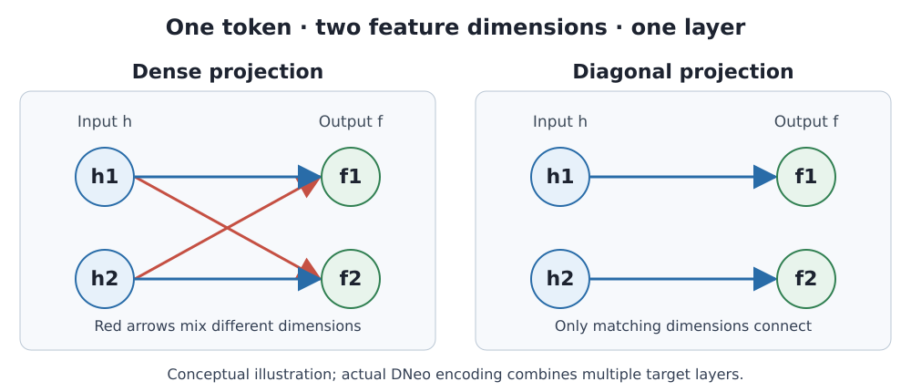

---
tags:
  - paper
  - collection/speculative-decoding
  - domain/model-systems
  - status/deep-review
  - topic/parallel-speculative-decoding
  - method/target-feature-encoding
document_type: paper
domain: speculative_decoding
collection: Speculative Decoding
review_status: deep-review
canonical: true
---

# DNeo：并行草稿器需要更好的目标特征编码

> [!info] 文档关系
> - 文档类型：Paper
> - 领域入口：[Speculative Decoding README](../README.md)
> - 上位汇总：[Speculative Decoding evolution](../surveys/evolution.md)
> - 证据资产：`../assets/papers/dneo/`
> - 相关文档：[DNeo figure inventory](../evidence/dneo-figure-inventory.md)

## 修订信息

- 当前版本：`1.0.4`
- 当前修订 ID：`rev-dneo-plain-layer-weighting-20261127`
- 当前修订时间：`2026-11-27T08:56:54Z`
- 修订类型：`clarification`
- 来源版本：arXiv:2611.21925v1（2026-11-16）
- 前一修订：`rev-dneo-explain-feature-dimensions-20261127`；其审阅 manifest SHA-256：`9298029bc7f9c98bb7b0ecf5f552d00a193e64a76c82f32a4f88cc76ecfc65cc`
- 本次改动：先用“各层向量乘固定可学习权重后相加”解释计算，再交代论文将其命名为 MoFA；注明权重按层而非按通道或当前 token 变化。不改变实验结论。
- 历史修订：
  - `1.0.3`／`rev-dneo-explain-feature-dimensions-20261127`：解释输入/输出坐标，增加逐维连接示意图。
  - `1.0.2`／`rev-dneo-expand-tpf-20261127`：展开 TPF 全称、说明每轮平均提交 token 数及其单位。
  - `1.0.1`／`rev-dneo-clarify-encoding-ablation-20261126`：重写稠密编码消融说明，区分普通投影、逐坐标对角限制及 TPF 数字对应的模型设置；指出原文 0.3% 与展示值约 0.36% 的差异。
  - `1.0.0`／`rev-dneo-initial-20261126`：首次精读；审阅 manifest SHA-256：`4e3184fcb05a7484685dadce95a1e7817d3ac4b34dafac15761e22a3ffebd415`。

## 先看问题：并行草稿怎样才能既快又少浪费

自回归模型每次只生成一个 token，长回答需要反复运行大模型。投机解码让小草稿器先提议一段 token，再让目标模型用一次并行前向验证整段；拒绝采样使最终输出仍服从目标模型分布，因此在理想实现下不牺牲生成分布。本文讨论的是一种特殊草稿器：它一次并行预测多个位置，延迟低，但各位置之间缺少逐 token 的因果依赖，草稿质量容易下降。

设想一个 Qwen3-4B 请求需要继续生成 16 个位置。并行草稿器一次给出 16 个提议，目标模型并行检查。若第 4 个位置首次被拒绝，第 5 到 16 个提议也必须丢弃，即使它们各自碰巧正确；本轮实际提交的 token 数因此很少，目标模型已经花费的验证算力也没有转化成输出。方法的目标不是改变这条无损验证规则，而是让小草稿器在低额外延迟下提出更合目标分布的 token，并在下一轮利用刚才验证时算出的信息。

这里的例子是依据论文第 2 节拒绝采样规则重构的说明场景，不是论文单独报告的实验案例。可观察的成本是每轮提交 token 数下降，同时每个输出 token 平摊到更多草稿与验证计算。

论文的出发点在于，现有并行草稿器已经读取目标模型隐藏状态，却可能在编码时破坏这些特征；它们通常还忽略上轮被拒绝位置的目标特征，并按固定间隔抽取目标层。DNeo 围绕这三处限制改造特征编码与草稿器结构。论文把 **tokens per forward（TPF）** 定义为一次投机解码轮次平均最终提交的 token 数，记作 $τ$；例如 TPF 为 2.5，表示许多轮次平均每轮提交 2.5 个 token，并非某一轮提交半个 token。这里的 *forward* 指这一轮的目标模型验证前向过程。TPF 衡量草稿接受效果；端到端速度还取决于每轮草稿和验证成本。只提高 TPF 并不自动保证系统变快。

## 总体流程

下图是论文 Figure 3 的 PDF 紧裁剪，原始完整 caption 保留。目标模型先计算干净前缀和已拒绝后缀的位置状态；DNeo 选择并混合目标层特征，再让并行草稿块通过跨注意力、两点因果卷积和融合因果头生成下一段提议。

![Figure 3: DNeo architecture. Target model (left) produces residual streams for the clean-prefix, and rejected positions. Streams are aggregated into prefix hidden states and rejection states (A). The most useful states are kept with the DNeo feature selector (B) (Section 4.5), then passed to the MoFA gate (C) (Section 4.1) to obtain the encoded prefix, and rejection memory (D) (Section 4.3). Parallel draft blocks perform cross-attention to the target features (E), utilize 2-tap convolutions (F), and finally apply the fused DNeo head (G) (Section 4.2) to produce the new draft.](../assets/papers/dneo/fig3-architecture-caption.png)

*原论文 Figure 3。图像来源：arXiv:2611.21925v1 PDF 第 6 页；裁剪与 QA 记录见 [Figure inventory](../evidence/dneo-figure-inventory.md)。*

一轮结束后，目标模型已经为整段草稿计算了隐藏状态。因此被拒绝位置虽然不能直接成为输出，却仍可作为下一轮草稿的上下文。DNeo 将通过位置的目标特征分成“已接受前缀”和“被拒绝后缀”，编码后分别供草稿器读取。该信息复用来自目标模型原本就要做的验证前向，但草稿器如何读取它会增加自身计算；论文报告总体延迟需结合具体服务结果判断。

## 核心机制：保留特征坐标含义

这里的“坐标”只是**同一个 token 的隐藏向量中的第几维特征**，不是句子中的第几个 token，也不是二维平面上的位置。例如某层给这个 token 的隐藏向量是 $[h_1,h_2]=[2,3]$，输入坐标就是第 1 维的数值 2 和第 2 维的数值 3。编码器把目标模型的向量变成供草稿器使用的另一个向量 $[f_1,f_2]$；$f_1$、$f_2$ 是**输出坐标**，也就是结果向量的第 1、2 维。

先只看一层，假设全连接线性投影计算 $f_1=2h_1+h_2$、$f_2=h_1+3h_2$。代入 $[2,3]$ 得到 $[7,11]$。注意 $f_1$ 同时用到输入第 1、2 维，$f_2$ 也同时用到这两维；“每个输出坐标可以读取所有输入坐标”说的就是**每个结果维度可以由所有输入特征维度加权求和**，不是模型真的在逐一读取 token。若把投影限制成对角矩阵，则只能写成 $f_1=a h_1$、$f_2=b h_2$：输出第 1 维不再使用输入第 2 维。这里的 2、3、$a$、$b$ 是帮助理解的示例值，不是论文实验参数。

论文实际把同一 token 在**多个目标层**的隐藏向量一起编码。普通全连接投影允许任意一层的第 $k$ 维影响输出第 $j$ 维（$j\ne k$）；作者称这种跨**特征维度**的混合为 residual mixing（残差维混合）。逐层使用对角矩阵仍能把不同层的“第 1 维”结合起来，但不会把“第 2 维”塞进输出“第 1 维”。作者认为禁止这种跨维度混合可能保留 Transformer 各层残差流的坐标对应关系；机制解释及对照见论文 Section 5.4.1、Table 5。

*整理示意图，依据论文 Section 5.4.1 的全连接与逐层对角投影定义绘制；只展示一个 token、一层、二维向量以解释连接关系，非原论文 Figure，也不代表实验测量。*

计算本身很简单：从目标模型选出若干层，为**每一层**学习一个标量权重；把每层的整个隐藏向量乘以对应权重，再相加。权重经 softmax 归一化，对所有 token 位置和特征维度共用；论文公式没有根据当前 token 动态生成一套新权重，也不是给每个特征维度单独生成一张掩码。作者把这种**沿模型层深度加权求和**的编码称为 MoFA（Mixture-of-Features Attention）。下文保留这个名称只为对应论文公式和消融表：

$$
\mathbf f_i = \sum_{k=1}^{c} u_k\,\mathbf h_i^{(l_k)},\qquad
\sum_{k=1}^{c}u_k=1,\quad u_k\ge 0.
$$

这个式子回答“位置 $i$ 的草稿器特征如何从 $c$ 个目标层状态得到”：输入是所选层的隐藏向量，输出仍是同宽向量；$l_k$ 是第 $k$ 个被选目标层，$u_k$ 是学得的层权重。关键不是“注意力”这个名字，而是**只沿层混合相同特征维度**：输出第 $j$ 维只从各层的第 $j$ 维取得数值。它假设目标与草稿隐藏维度相同；论文说可通过改变草稿器键值投影输入维度扩展到不同宽度。这个实验不能证明坐标语义在所有模型里都稳定，论文证据只覆盖其 Qwen3-4B 设定。

三种编码的差别可以这样看：

| 编码方式 | 输出向量第 $j$ 维可以读取什么 | 直观理解 |
| --- | --- | --- |
| 普通全连接投影 $F_c$ | 所选各层的所有坐标 | 第 7 维可能混入第 2、7 等维度的信息 |
| 受限投影 $F_c^{restricted}$ | 所选各层的第 $j$ 维 | 不同坐标不再互相混合；每层仍可学习各自的坐标权重 |
| 按层加权求和（论文称 MoFA） | 所选各层的第 $j$ 维 | 每层一个标量权重，对所有 token 和坐标共用；不是按 token 或通道动态生成的掩码 |

Table 5（论文 Section 4.1、Section 5.4.1）比较的是训练提示上测得的 TPF：每轮草稿交给目标模型验证后，平均能提交多少 token。这里的 1.938、2.361 等数字不是“编码矩阵的大小”，而是对应草稿器设置的 TPF。

先看 DFlash-2 这一组。默认全连接投影的训练 TPF 是 1.938。作者再做一个控制版本：保留相同的多层编码框架，但把每层的投影矩阵改成对角矩阵。对角矩阵只让输入第 $j$ 维影响输出第 $j$ 维；例如第 7 维不再混入第 2 维，不过不同目标层的第 7 维仍可加权组合。这个限制版的 TPF 是 2.361，比默认版高 0.423。也就是说，在 DFlash-2 这个设置里，禁止跨坐标混合后，草稿接受效果更好。

再看 DNeo 这一组：MoFA 的训练 TPF 是 2.526；把 MoFA 换成上述“每层只做逐坐标缩放”的受限投影后是 2.517。两者很接近，差值为 0.009，约为 0.36%（按 2.517 计算）。论文文字称差距在 0.3% 以内，但表中保留三位小数后算出的差值约为 0.36%，因此不宜说两者严格符合 0.3%；更稳妥的结论是它们在该实验中接近。普通全连接投影、受限投影和 MoFA 的区别至此也就清楚了：前者允许不同坐标互相混合；受限投影仍逐层学习坐标权重，但禁止跨坐标；MoFA 则直接学习跨目标层的权重，对每个坐标沿层深度加权。

两组比较共同支持作者的解释：跨坐标混合可能是普通全连接编码在这些实验里表现较差的原因之一；而结构受限后，TPF 可以接近 MoFA。它们测量的是训练 TPF，不能单独说明端到端推理一定更快，也不能证明所有模型的隐藏坐标都具有相同性质。

## 另外三项设计怎样补足草稿器

### 融合因果头：同时看上下文并修正全词表

并行草稿器的各位置容易给出彼此不一致的预测。DFlash-2 的因果头结合前一 token 和当前位置目标特征，但只重排草稿分布的 top-16 候选；DSpark 头可通过低秩映射影响整个词表，却缺少同样的目标上下文。DNeo 将两种头在低秩空间融合，再映射回全词表，并用按草稿位置学习的系数调整两路贡献。简化写为：

$$
\mathbf z'_j=\mathbf z_j + \operatorname{Head}_{DNeo}(\hat x_{j-1},\mathbf h_j),\qquad
q_j=\operatorname{softmax}(\mathbf z'_j).
$$

其中 $\mathbf z_j$ 是并行骨干对位置 $j$ 的原始词表分数，$\hat x_{j-1}$ 是左侧已确定的草稿 token，$\mathbf h_j$ 是该位置的上下文隐藏状态；输出 $q_j$ 是修正后的下一 token 分布。公式概括其作用，完整低秩融合见论文式 (8)。在 100K prompts 的头部对照中，DNeo 融合头 TPF 为 2.361，单独 DFlash-2 头为 2.217，单独 DSpark 头为 2.273。该对照支持融合的互补性，尚不能单独证明不同模型或更大词表下都同样有效。

### 拒绝记忆：不再丢掉已经算出的后缀特征

若某轮在位置 $j$ 首次拒绝，下一轮要重新草拟的位置与上轮被拒绝后缀相重叠。目标模型已计算这些位置的隐藏状态。DNeo 用与前缀相同的 MoFA 编码后缀，把结果作为键值特征追加到下一轮上下文；被遮蔽的草稿位置通过跨注意力按需读取它们，而不是把这些信息直接融合进所有遮蔽 token embedding。这样每个预测位置可选择相关的拒绝特征，且两种表示保持分离。

论文将“拒绝记忆”与把拒绝信息塞入固定输入表示的 DFlow 式融合进行比较。100K prompts 的消融中，DNeo 拒绝记忆 TPF 为 3.112；移除记忆为 2.923（增量表报告 +0.189，正文另一处写 +0.182，存在数值口径不一致）；DFlow 式融合无 MLP 为 2.932（+0.009），加 MLP 为 2.953（+0.030），融合再加记忆为 3.078（低于单独记忆 0.034）。这组消融支持“按需跨注意力优于固定融合”的解释，但应注意表 4 的独立移除值 2.930 对应差值 0.182，和表 7 的差值 0.189 不完全相同。本文保留两种报告口径，不把差值合并成一个精确数字。

### 前缀专注注意力与两点因果卷积

以往并行草稿器允许遮蔽位置彼此做双向自注意力。DNeo 移除这部分连接，仅让草稿位置读取前缀和拒绝特征；局部相邻位置依赖交给 DFlash-2 的两点因果卷积和因果头。论文的组合消融显示，加入卷积后再移除遮蔽块自注意力，训练 TPF 变化仅 +0.004（无卷积时 +0.027）。收益主要是减少注意力计算，而不是提升草稿质量。论文附录称延迟降低，但没有在正文给出足够完整的逐项硬件延迟数字来单独归因这一节省。

Figure 4 展示这个连接限制：遮蔽草稿位置不再互相做双向注意力，但仍可跨注意力读取先前被拒绝位置的目标特征。图中以块长 $b=3$ 的三个草拟轮次说明；实际每轮可读取的拒绝特征数随上一轮接受长度变化。它把“减少草稿块内部注意力”与“保留拒绝记忆读取”区分开来。

*原论文 Figure 4。图像来源：arXiv:2611.21925v1 PDF 第 9 页；裁剪与 QA 记录见 [Figure inventory](../evidence/dneo-figure-inventory.md)。*

### 目标层选择：把采样预算放到后半层

常见协议从目标模型各深度均匀选层。DNeo 的 MoFA 门权重观察显示，后半层权重通常较大；作者据此保留第一层，再从后半层抽取其余特征。第一层保留 token 身份信息，较深层通常更接近目标模型的下一 token 判断。附录 Figure 6 与固定骨干的选择协议对照支持这一动机，但“后层普遍最有用”仍是基于本论文模型、训练和目标任务的经验结果，不是跨模型定律。

## 公式：接受数与速度的关系

令 $\tau$ 表示一个投机轮次最终提交的 token 数期望，$t_{draft}$ 与 $t_{verify}$ 分别表示草稿生成和目标验证耗时。平均每个已提交 token 的时间可写为：

$$
t_{token}=\frac{t_{draft}+t_{verify}}{\tau}.
$$

分子是每轮成本，分母是每轮有效输出量；提高 $\tau$ 会降低单位 token 成本，但如果复杂草稿器让 $t_{draft}$ 增长过多，净收益会被抵消。该关系忽略调度、请求并发、预填充和服务实现的具体影响，因此应将论文离线 TPF 消融与端到端服务结果分开阅读。

另一个关键机制是拒绝采样（论文 §2）：草稿 token $\hat x_i$ 被接受的概率为 $\min(1,p(\hat x_i)/q(\hat x_i))$。第一次拒绝后丢弃其后提议，并从校正分布抽取替代 token。这个校正保留目标分布，是论文所说“无损”的含义；无损不等于每项任务质量指标不变的经验结论，而是解码分布层面的性质，前提是实现严格遵循采样规则。

## 实验结果：质量优势如何变成速度

论文训练目标为 Qwen3-4B，训练提示来自 Llama-Nemotron 后训练数据，使用思考模式与 on-policy distillation。主要比较训练 1.6M rollouts，结构消融训练 100K rollouts；解码测试在单张 H100、草稿块长 $b=16$，六类基准（GSM8K、MATH-500、HumanEval、MBPP、GPQA、MT-Bench）按 prompt 和 token 匹配。除 EAGLE-3 使用官方权重外，多个并行草稿器在相同目标模型、数据、损失和训练预算下训练。主表中的 speedup 相对只解码目标模型的自回归基线。

温度 1、batch 1 的六个测试集结果如下。$\tau$ 是每轮提交数，括号表示该列最高 TPF；加速比是相对自回归基线：

| 方法 | GSM8K | MATH-500 | HumanEval | MBPP | GPQA | MT-Bench |
| --- | ---: | ---: | ---: | ---: | ---: | ---: |
| DFlash-2：加速比 / $\tau$ | 2.65× / 3.66 | 2.93× / 4.05 | 2.56× / 3.53 | 2.60× / 3.60 | 2.06× / 2.85 | 1.93× / 2.68 |
| DSpark：加速比 / $\tau$ | 2.59× / 3.87 | 2.92× / 4.36 | 2.58× / 3.85 | 2.65× / 3.96 | 2.01× / 3.00 | 1.87× / 2.80 |
| DNeo：加速比 / $\tau$ | **3.20× / 4.84** | **3.55× / 5.37** | **3.09× / 4.67** | **3.08× / 4.66** | **2.43× / 3.67** | **2.25× / 3.41** |

来源：论文 Section 5.1、Table 2，温度 1。DNeo 相对 DFlash-2 的加速比提升范围约 16.6%（MATH-500）到 20.7%（GSM8K）；相对 DSpark 也在六项上均更快。作者摘要提及“1.3×”，这是特定设置下最高端到端生成速度的比值，不应误读为上述所有场景平均提升 30%。温度 0 时 DNeo 在 GPQA 与 MT-Bench 不再是最快方法，说明因果头成本与接受数优势之间存在任务及解码条件依赖。

并发吞吐的结果显示另一种边界：在 SGLang、H100、温度 1、$b=16$ 下，batch 64 的 DNeo 为 10,324 tokens/s，AR 为 10,335，几乎持平；DFlash-2 为 9,318。Transformers 后端 batch 32 下，DNeo 为 2,201，DFlash-2 为 1,475，约高 49%，而论文文字称最多 +58%（另一并发点/统计口径）。这些数字来自论文 Table 3；同样的算法在不同服务后端的吞吐差异很大，不能脱离软件栈引用单一倍率。

## 主张与证据对照

| 论文主张 | 证据 | 证据强度与边界 |
| --- | --- | --- |
| 避免不同坐标互相混合可提高草稿接受效果 | DFlash-2 全连接投影与逐坐标受限投影比较；DNeo MoFA 与受限投影比较 | 两组训练 TPF 对照支持该解释；不是端到端时延归因，也不证明跨模型普遍成立 |
| 拒绝位置特征有用 | 记忆移除及 DFlow 式融合对照 | 直接消融；不同表格基线有 0.007 TPF 不一致 |
| 融合头比两种单头更好 | 固定 DSpark 主干、同 rank 头部对照 | 较直接，但仅报告训练 TPF |
| 前缀专注注意力不损失质量并降低成本 | 有/无遮蔽块自注意力的组合对照；延迟分解图 | TPF 近似持平；延迟收益的单项归因较弱 |
| DNeo 比既有并行草稿器更快 | 六项任务主表与多个并发点吞吐表 | 有端到端系统结果；仅覆盖 Qwen3-4B、H100 与报告中的后端/基准 |
| 收敛可快 10 倍 | 附录训练曲线 Figure 5 | 论文曲线报告；尚未作为单独控制实验给出资源/重复试验区间 |

这些证据形成一条合理但非处处完整的因果链：结构更合适的目标特征和拒绝记忆提升训练期接受数；接受数优势在实际 H100 服务中对应更高速度；但不同组件的联合效果有交互，不能把所有端到端增益按单项消融简单相加。作者的附录加法消融也明确指出顺序可能影响增量。

## 解读结论、适用边界与待核查点

DNeo 的核心不是更大的草稿器，而是让已有目标隐藏状态更有效地流入并行草稿器：沿目标深度做逐坐标加权而不是允许不同坐标彼此混合；把已拒绝后缀作为可检索记忆；再用轻量因果机制补齐草稿位置之间的依赖。论文在 Qwen3-4B、H100 和 SGLang/Transformers 设置下给出较完整的 TPF、速度、吞吐和组件消融，支持其在报告条件下成为强并行草稿器。

复现或迁移时需重点验证：目标/草稿维度是否兼容 MoFA；训练是否包含真实投机轮次以匹配拒绝记忆的推理状态；目标层选择在新模型上是否仍偏向后层；因果头和草稿器额外算力是否被服务后端抵消；并发上升时验证成本是否仍合算。当前材料没有论文对应的可核验代码仓库 commit、跨目标模型外推实验或统计置信区间，因此不把架构效果外推到其他模型、硬件或服务系统。

还有一项文稿口径需谨慎：拒绝记忆在不同表格/段落中报告的增益为 +0.182 或 +0.189 TPF；主表、摘要与附录的训练阶段和口径也不同。应引用具体表格及其基线，而不是把这些数字当成同一实验结果。

## 术语与符号

| 名称 | 本文含义 |
| --- | --- |
| 投机解码 | 小模型提议 token，大模型并行验证并校正，保持目标模型输出分布 |
| 并行草稿器 | 一次前向并行预测多个草稿位置的模型 |
| TPF（tokens per forward）/ $\tau$ | 每轮目标模型验证前向后，最终提交的 token 数的期望；单位为 token/轮，不是每秒 token 数 |
| MoFA | 论文对“所选目标层的整个向量各乘一个学得的固定标量，再逐坐标相加”的命名；权重沿层深度分配，不按当前 token 或特征维度动态生成 |
| residual mixing | 稠密编码将隐藏向量不同坐标相互混合的现象 |
| 拒绝记忆 | 将本轮被拒绝后缀的目标特征存为下一轮可跨注意力读取的上下文 |
| prefix-only attention | 遮蔽草稿位置只读取前缀/拒绝特征，不彼此做双向自注意力 |
| on-policy distillation | 用模型实际投机轨迹产生训练样本，以匹配推理时状态 |

| 符号 | 含义 |
| --- | --- |
| $p,q$ | 目标模型与草稿器 token 分布 |
| $\hat x_i$ | 草稿器在位置 $i$ 的提议 token |
| $\tau$ | 一轮提交 token 数的期望 |
| $t_{draft},t_{verify}$ | 每轮草稿与目标验证时间 |
| $\mathbf h_i^{(l_k)}$ | 位置 $i$ 在目标模型层 $l_k$ 的隐藏向量 |
| $u_k,c$ | MoFA 的第 $k$ 层权重与所选目标层数 |
| $\mathbf f_i$ | 编码后供草稿器使用的目标特征 |
| $\mathbf z_j,q_j$ | 位置 $j$ 的修正前分数向量与修正后分布 |

## 作者、来源与版本

- 标题：*DNeo: Your Parallel Draft Model Needs Better Target Feature Encoding*。
- 作者顺序：Jameson Sandler、Shane Bergsma、Mostafa Elhoushi、Bin Claire Zhang、Gavia Gray、Joel Hestness、Nolan Dey、Ferdinando Fioretto。
- 首页标记：Jameson Sandler 带 `*`，脚注标为通讯作者；其机构编号为 1（University of Virginia）。Nolan Dey 与 Ferdinando Fioretto 带 `†`，源码作者说明为 project supervisors，不等于通讯作者标记。其余作者机构映射未在本文逐人展开；标题栏只列机构编号 1 与 2，去重机构为 University of Virginia、Cerebras Systems。
- 来源： [arXiv:2611.21925v1](https://arxiv.org/abs/2611.21925v1)，PDF 版本日期 2026-11-16；精读核对 PDF 与 arXiv 源码档案。
- 公开评审：该版本标为 ICLR 2027 投稿格式；本次未取得可核验公开评审记录，不据此声称已接收或已完成公开评审核对。
- 代码：源码首页链接标记为 coming soon；未发现可核验官方代码仓库或 commit。
- 图表证据：[DNeo figure inventory](../evidence/dneo-figure-inventory.md)。Figure 3、4 为原论文 PDF 裁剪并保留全文 caption；关键数据表在本文重建为 Markdown 表格。
