---
tags:
  - paper
  - collection/speculative-decoding
  - domain/model-systems
  - status/deep-review
  - topic/parallel-speculative-decoding
  - method/outcome-independent-overlap
document_type: paper
domain: speculative_decoding
collection: Speculative Decoding
review_status: deep-review
canonical: true
---

# DPara：并行草稿器与并行投机解码的结合

> [!info] 文档关系
> - 文档类型：Paper
> - 领域入口：canonical `02_model_systems/speculative_decoding/README.md`
> - 上位汇总：canonical `02_model_systems/speculative_decoding/surveys/evolution.md`
> - 证据资产：canonical `02_model_systems/speculative_decoding/assets/papers/dpara/`
> - 相关文档：[DPara Figure inventory](../evidence/dpara-figure-inventory.md)

## 修订信息

- 当前版本：`1.1.0`
- 当前修订 ID：`rev-dpara-ssd-background-20261008`
- 当前修订时间：`2026-10-08T12:00:00+08:00`
- 前序：`rev-dpara-initial-20260929` / `1.0.0` / manifest SHA-256 `9e7d04f70e969cae4c15f75a3306a0bfe93a4ba26426ca5db848ef62d2e6eec6`

| 修订 ID | 文档版本 | 时间 | 修订者 | 类型 | 替代修订 | 变更摘要 | 依据 | 对结论影响 |
|---|---|---|---|---|---|---|---|---|
| `rev-dpara-initial-20260929` | `1.0.0` | `2026-09-29T18:00:00+08:00` | `/root` | `initial` | 无 | 建立 DPara 单篇深度解读 | arXiv:2609.27396v1 PDF、图表与实验 | material |
| `rev-dpara-ssd-background-20261008` | `1.1.0` | `2026-10-08T12:00:00+08:00` | `/root` | `content-update` | `rev-dpara-initial-20260929` / `1.0.0` / `9e7d04f70e969cae4c15f75a3306a0bfe93a4ba26426ca5db848ef62d2e6eec6` | 补充普通投机解码、SSD 跨轮并行、预测 bonus 失配和批回退背景 | 用户阅读反馈；论文 §2.1–2.3、Figures 2–3、Appendix B | minor：不改变论文结论，补足理解 DPara 所需的前置机制 |

## 0. 资料与配图索引

- 论文：arXiv:2609.27396v1，2026-09-23；本地 PDF 15 页，SHA-256 记录于过程 manifest。
- 作者：Fuliang Liu、Xue Li、Kun Qian、Zhibin Wang、Wanchun Dou、Wenyuan Yu、Chen Tian。
- 机构：南京大学 State Key Laboratory of Novel Software Technology；Alibaba Group。首位作者 Fuliang Liu 标注机构 1、2；通讯作者 Zhibin Wang 标注机构 1，论文明确给出邮箱；其余作者机构按标题页编号归并为上述两家。未标注共同第一作者。
- 公开评审：未找到 OpenReview 页面、评审、rebuttal 或 decision；结论只基于论文 PDF。
- 代码/source：未能在受限网络环境取得官方代码或 LaTeX 源码；实现细节以论文正文和附录为准。
- 论文图表裁剪与 QA：[DPara figure inventory](../evidence/dpara-figure-inventory.md)；共 11 个正式对象，均包含完整 caption，contact sheet 与逐图原分辨率检查在过程目录完成。

## 0.1 术语与符号解释

### 0.1.1 术语表

| 术语 | 本文含义 | 来源/边界 |
|---|---|---|
| 投机解码 | 小草稿器先提出候选，大模型一次验证并保留可接受前缀 | 论文 §2.1；不等同于无验证的小模型生成 |
| 并行草稿器 | 一次前向同时产生多个未来位置的 logits | 论文 §2.2；位置间仍需轻量头恢复局部因果性 |
| 并行投机解码（PSD） | 草稿下一轮与当前目标验证重叠执行 | 论文 §2.3 |
| SSD | *Speculative Speculative Decoding*：在当前轮验证期间，预测接受边界和 bonus，并据此提前生成下一轮草稿 | 论文 §2.3 对前置工作的概括；不要与 Mamba-2 的 Structured State Space Duality 混淆 |
| 骨干网络 | M-DFlash 的高成本扩散式主干 | 论文 §3；负责多接受边界的基础 logits |
| 自回归头（AR head） | 逐位置读取前一已采样 token 的低成本修正头 | 论文 §3.2–3.3；只留下少量串行开销 |
| 特征无目标锚点 | 尚未经过目标模型、因此没有目标隐藏特征的 carried-over token | 论文 §3.1；不是“无 embedding” |
| 接受边界 | 当前验证结果接受了多少 draft token 的位置 $r$ | 论文算法 1；共有 $d+1$ 个候选边界 |
| 真实 bonus token | 当前轮验证后由目标模型产生的修正 token；若全部接受，则是目标模型额外产生的下一 token | 论文 §2.1；本文记为 $b$，它本身不是“猜错”的对象 |
| SSD 预测 bonus | SSD 为了在验证结束前提前草拟，对未来真实 bonus 所作的预测 | 论文 §2.3、Figure 2；本文记为 $\hat b$，所谓“bonus 猜错”是 $\hat b\ne b$ |
| 临界路径 | 决定下一轮何时能开始的串行时间 | 论文 §1、§3.3 |

### 0.1.2 符号表

| 符号 | 含义 | 来源 |
|---|---|---|
| $M_t,M_d$ | 目标模型、草稿模型 | 论文 §2.1 |
| $d$ | 每轮 draft 长度；主实验为 7 | 论文 Table 1、算法 1 |
| $t_{0:d}$ | carried-over 的 bonus 加本轮待验证 draft block | 论文算法 1 |
| $r$ | 接受 draft 数，$r\in\{0,\ldots,d\}$ | 论文 §3.1 |
| $b$ | 本轮由目标模型返回的 bonus token | 论文算法 1 |
| $\hat r,\hat b$ | 本文为解释 SSD 引入的预测接受边界与预测 bonus | 分析符号；论文 §2.3、Figure 2 |
| $p,B$ | 单请求 bonus 预测失配概率、同步 batch 的请求数 | 本文分析公式；$p\in[0,1]$，$B$ 为正整数 |
| $C$ | 已接受历史的目标特征缓存 | 论文 §3.3 |
| $\ell_i^{(r)}$ | 边界 $r$ 对应的第 $i$ 个基础 logits | 论文算法 1 |
| $E,W$ | AR 头的低秩 token embedding 与词表投影 | 论文 §3.2 |
| $q_i,p_i$ | 草稿分布、目标分布 | 论文 §3.2 |
| $\tau$ | 平均接受长度（含 bonus 的口径需按论文表格理解） | 论文 Table 1 |

## 0.2 AI 生成算法分析示意图

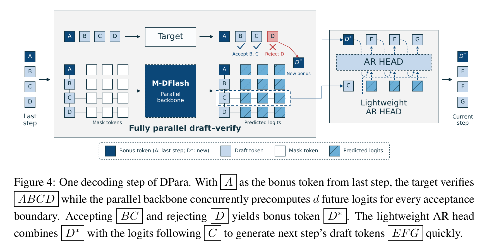

图 4 原 caption：With A as the bonus token from last step, the target verifies ABCD while the parallel backbone concurrently precomputes d future logits for every acceptance boundary. Accepting BC and rejecting D yields bonus token D*. The lightweight AR head combines D* with the logits following C to generate next step’s draft tokens EFG quickly. 这是论文原图，不是生成图；它展示输入、并行主干、验证边界选择和输出的完整顺序。

## 1. 论文基本信息

论文题目为 *When Parallel Drafter Meets Parallel Speculative Decoding*。DPara 的目标不是提高模型回答质量，而是在保持投机验证合同的前提下，减少草稿器对下一轮的等待。作者报告 Qwen3-8B/14B、七个数学/代码/聊天基准上的端到端速度提升。

## 2. 研究动机与问题—方案闭环

### 2.1 出发点与背景痛点

要理解 DPara，必须先区分两种“并行”。DSpark/DFlash 解决的是**一轮内部**的并行：一次生成多个 draft token；SSD 解决的是**相邻两轮之间**的并行：让第 $t+1$ 轮草拟与第 $t$ 轮目标验证重叠。DPara 的直接问题背景正是 SSD，而不是只有普通投机解码。

#### 2.1.1 从普通投机解码到 SSD

下面的时间线是本文依据论文 §2.1–2.3 和 Figure 3 所做的解释性重构，不是 SSD 原论文的独立精读。设已提交上下文为 $H$，草稿器在第 $t$ 轮提出 `B C D`：

```text
普通投机解码 / DSpark：

H -> 草拟 B C D -> target 验证 B C D
                         -> 接受 B、C，拒绝 D
                         -> target 返回真实 bonus D*
                         -> 新上下文 H B C D*
                         -> 下一轮才草拟 E F G

时间：Draft_t -> Verify_t -> Draft_{t+1} -> Verify_{t+1}
```

真实 bonus $b=D^*$ 是 target 在验证后给出的结果，本身没有“猜错”这一说法。串行瓶颈来自：第 $t+1$ 轮必须等真实接受边界 $r$ 和真实 bonus $b$ 都揭晓后，才知道应该基于哪个上下文生成 `E F G`。DSpark 即使把 `B C D` 一次并行产生，也没有消除 `Verify_t` 与 `Draft_{t+1}` 之间的等待。

SSD（*Speculative Speculative Decoding*）再向前投机一步：在 target 验证 `B C D` 的同时，先预测验证将返回的接受边界和 bonus，记为 $(\hat r,\hat b)$，并根据这个预测上下文提前生成下一轮 `E F G`：

```text
SSD：

                    +-> target 正在验证 B C D -> 返回真实 (r, b)
H B C D ------------+
                    +-> SSD 预测 (r_hat, b_hat) -> 提前草拟 E F G
```

如果 $(\hat r,\hat b)=(r,b)$，预计算的 `E F G` 已经建立在真实上下文上，下一轮可以立即验证，原来的 `Draft_{t+1}` 延迟就被隐藏。这里 SSD 投机的不只是 token，而是“本轮投机验证会产生什么结果”，这也是其名称中第二个 *speculative* 的含义。

#### 2.1.2 “bonus 猜错”究竟是什么

所谓“bonus 猜错”，准确含义是 SSD 的预测 $\hat b$ 与 target 随后揭示的真实 $b$ 不同，而不是 target 自己给出了错误答案。例如：

```text
SSD 预计算所用上下文：H B C )
target 返回真实上下文：H B C ;
```

即使只有 `)` 与 `;` 一个 token 不同，后续分布也是不同的：预先算出的 `E F G` 条件于错误前缀 `H B C )`，不能直接当作真实前缀 `H B C ;` 下的草稿。接受边界猜错也同理：SSD 若按“接受 B、C”预计算，而 target 实际只接受 B，那么上下文的长度和内容都变了，预计算 continuation 失效。

#### 2.1.3 为什么一个请求失配会触发整批回退

论文 Figure 2 和 Appendix B 评测的 SSD 把一批请求作为同步的 GPU 草拟/验证单元，并维护批量 speculation cache。只要某个请求揭示出的真实 bonus 没有命中其预计算 cache，该实现就丢弃整批预计算 continuation，并为整批串行重新草拟。因此，若单请求失配概率为 $p$，batch 中至少一次失配的概率为：

$$
P(\text{整批回退})=1-(1-p)^B.
$$

**这条公式在算什么？** 它计算一个同步 batch 中至少有一个请求发生 bonus 预测失配的概率。

**怎么读？** 单请求不失配的概率是 $1-p$；$B$ 个请求都不失配的概率是 $(1-p)^B$；用 1 减去它，就是至少一次失配的概率。

**输入与输出。** 输入是单请求失配概率 $p$ 和 batch 大小 $B$；输出是该步触发至少一次失配、进而在论文 SSD 实现中触发整批回退的概率。

**变量在这里各做什么？** $p$ 描述单个请求的预测风险，$B$ 描述同步耦合的请求数；二者增大都会提高整批回退概率。

**直觉。** 即使每个请求单独看都很可靠，请求越多，“至少一个出错”也越容易发生。

**边界。** 该式使用请求失配相互独立的近似，并把“至少一个失配”映射为论文所测 SSD 的整批回退事件；若运行时允许请求级拆批或失配相关，实际概率与代价会不同。

**小例子。** 本文构造的说明例，不是论文实验：$p=0.1$、$B=16$ 时，$1-0.9^{16}\approx81.5\%$。

例如 $p=10\%$、$B=16$ 时，该概率约为 $81.5\%$。论文实测 batch 16 的 SSD 回退率为 57%–96%。需要强调：**整批回退不是投机解码正确性在数学上的必然要求，而是论文所评测 SSD 的批处理与 cache 调度行为。** 理论上可以拆出失配请求单独重算，但会引入动态拆批、重组、不同步执行和 CUDA Graph 形状管理成本；DPara 论文没有评测这种替代实现。

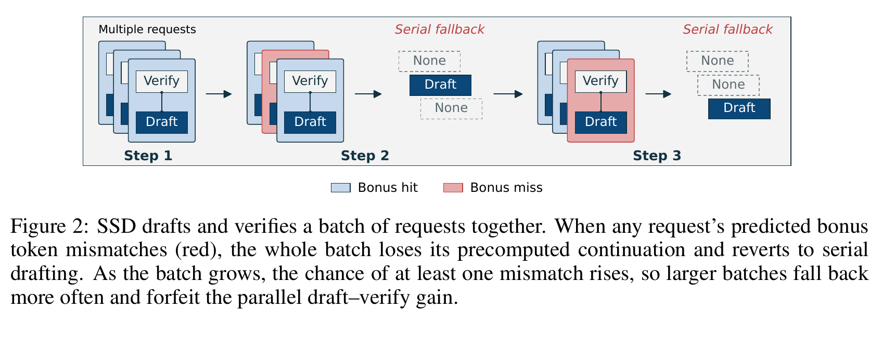

Figure 2 中红色请求表示预测 bonus 未命中真实结果；它使该步的整批预计算 continuation 失效。DPara 要改变的决策点是：不预测单一 $(\hat r,\hat b)$，而是在昂贵骨干中覆盖所有可能的 $r$，等真实 $b$ 返回后才用轻量头完成条件化。

### 2.2 现有方案为何不够

串行 DSpark/DFlash 的问题是骨干前向位于临界路径；论文附录 A 报告该草拟阶段占 24%–32% 的单轮时间。SSD/PEARL 将草拟与验证重叠，却依赖预测结果命中。简单提高 $\hat b$ 的准确率只能降低回退概率，不能从结构上消除同步批处理中“一个请求失配拖累整批”的放大效应。Figure 10 直接显示 SSD 回退率随 batch 增长，而 DPara 的“预测诱发回退”为 0；这不等于 DPara 永远不会因显存、运行时或其他异常回退。

| 现有方案/做法 | 可观察的失败 | 具体场景或例子 | 例子来源 | 根因/被忽略变量 | 为什么简单修补仍不够 | 证据 |
|---|---|---|---|---|---|---|
| 串行 DSpark/DFlash | 下一轮草拟等待本轮验证 | `Verify_t` 结束后才能开始 `Draft_{t+1}` | 本文依据论文 §2.2 重构 | 下一轮上下文依赖真实 $(r,b)$ | 只并行一轮内部 token，不能跨轮隐藏骨干 | §2.2、Figure 3 |
| SSD | 预测失配时预计算 continuation 作废 | 预测 `H B C )`，真实结果为 `H B C ;` | 本文依据 Figure 2 重构 | 提前草拟绑定了单一预测 $(\hat r,\hat b)$ | 提高预测率不能消除剩余失配，也不能消除 batch 放大 | §2.3、Figure 2、Appendix B |
| 同步批 SSD | 任一请求失配可触发整批重新草拟 | 单请求 $p=10\%$、batch 16 时至少一次失配约 81.5% | 本文公式例；不是论文实验数字 | 批量 cache 与固定执行形状耦合请求 | 按请求拆批可避免整批重算，但引入动态调度成本且论文未评测 | Appendix B、Figure 10 |

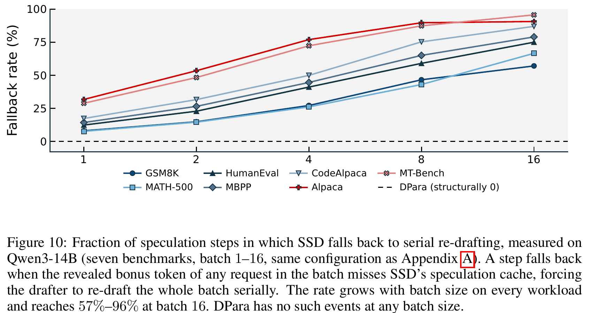

### 2.3 论文计划解决的问题与成功标准

目标是让每轮骨干—目标验证必然重叠，同时仍保留较高接受长度。成功标准是：单轮时间近似由验证时间与预计算时间的最大值加轻量头时间决定；batch 1–16 均不因预测失误回退；端到端速度超过串行和已有 PSD 基线。

### 2.4 核心方案如何解决并优化问题

1. M-DFlash 在共享、特征无目标的 token spine 上，用树状 mask 一次计算 $r=0\ldots d$ 的所有分支 logits。
2. 目标模型同时验证当前 block，返回真实 $r,b$；DPara 直接选择已完成的分支，不需 rollback。
3. 冻结的 AR 头把真实 bonus $b$ 加入选中分支，只生成下一轮 draft token；被拒后缀丢弃，接受前缀特征写回 $C$。
4. 因而高成本骨干从临界路径移出，变量从“猜中某个结果”变成“枚举全部结果”；预期优化是降低 $T_{step}$，代价是特征缺失导致 $\tau$ 低于串行 DSpark。

| 闭环环节 | 证据 | 结论 |
|---|---|---|
| 痛点 | Figure 2、Appendix B | SSD 回退随 batch 放大 |
| 机制 | Figures 4–6、算法 1 | 所有边界预计算，验证后只选分支 |
| 时间模型 | §3.3 | $T_{step}\approx\max(T_{verify},T_{precompute})+T_{Head}$ |
| 测量 | Tables 1–3、Figures 7–10 | 速度和回退率改善，但硬件/模型覆盖有限 |

### 2.5 完整因果链与证据闭环

背景痛点（草稿在临界路径）→约束（验证结果尚未返回）→方案（枚举 $d+1$ 边界）→改变的行为（从猜测转为选择）→预期优化（隐藏骨干）→测量（13.8 ms 单轮、batch 1–16 领先）→边界（仅两种模型和有限硬件）。

## 3. 核心贡献与创新点

- 将 DSpark 风格并行草稿器改造成可在验证尚未返回时工作的多锚点 M-DFlash。
- 用“结果无关的预计算”替代 SSD 的 bonus 预测，结构性消除串行骨干回退。
- 在双 GPU、异构 A10+H800 和单 GPU CUDA stream 三种部署下测量成本边界。

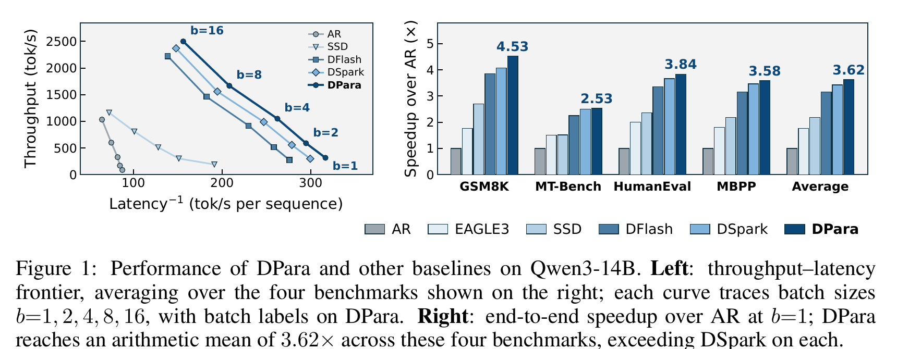

## 4. 研究方法

### 4.1 方法总览

Figure 3 对比了串行 SD、SSD 和 DPara 的调度。DPara 的输入是上轮 bonus 与 draft block、目标特征缓存 $C$；输出是接受前缀、bonus 和下一轮 draft block。

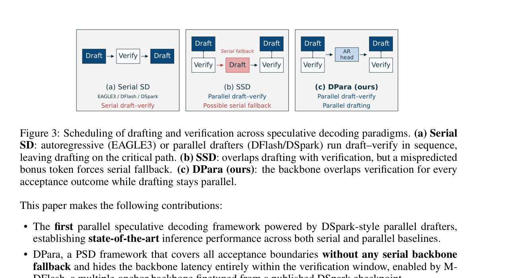

### 4.2 组件级设计动机与具体问题映射

多锚点骨干解决“验证还未结束时不知道哪一段前缀有效”的问题：没有它，DPara 只能回到单锚点 DFlash，无法同时覆盖所有 $r$。树状 mask 把共享 spine 与各分支隔离，避免一个假设接受边界污染另一个分支；代价是分支数量和固定 buffer 增长。冻结 AR 头把真实 bonus 的依赖延迟到 barrier 之后，只留下低秩修正的串行时间；代价是接受长度低于已看见完整特征的串行 DSpark。仅微调骨干而冻结头部是复用 DSpark checkpoint 的工程选择，Figure 8 支持接受长度改善，但没有证明其他训练配方不会更好。

| 设计 | 具体问题 | 改变的变量/状态 | 代价与证据 | 动机状态 |
|---|---|---|---|---|
| 多锚点 M-DFlash | 验证结果未知，单锚点无法覆盖所有前缀 | 一次输出 $d+1$ 边界 logits | 需要微调；Figure 8 接受长度平均提升 30.7% | 作者明确 |
| 树状 mask | 分支之间不能互相泄漏 | 共享 spine + 分支内双向可见 | mask 复杂；Figure 6 是机制图 | 作者明确 |
| 冻结 AR 头 | bonus 只有验证后才知道 | 把 bonus 条件化延迟到头部 | 串行头仍在临界路径；Figure 4/算法 1 | 作者明确 |
| 仅微调骨干 | 新输入 regime 与 DSpark 不匹配 | 适配多锚点、无目标特征输入 | 未提供从零训练对照；Figure 8 只验证“微调 vs 原 checkpoint” | 作者明确但证据有限 |
| A10+H800 异构拆分 | 弱 GPU 上 logits 传输和 AR 头拖慢 | 只传 hidden states，把 LM head 移到目标侧 | 受网络带宽/RTT 约束；Figure 7、Appendix D | 作者明确 |

### 4.3 模型/系统架构

M-DFlash 的 spine 对历史 anchor 保持因果可见，对每个接受边界的 mask block 只开放对应 prefix，并允许同一分支内 mask 相互读取。这样，接受 $A,B,C$、拒绝 $D$ 时，$C$ 分支的 logits 无需重算。

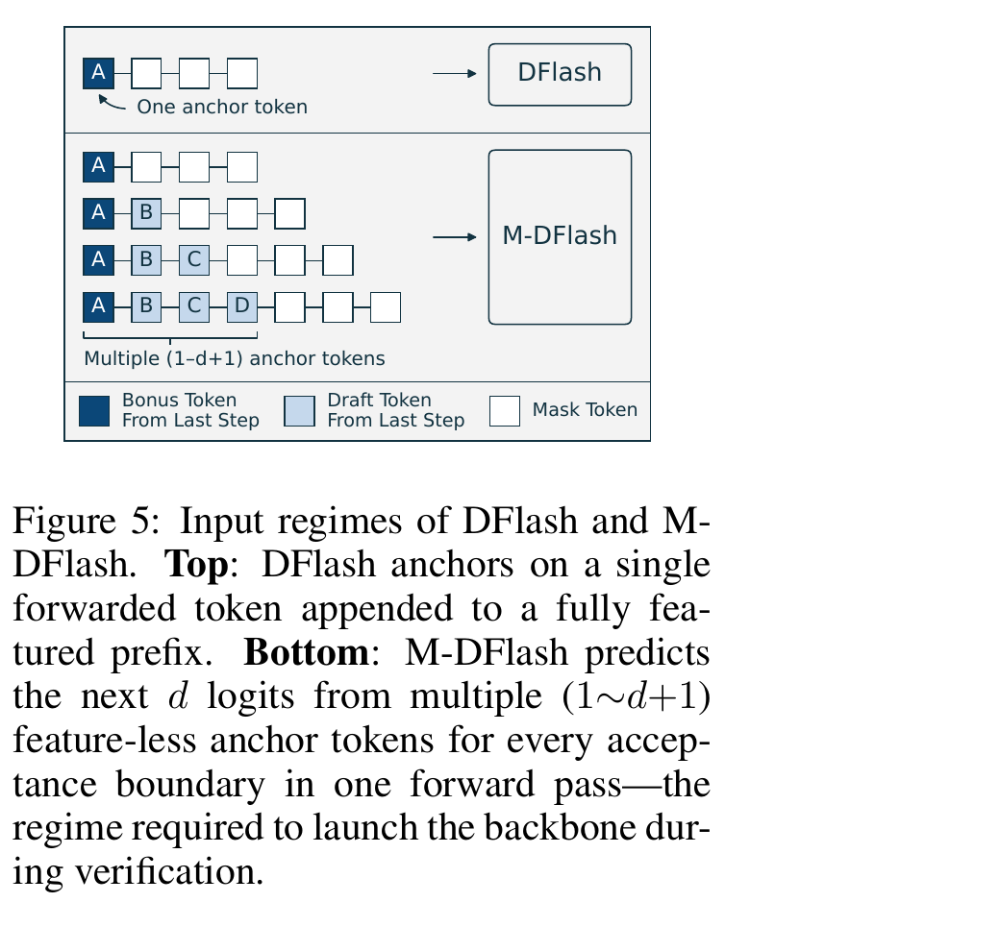

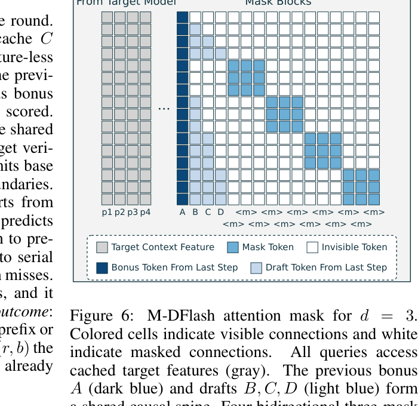

### 4.4 关键公式

$$
z_i=\ell_i+WE(y_{i-1}),\qquad y_i\sim\operatorname{softmax}(z_i),\quad y_0=b.
$$

**这条公式在算什么？** 它把验证后才出现的 bonus $b$ 注入选定分支，并逐位置采样下一轮 draft。

**怎么读？** 基础 logits 加上“前一个已采样 token”的低秩修正，再做 softmax。

**输入与输出。** 输入是边界 $r$ 的 $\ell_i$、上一 token $y_{i-1}$ 和 bonus $b$；输出是 $y_{1:d}$。

**直觉与边界。** 骨干负责并行候选，AR 头只恢复局部依赖；若头耗时超过验证窗口，隐藏骨干的收益会下降。小例子：Figure 4 中接受 $B,C$、拒绝 $D$ 后，$b=D^*$，头读取 $C$ 后生成 $E,F,G$。

$$
\mathcal L=\frac{\sum_i m_iw_i\left[0.1(-\log q_i(y_i))+0.9\sum_{v\in V}|q_i(v)-p_i(v)|\right]}{\sum_i m_iw_i},\qquad w_i=e^{-(i-1)/\gamma}.
$$

**这条公式在算什么？** 它用位置衰减加权地同时训练 token 交叉熵和全词表概率距离。

**怎么读？** 目标分布匹配占 90%，真实 token 交叉熵占 10%，越靠后的 draft 位置权重越低；$m_i$ 排除 assistant span 外的监督。

**边界。** 论文固定 $\gamma=4$，禁用 confidence loss，因此 draft 长度 $d$ 不动态截断。该损失能解释接受率变化，但没有单独消融 0.1/0.9 比例。

$$T_{step}\approx\max(T_{verify},T_{precompute})+T_{Head}.$$

**这条公式在算什么？** 它给出重叠调度的临界路径估算。

**怎么读？** 骨干只要在目标验证窗口内完成，就不增加串行时间；剩下的头成本仍要相加。论文 Figure 7 的 Qwen3-14B batch 1 测量为验证 12.5 ms、暴露头/调度 1.3 ms，总计 13.8 ms。

### 4.5 训练/实验/部署设计

目标模型为 Qwen3-8B/14B；训练用 GB200，主结果用 H800，另测 GB200 单卡和 A10+H800。训练一 epoch、AdamW、学习率 $3\times10^{-5}$、全局 batch 128、长度 4096、最多 256 个窗口，数据来自 Qwen3-8B 在 Open-PerfectBlend prompts 上生成的响应。主表为 batch 1 greedy、draft length 7；附录另测 temperature 1 sampling。

## 5. 关键结论

### 5.1 主结果

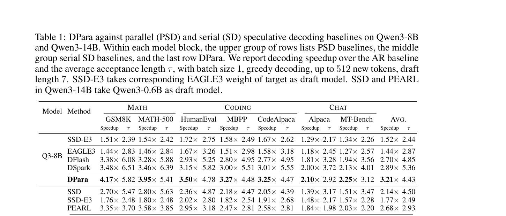

Table 1 显示平均速度提升：Qwen3-8B 为 3.21×，Qwen3-14B 为 3.52×；对应平均接受长度为 4.43、4.41，低于 DSpark 的 5.36。Qwen3-14B 上 DPara 相对 DSpark 的平均提升为 5.1%，相对 PEARL/SSD 为 31%/64%。这些是同一硬件配置下的系统结果，不等于骨干单模块的独立加速。

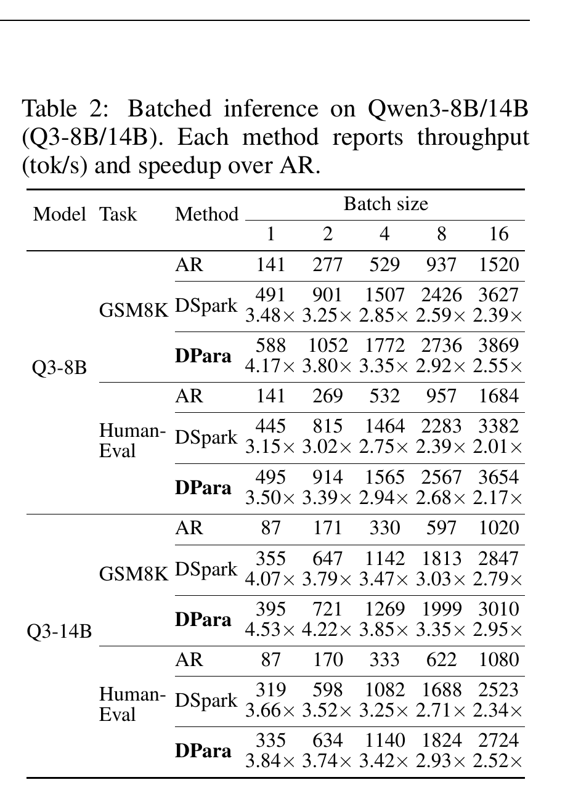

Table 2 中 Qwen3-14B GSM8K batch 16 的 DPara 为 2.95×，HumanEval 为 2.52×，仍比 DSpark 高约 6%–8%；但 batch 增大时两者相对 AR 的加速都下降。

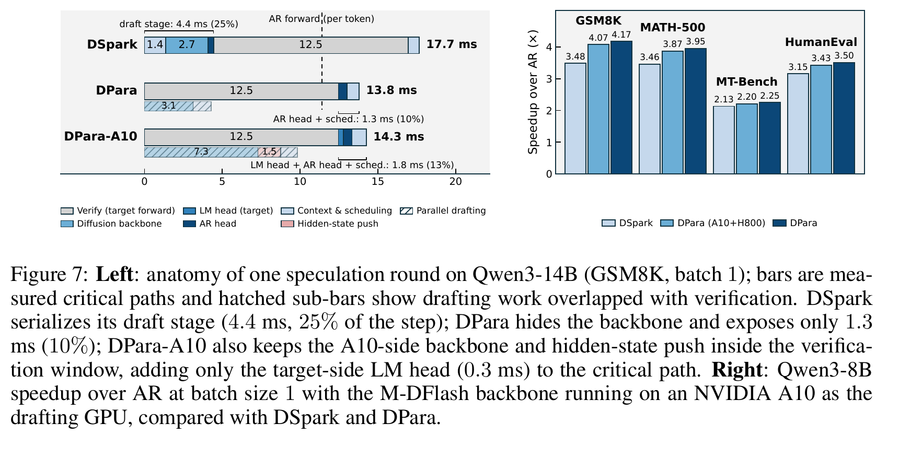

### 5.2 消融和机制证据

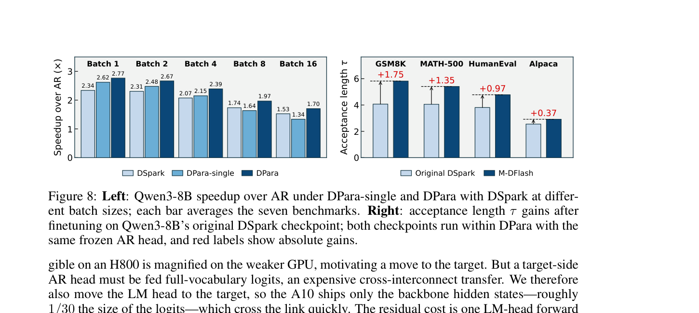

Figure 8 的受控对照只替换原 DSpark 骨干为 M-DFlash、保持 AR 头和解码配置不变，四个数据集平均 $\tau$ 从 3.62 增至 4.73（+30.7%）。这直接支持“多锚点 regime 需要骨干适配”，但没有证明 M-DFlash 的全部收益独立于数据或训练配方。

### 5.3 是否验证了假设

| 技术主张 | 证据等级 | 判断 |
|---|---|---|
| DPara 没有预测诱发的回退 | 直接：Figure 10/Appendix B | 在测量设置内成立；未证明所有 runtime 实现都无其他回退 |
| 骨干被验证窗口隐藏 | 直接：Figure 7、Appendix A | H800/A10 条件下成立；需要窗口长度足够 |
| 多锚点微调提高接受率 | 直接：Figure 8 | 只测 Qwen3-8B 四任务，范围有限 |
| 收益来自 overlap 而非接受率 | 间接/组合 | DPara 的 $\tau$ 低于 DSpark 但速度更高，支持机制；未提供完全匹配的骨干时间替换实验 |
| 可扩展到更大 batch | 直接但有限 | batch 1–16 测试显示领先，不代表无限扩展 |

### 5.4 收益来源归因

主要收益应归因于调度重叠和去除 SSD fallback；M-DFlash 负责恢复足够接受长度；AR 头、LM head 迁移和 CUDA graph 是实现层贡献。论文未提供“相同 M-DFlash、关闭 overlap”的完整桥接基线，因此对三者精确分摊只能作机制推断。

## 6. Related Work 对比

| 路线 | 优点 | 局限 | DPara 的差异 |
|---|---|---|---|
| EAGLE3/DSpark 串行 SD | 接受长度高 | 草拟在临界路径 | DPara 隐藏骨干，但接受长度略降 |
| DFlash/DART | 单次前向并行 draft | 位置依赖弱或需修正头 | DPara 把并行骨干放入验证窗口 |
| PEARL/AMUSD | 早期重叠 | 假设 all-accepted 或有限分支 | DPara 枚举全部边界 |
| SSD/SpecBranch | 预测 bonus/拒绝位置以重叠 | 预测错则整批回退 | DPara 不猜具体结果 |

## 7. OpenReview 公开评审 × 论文内容交叉核验

未找到公开 OpenReview 页面，因此没有可交叉核验的 reviewer claim、rebuttal 或 decision。该缺失不影响 PDF 内部证据分析，但意味着外部对基线公平性、代码可复现性和统计显著性的质疑尚未纳入。

### 7.1 与论文证据一致的正向评价

论文内部证据一致支持“回退率结构为零”和“骨干可被验证窗口隐藏”。

### 7.2 经核验仍成立的主要担忧

代码、数值格式和更大批量未公开或未测量，限制复现与外推。

### 7.3 Rebuttal/Revision 是否真正解决问题

无公开 rebuttal 或修订记录，无法判断。

### 7.4 对本文贡献、适用范围和潜在风险的影响

贡献在论文测试配置内成立；部署外推仍需验证。

## 8. Infra 需求分析

### 8.1 算力

默认 PSD 使用一张额外 drafting GPU；训练 4×GB200（268 GB），主结果 8×H800 80 GB。单卡模式用两条 CUDA stream，但 batch 8/16 时骨干与目标竞争算力和带宽，优势消失。

### 8.2 显存与存储

论文没有给出 M-DFlash 参数量、分支激活峰值或 KV cache 字节数；只报告 A10 24 GB 和 H800 80 GB，显存占用不能从文中精确复算。

### 8.3 Data Types / 数值格式

论文未披露 fp16、bf16、fp8 或累加精度；因此不能把收益归因于某种低精度格式。

### 8.4 带宽、互联与高效利用

A10+H800 通过 Ethernet/NCCL TCP，实测 RTT 约 0.8 ms、流式带宽 3.9–4.0 GB/s；只传 d+1 个分支 hidden states，Qwen3-14B 约 573 KB，约为 logits 的 1/30，传输约 0.14 ms。有效利用率可按 $573\text{KB}/0.14\text{ms}\approx4.1\text{GB/s}$ 估算，该数字是论文附录的派生检查，不是峰值带宽利用率。

### 8.5 CPU/GPU/NPU 异构执行

实验只覆盖 NVIDIA GPU；A10+H800 是异构 GPU，而 CPU/NPU fallback、主机预处理与 DMA 路径未报告。

### 8.6 调度/Serving/自定义算子

实现依赖 CUDA graph、异步 hidden-state 传输、固定 buffer 和 cache 增量更新；这些是系统条件，不应归因于 DPara 的接受机制本身。

## 9. 开源代码对照

官方代码、commit、checkpoint metadata 未能在受限网络环境取得；因此不存在可核验的本地路径或 commit。论文明确的训练和部署配置已记录在 §4.5 与 §8，其他实现细节标记为未验证。

### 9.1 开源权重/配置对照

未取得公开 checkpoint 文件和 config，无法完成参数量或层数对照；该项保持阻塞。

## 10. 优点与局限

### 优点

- 以结构性枚举替代结果预测，清楚地解释了为什么 batch 放大不再触发 SSD 式回退。
- 机制图、算法和附录延迟/回退测量相互对应。
- 同时报告双 GPU、异构 GPU 和单 GPU 的资源折中。

### 局限

- 只有两个 Qwen3 目标模型、七个基准和 batch 1–16；未证明跨模型、长上下文或更大批量稳定。
- M-DFlash 只与原 DSpark checkpoint 做一次替换消融，缺少不同骨干容量、不同 mask 和不同 loss 权重的控制实验。
- 额外 drafting GPU 的硬件成本、网络拓扑和未披露数值格式会影响实际总拥有成本。
- 没有公开代码/commit，复现和 kernel 归因受限。

### 可改进之处

补充不同骨干容量、branch 数、loss 权重、真实服务队列尾延迟和多厂商加速器实验，并公开可复现实装。

## 11. 研究启发

DPara 提示一个可推广的系统原则：当未来控制流依赖尚未返回的验证结果时，应预计算“结果的充分覆盖表示”，把不可避免的条件化压缩到低成本后处理，而不是预测一个可能错误的分支。后续工作应测试自适应 $d$、更长验证窗口、跨请求 branch packing，以及在真实服务调度器中测量队列等待和尾延迟。

## 12. 解读问题/待验证清单

1. 在相同 M-DFlash 下关闭重叠，骨干隐藏贡献占总收益多少？
2. $d+1$ 分支的计算/显存开销随 draft length 增长到何处会超过验证窗口？
3. 不同 target/drafter 规模比、采样温度和长上下文下，接受长度是否仍足够？
4. CUDA graph、TCP NCCL 和 fixed buffer 在 vLLM/SGLang 等服务框架中是否保持同样的回退率为零？

## 13. 一句话总结

DPara 不再猜“这轮会接受哪条路径”，而是在目标验证期间把所有路径的骨干表示都准备好，验证结束后只用轻量 AR 头接上真实 bonus，因此以较小的接受长度代价换取了稳定的骨干—验证重叠。

## 14. 冻结前发布审计

- 过程审阅：结构化章节、公式解释、术语审计、图表邻近性已完成。
- 渲染检查：使用 `pandoc -f markdown -t html5 -s` 成功生成 HTML；数学公式由浏览器 MathJax/Obsidian 继续解释，pandoc 对损失公式给出保留 TeX 的警告。
- 临时标记扫描：canonical Paper 无 HTML 注释、TODO、FIXME、过程目录或绝对本地路径引用。
- 发布状态：2026-10-08 重跑 review validator，结构校验通过但语义/完整性仍有 33 项错误；publisher validator 通过且错误列表为空。交付状态继续保持 `blocked`。
