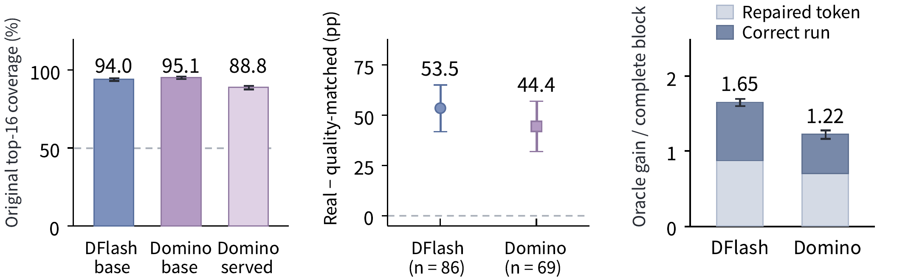

---
tags:
  - paper
  - collection/speculative-decoding
  - domain/model-systems
  - status/deep-review
  - topic/prefix-repair
  - method/global-candidate-repair
---

# DRelay: Global Draft Context for Prefix-Aware Parallel Speculative Decoding Repair 精读分析

> [!info] 文档关系
> - 文档类型：Paper
> - 领域入口：[README](../README.md)
> - 上位汇总：[投机推理方法演进](../surveys/evolution.md)
> - 证据资产：`../assets/papers/drelay/`

## 修订信息
- 当前文档版本：`1.0.0`；当前修订 ID：`rev-drelay-initial-20261008`；当前修订时间：`2026-10-08T21:00:00+08:00`；替代版本：无。

## 0. 资料与配图索引
- 论文：[arXiv:2610.01439](https://arxiv.org/abs/2610.01439)，PDF/source v1。
- 配图：[Figure 2 candidate repair evidence](../assets/papers/drelay/fig2-repair-evidence.png)，原始 source figure 转 PNG，单一 Figure 2，原分辨率 QA 已完成。
- 代码/公开评审：未取得可核验代码 commit；未发现公开 OpenReview 评审。

## 0.1 术语与符号解释
### 0.1.1 术语表
| 术语 | 本文含义 | 不等于 | 证据 |
|---|---|---|---|
| candidate pool | 每个位置由并行 drafter 提供的 top-K token 候选 | 最终 target 分布 | §3 |
| global reader | 跨位置读取候选相关性的模块 | target verification | §4 |
| causal selector | 结合 global signal 与已选前缀决定保留/替换 | 独立 target model | §4 |
| prefix repair | 在 target 验证前修复早期 native choice | 事后纠错 | §1–4 |
### 0.1.2 符号表
| 符号 | 含义 | 来源 |
|---|---|---|
| $H$ | draft block 位置数 | §6 |
| $K$ | 每个位置候选数 | §6 |
| $\tau$ | 每轮提交 token 数 | Table 1 |
| $S$ | 相对 AR 的端到端 speedup | Table 1/2 |

## 0.2 AI 生成算法分析示意图
使用原论文 Figure 3 的流程描述与 Figure 2 证据图；未另生成 AI 图。

## 1. 论文基本信息
- 标题：DRelay: Global Draft Context for Prefix-Aware Parallel Speculative Decoding Repair。
- 作者：Zhuoyu Wang, Junnan Huang, Xinyu Chen；第一作者 Zhuoyu Wang、Hong Kong University of Science and Technology (Guangzhou)；通讯作者 Xinyu Chen（标题页 †），同一机构。未列其他机构。
- 核心问题：并行候选中正确 token 已存在，但早期 native 选择错误导致连续前缀过早截断。

## 2. 研究动机与问题—方案闭环
### 2.1 出发点与背景痛点
假设第 1 个位置的 top-1 选成 `A`，而正确候选 `B` 已在 top-16；第 2–15 个位置其实沿正确路径预测，但 speculative verification 只能接受从开头连续正确的 prefix，于是一个选择错误浪费整个 suffix。DRelay 的目标是让后面位置的候选相关性反过来帮助第 1 个位置修复，而不调用 target 额外 forward。
### 2.2 现有方案为何不够
| 方案 | 失败 | 根因 | 简单补丁不足 | 证据 |
|---|---|---|---|---|
| DFlash | 正确 token 在 pool 但 native top-1 错 | 各位置独立选择 | 只扩大 K 增加验证/显存 | Fig.2 |
| Domino/DSpark | 后续依赖前缀，但无法回看早期选择 | 因果方向单向 | 加深 causal head 仍不能 backward repair | §1, Fig.3 |
### 2.3 论文计划解决的问题与成功标准
在不增加 target 验证次数的情况下，提高连续 accepted prefix。成功标准是 $\tau$、单请求 speedup、并发吞吐同时提升；不解决候选池本身没有正确 token 的情况。
### 2.4 核心方案如何解决并优化问题
global reader 汇聚整个 block 的候选 hidden states/distributions；causal selector 按位置结合全局 signal 与已修复 prefix，决定保留 native token 还是换成候选。训练同时优化候选支持损失与 repair 损失，并按位置对连续前缀贡献加权。
| 设计 | 改变的行为 | 预期收益 | 证据 |
|---|---|---|---|
| global reader | 引入跨位置信息 | 找到早期错误的替代候选 | Fig.3, Table 3 |
| causal selector | 修复后再影响 suffix | 延长连续 prefix | Table 3/4 |
| position-weighted repair loss | 早期位置权重更高 | 直接优化 $\tau$ | §5, Table 4 |
### 2.5 完整因果链与证据闭环
早期选择错误截断 prefix → 候选池中仍有正确 token → global reader 找到跨位置信号 → selector 修复早期 choice → target 接受更长 prefix → H800/SGLang 上 speedup 提升。Figure 2/3 与 Table 1–4 支持该链；没有正确候选的位置无法被修复，且 selector overhead 必须计入。

## 3. 核心贡献与创新点
1. 将 parallel drafting 的错误从“候选缺失”区分为“候选选择错误”。
2. 用 global reader + causal selector 做 target 前 prefix repair。
3. 用候选支持、修复和位置权重联合训练。

## 4. 研究方法
### 4.1 方法总览

图注：原论文 Figure 2，展示 candidate availability、continuation evidence 与 repair value；它支撑“正确候选常已在池中”的动机。
### 4.2 组件级设计动机与具体问题映射
global reader 解决因果 selector 看不到未来候选的问题，但引入跨位置注意力和额外显存；selector 保持输出路径因果，避免使用未来已选 token 造成泄漏。位置加权损失把早期位置的高边际价值编码进训练，直接对应连续 prefix 指标。Table 3/4 的移除实验支持这些模块，但无法完全拆开 reader 的容量与 selector 的训练收益。
| 设计项 | 证据 | 判断 |
|---|---|---|
| global read | Table 3 No Global Read | 直接支持 |
| causal selector | architecture ablation | 直接支持 |
| support + selector loss | Table 4 | 部分支持，损失项仍有耦合 |
### 4.3 模型/系统架构
parallel drafter 生成 $H\times K$ 候选 → global reader 聚合 → selector 从左到右选择/修复 → target 一次验证 → 提交连续 prefix。
### 4.4 关键公式
$$\mathcal L=\mathcal L_{\mathrm{support}}+\lambda\mathcal L_{\mathrm{repair}}$$
**这条公式在算什么？** 同时训练候选池质量与 prefix 修复决策。
**怎么读？** 候选要包含正确 token，selector 才有可修复空间。
**输入与输出。** 输入是候选 logits、真实 token 与已选 prefix；输出是训练 loss。
**变量在这里各做什么？** $\lambda$ 平衡两项，support 约束候选覆盖，repair 约束保留/替换。
**直觉。** 只有 repair 没有 support 会“巧妙选择但池中无真值”；只有 support 则仍可能 top-1 选错。
**边界。** repair 不能创造 candidate pool 中不存在的 token；损失权重需与 block 长度匹配。
**小例子。** 若 support=0.4、repair=0.2、$\lambda=2$，总 loss=0.8。
### 4.5 训练/实验/部署设计
Qwen3-4B/8B、八个 math/code/chat benchmark，H800 单卡与 SGLang；单请求和并发 2–32 均测试。论文报告相对 DFlash 端到端 speedup 提升 14.7%–16.8%，相对 Domino 8.7%–9.3%，相对 DSpark 8.1%–9.3%。

## 5. 关键结论
### 5.1 主结果
DRelay 在八个 benchmark 上提升 $\tau$ 与 speedup；并发 32 时 Qwen3-4B/Qwen3-8B 在 AIME25/HumanEval 达 2.34×/2.27×、2.63×/2.89× 相对 AR（Table 2）。
### 5.2 消融和机制证据
| 技术点 | 对照 | 结果 |
|---|---|---|
| global reader | No Global Read | accepted length 下降 |
| selector | architecture ablation | 去掉后修复收益消失 |
| support/repair loss | Table 4 controls | 去掉任一项均下降；耦合仍存在 |
### 5.3 是否验证了假设
“候选池中有正确 token”由 Figure 2 支持；“全局信号可稳定修复”由跨任务结果与消融支持，但尚未在不同 K/H、不同硬件上系统敏感性分析。
### 5.4 收益来源归因
收益主要来自 accepted prefix 增长；Figure 4 显示新增 selector/global read 开销，故 speedup 是端到端结果，不应归为纯候选生成改进。

## 6. Related Work 对比
| 方法 | 机制 | 优点 | 局限 | DRelay 差异 |
|---|---|---|---|---|
| DFlash | 独立位置并行预测 | draft 快 | 早期选择错误浪费 suffix | 增加全局修复 |
| Domino | GRU/前缀依赖 | 后续位置有条件 | 不能回改早期 | backward global signal |
| DSpark | transition/refiner | 提高条件接受 | 额外结构 | 候选池内选择修复 |

## 7. OpenReview 公开评审 × 论文内容交叉核验
未发现公开 OpenReview 评审。

## 8. Infra 需求分析
### 8.1 算力
global reader 与 selector 增加 draft-side FLOPs；若 $\Delta\tau$ 足够，target verification 摊薄这些成本。
### 8.2 显存与存储
需要保存 $H\times K$ 候选 logits/hidden states，显存约随 $HK$ 线性增长；论文未给峰值显存表。
### 8.3 Data Types / 数值格式
H800 浮点推理；未报告量化或低精度敏感性。
### 8.4 带宽、互联与高效利用
单卡主要为 HBM；SGLang serving 还涉及 KV cache 调度，缺少 kernel-level bytes 统计。
### 8.5 CPU/GPU/NPU 异构执行
selector 可放 GPU；CPU 放置会引入候选 logits 往返，论文未测异构路径。
### 8.6 调度/Serving/自定义算子
需要 SGLang 支持候选 metadata、selector kernel 与可变 block；论文给出 backend 结果但未给 commit。

## 9. 开源代码对照
未取得可核验代码仓库/commit；SGLang 端到端结果可作为系统证据，但实现细节未独立审计。
### 9.1 开源权重/配置对照
未取得 checkpoint metadata；与 DFlash/Domino/DSpark 的容量公平性以论文设置为准，尚未外部复核。

## 10. 优点、局限与风险
### 优点
利用已有候选池做修复，不改 target 合同；同时覆盖单请求和并发 serving；定位了“候选存在但选择错误”这一具体 failure。
### 局限
候选池缺 token 时无能为力；$H,K$ 增大带来显存和 selector 成本；训练损失耦合使组件归因不完全。
### 可改进之处
报告不同候选预算下的收益曲线，并将 global reader 与 selector 的纯 runtime 开销单独拆出。

## 11. 研究启发
DRelay 与 D-Loop 分别优化“选择质量”和“块内条件化”，可组合成先 repair 再 loop；但两者都需防止 draft-side 开销吞噬 target 节省。
## 12. 解读问题/待验证清单
1. repair 是否在候选池质量下降时退化为额外开销？
2. selector 的 global read 能否用低秩/稀疏注意力降低 $HK$ 成本？
3. 不同温度、block 长度、并发下的 gate/权重是否需要重调？
4. SGLang 结果能否在 vLLM/TensorRT-LLM 复现？
## 13. 一句话总结
DRelay 用全块候选上下文在 target 验证前修复早期选择错误，延长连续接受前缀；收益证据完整，但显存与 selector runtime 是部署边界。
## 14. 冻结前发布审计
- Markdown 渲染器：`markdown-it`；结果 passed。
- Figure/Table 邻近性：Figure 2 紧邻动机；passed。
- 临时标记扫描：clean；审计证据为过程侧 checklist/manifest。
