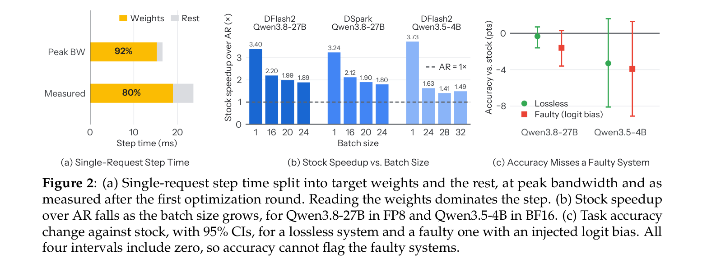
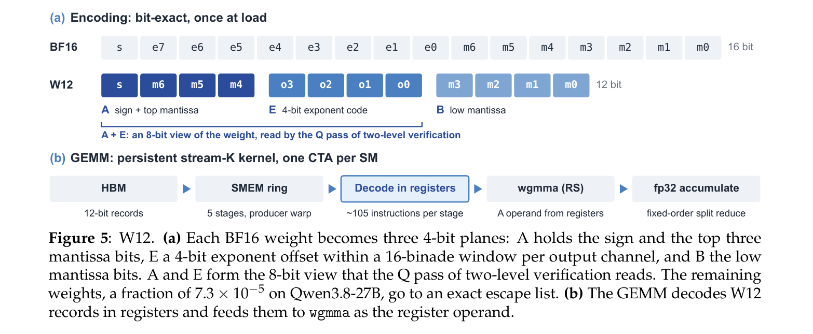
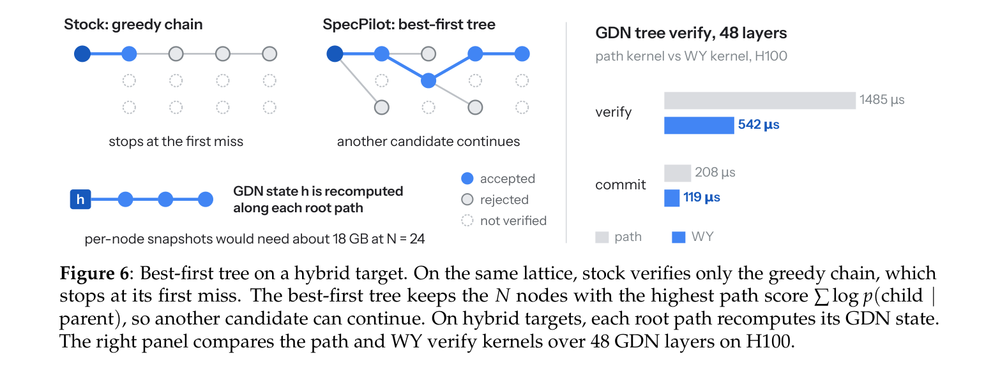
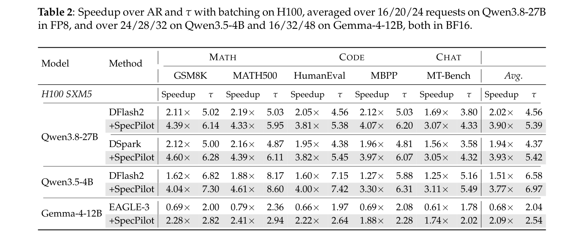
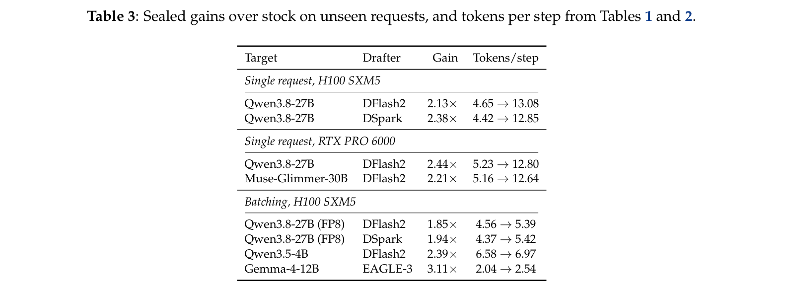
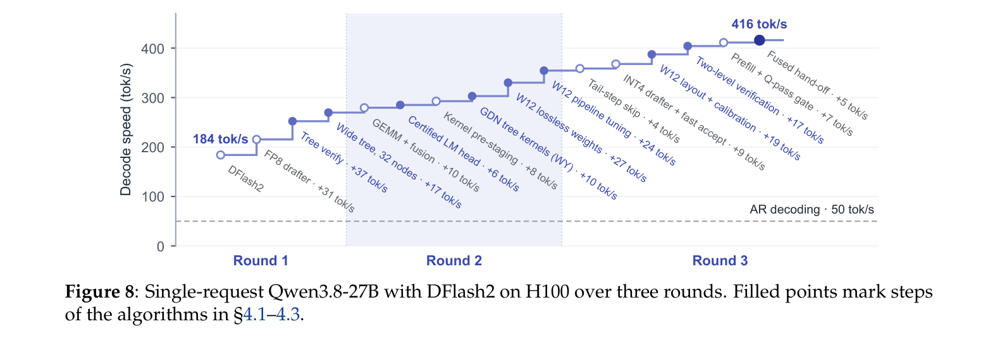
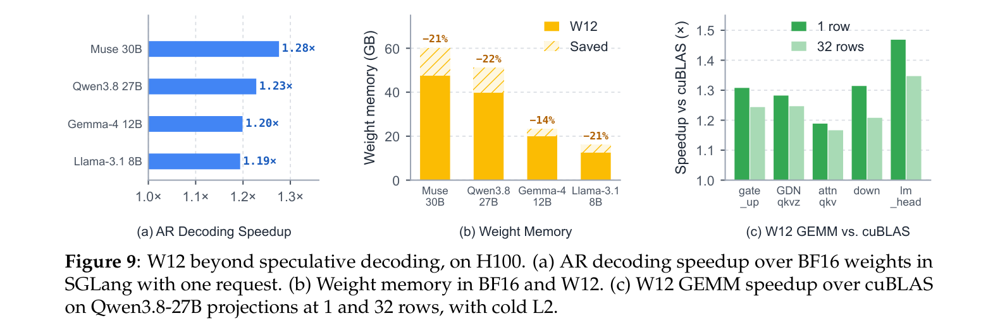

---
tags:
  - paper
  - collection/speculative-decoding
  - domain/model-systems
  - status/deep-review
  - topic/speculative-decoding-systems
  - method/agentic-systems-optimization
---

# SpecPilot: Autonomous Algorithm Discovery and Systems Optimization for Speculative Decoding 精读分析

> [!info] 文档关系
> - 文档类型：Paper
> - 领域入口：[README](../README.md)
> - 上位汇总：[投机推理方法演进](../surveys/evolution.md)

## 修订信息

- 当前文档版本：`1.0.0`；当前修订 ID：`rev-specpilot-initial-20261116`；当前修订时间：`2026-11-16T22:00:00+08:00`；替代版本：无。

| 修订 ID | 文档版本 | 时间 | 修订者 | 类型 | 替代修订 | 迁移问题/解析 | 变更摘要 | 原因 | 影响位置 | 依据 | 对结论影响 |
|---|---|---|---|---|---|---|---|---|---|---|---|
| `rev-specpilot-initial-20261116` | `1.0.0` | `2026-11-16T22:00:00+08:00` | Codex | initial | 无 | 无 | 首次精读与正式入库 | 用户请求 | 全文及图表 | arXiv:2611.02501v1、官方代码 commit `78c42af` | material |

## 0. 资料与配图索引

- 论文：[arXiv:2611.02501v1](https://arxiv.org/abs/2611.02501v1)，2026-11-02 提交；精读依据为 23 页 PDF（含附录）。
- 官方代码：[StargazerX0/SpecPilot](https://github.com/StargazerX0/SpecPilot)，核验 commit `78c42af4297bdd0b58020a491802817241a37331`。仓库给出六种部署的最终引擎及运行脚本；并非完整公开的自主搜索运行轨迹或隔离控制器。未独立运行 GPU 基准。
- 原论文图表按论述位置嵌入下文；页码、300 dpi 像素尺寸、精确裁剪框、完整 caption 和逐图 QA 见[图表清单](../evidence/specpilot-figure-inventory.md)。原文 Figure 3 是可读的算法总览，无需 AI 生成示意图。
- 未发现该 v1 的公开 OpenReview 评审或作者回复；不据此推断评审状态。

## 0.1 术语与符号解释

### 0.1.1 术语表

| 术语            | 本文含义                                         | 易混边界                    | 证据          |
| ------------- | -------------------------------------------- | ----------------------- | ----------- |
| stock         | 已发布的草稿器推测解码实现，经同 GPU/负载调优后作为对照               | 不等于纯自回归解码 AR            | §1、§5.1     |
| exact pass    | 使用目标模型精确权重对候选路径进行最终验证的前向                     | 低精度 Q pass 不提交 token    | §2.1、§4.3   |
| token forcing | 将生成 token 再喂给目标模型打分，比较与其贪心选择的逐位置差异           | 统计审计，不是形式化正确性证明         | §3.3、Fig. 4 |
| W12           | 按通道为 BF16 权重选指数窗，12 位主体加稀疏例外表实现位级可逆存储        | 不是近似 12 位量化             | §4.1、Fig. 5 |
| TLV           | two-level verification：低精度预验证后重草拟，最后仅由精确验证提交 | 不是低精度直接接受               | §4.3、Fig. 7 |
| sealed final  | 在代理未见请求上进行封闭计时和 token 核验的最终系统                | 表 1/2 的 AR 比值来自开发请求交错运行 | §3.2、§5.1   |

### 0.1.2 符号表

| 符号 | 含义 | 性质/单位 | 作用域与易混点 | 来源 |
|---|---|---|---|---|
| $N$ | 单请求精确验证的候选节点/行数 | 作者定义，行 | batch 时是共享行预算，不再单请求解释 | Eq. (3)、§4.4 |
| $\tau(N)$ | 每轮被提交的 token 数 | 作者定义，token/轮 | TLV 时以一次精确 pass 为一轮 | Eq. (3)、§4.3 |
| $S(N)$ | 相对自回归解码的加速比 | 作者定义，无量纲 | 同一引擎和工作负载下比较 | Eq. (3) |
| $c(N)$ | 投机轮时长相对 AR 单步时长 | 作者定义，无量纲 | 包含草拟、验证和调度 | Eq. (3) |
| $T_{\rm step},T_{\rm AR}$ | 投机轮及 AR 单步时间 | 作者定义，时间 | 对应同一引擎 | Eq. (3) |
| $T_{\rm prof},T_{\rm floor}$ | 已剖析内核时长与估计硬件下限和 | 作者定义，时间 | 后者使用 60% 峰值密集算力与 90% 峰值带宽 | Eq. (4) |
| $\tau_{\rm best}$ | 固定草稿候选格与节点预算下最优树的离线接受长度 | 作者定义，token/轮 | 不是可达的全局理论最优 | Eq. (4)、§6.4 |
| $E_n,e$ | 输出通道 $n$ 的指数窗上界、单个 BF16 指数 | 作者定义，指数码 | 仅窗内正规非零权重直接编码 | §4.1 |
| $\delta$ | 由 stock 与 AR 首次偏离所校准的近乎平手阈值 | 作者定义，log-prob 差 | 大边际事件使用 $2\delta$ | §3.3 |

本文分析推导中的变量均在公式旁重新解释；术语与符号的原文定义均以上述章节为准。

## 0.2 AI 生成算法分析示意图

原论文 Figure 3 已给出输入、成本诊断、探索、整合、逐 token 核验及记忆回流的完整顺序，直接使用原图，无需额外生成解释图。

## 1. 论文基本信息

- 完整标题：*SpecPilot: Autonomous Algorithm Discovery and Systems Optimization for Speculative Decoding*。
- 作者（论文首页顺序）：Kunjun Li, Wenhao Chai, Yihao Liang, Yuezhou Hu, Shuyao Xu, Yi Pan, William X. Zheng, Kannan Ramchandran, Kurt Keutzer, Jiantao Jiao。
- 共同一作：Kunjun Li（University of California, Berkeley）、Wenhao Chai（Princeton University）、Yihao Liang（Princeton University）；论文首页以 `* Equal contribution` 明示。通讯作者：Jiantao Jiao（University of California, Berkeley；NVIDIA），首页以 `Corresponding Author: jiantaoj@nvidia.com` 明示。其余作者涉及机构去重：University of California, Berkeley、Stanford University。机构对应来自首页上标 1–4，未按邮箱猜测。
- 领域：大模型推测解码、GPU 推理系统和代理辅助系统优化；版本状态：arXiv v1，未核验会议录用。
- 研究对象：不同目标模型、草稿器、GPU 和并发档位下的贪心推测解码；不声称对采样分布或所有硬件自动适用。

## 2. 研究动机与问题—方案闭环

### 2.1 出发点与背景痛点

**本文为便于理解所做的场景重构，不是论文逐字案例/实验。** 一个 H100 服务正在处理单条数学解题请求。小草稿器一次提出多个后续 token，目标模型随后读取整套权重验证。现有系统只核对一条贪心链：链上早期 token 一错，同轮其它位置的候选即使包含目标模型想要的词，也被丢弃。用户看到的是每轮仍付一次大模型权重读取成本、输出速度没有达到候选池的潜力。想改进，必须让大模型**继续决定最终提交 token**，同时增加每次昂贵权重读取对应的有效输出。

论文在 Figure 2a 和 §3.1 测得单请求目标权重读取占优化后轮时长约 80%；Figure 10 的离线重放中，8 位置 stock 链每轮接受 4.25 个 token，而 16 位置候选格的 32 节点树达到 5.85。作者据此转向跨层面的算法与内核优化。并发时问题反过来：多请求各自增加注意力、循环状态和验证行数，宽树可能拖慢整批。这是部署条件改变优化方向的直接动机（§1、§6.5）。

图注：原论文 Figure 2，展示权重读取、batch 增大后的 stock 加速退化，以及任务准确率无法识别注入错误的例子；完整原 caption 见清单。

### 2.2 现有方案为何不够

| 现有方案/做法 | 可见失败与具体场景 | 根因；简单补丁为何不够 | 证据 |
|---|---|---|---|
| 只验证一条草稿链 | 单请求早期预测错，后续候选无法继续；已读取的目标权重仅换来少量 token | 扩大链长会增加候选，但不能利用同位置的替代分支；需树与按父节点条件评分 | §1、§3.1、Fig. 10 |
| 统一使用宽树或低精度预检查 | batch 中每个请求多出验证行，BF16 Qwen3.8-27B 的 TLV 反而慢 13% | 权重读取不再掩盖逐行计算；仅增加接受长度不保证每秒吞吐更高 | §6.5 |
| 仅用任务分数审计自动改代码 | 注入错误的系统在任务准确率置信区间仍覆盖零变化 | 大量 token 错误可能不改变少量任务答案；需逐 token 的目标模型校验 | Fig. 2c、Fig. 4、§6.2 |

这些例子由论文数据支撑；第一行的用户请求叙事是上述说明性重构。论文没有证明任意长树、任意低精度层级都值得部署。

### 2.3 论文计划解决的问题与成功标准

核心问题是：在保持目标模型贪心结果的前提下，能否让代理在每种部署中找到真正提高解码吞吐的算法与内核组合？成功以同引擎的每请求输出速度、相对 AR/stock 的加速比、接受长度、封闭请求上的置信下界与逐 token 正确性门槛衡量（§3、§5）。作者未把训练新草稿器、开放式采样分布保持或生产 SLA 作为实证目标。

### 2.4 核心方案如何解决并优化问题

SpecPilot 每轮先用成本模型判断瓶颈是“接受太短”“内核离硬件下限太远”还是调度开销，再让多个代理在不同 GPU 上探索、由隔离控制器做成对计时与正确性筛选，最后把能复现的代码增量和适用边界写入结构化记忆。单请求用树验证、可逆 W12 权重和两级验证换取每次精确大模型读取更多 token；batch 改为共享节点预算、按请求选草稿块长、把等待的短 prompt 混入验证步骤。成本模型重新运行，避免一轮的主要瓶颈被误当成永远的瓶颈（§3–4）。

| 原始问题 | 设计与改变的变量 | 预期指标 | 实际证据与判断 |
|---|---|---|---|
| 候选分支闲置 | 最优先树扩大有效验证路径 | $\tau$ 上升 | Fig. 10 离线重放直接支持；真实速度受内核成本影响 |
| 权重读取占主导 | W12 将主体权重从 16 位降至 12 位且位级恢复 | 单轮时长下降、显存释放 | Fig. 9、Table A2/A6 支持；特定核和 GPU 条件 |
| 一次精确验证只覆盖一次草拟 | 低精度预检查后再草拟，仍只由精确 pass 提交 | 每次精确 pass 的 $\tau$ 上升 | Fig. 7、A3 支持；batch 中可失效 |
| batch 验证行昂贵 | 跨请求共享预算并避开 GEMM 台阶 | 每请求速率上升 | §6.5、Table 2；组件归因只有部分对照 |
| 代理可能投机取巧 | 隔离计时 + token forcing | 可信速度且不漏大错 | Fig. 4 注入故障直接支持检测能力；并非形式证明 |

### 2.5 完整因果链与证据闭环

作者的链条是：已发布系统在单请求浪费候选、在批处理承担逐行成本 → 统一策略失效 → 成本模型找当前最大缺口 → 代理实现并经隔离门槛筛选 → 针对性改动提高被接受 token 数或降低每轮耗时 → 封闭请求计时测出加速，同时逐 token 审计约束输出。Figure 8 与 Table 3 支持完整系统效果；Figure 9/10 和 A3 支持部分机制。论文未用完全正交的消融把“代理规划、并行搜索、记忆、内核调优”的贡献拆干净。`lossless` 的强保证来自精确验证设计与位级权重回读；token forcing 只补充统计检查。

## 3. 核心贡献与创新点

1. 把跨部署调优做成成本上限驱动、隔离控制器审核的多轮代理流程（Fig. 3、§3）。
2. 将候选格中的替代路径用于混合循环目标模型的树验证，并以重算路径状态替代逐节点快照（Fig. 6、§4.2）。
3. 提出主体 12 位、例外可恢复的 W12 权重格式及融合解码 GEMM；收益不限于投机解码（Fig. 5/9、§4.1/6.3）。
4. 两级验证仅把低精度结果作候选提示，最终精确 pass 仍裁决所有 token（Fig. 7、§4.3）。
5. 用跨请求预算、动态草稿块和 prompt 准入应对并发逐行成本，并以逐 token 审计阻止错误捷径（Table 2、Fig. 4、§4.4）。

## 4. 研究方法

### 4.1 方法总览

输入是某个固定部署（目标模型、草稿器、GPU、单请求或批处理）及其 stock 引擎。输出是经封闭请求、逐 token 审计筛选的具体推理引擎，不是训练后的新模型。工作流依次为：剖析瓶颈及可达上限 → 多代理分方向写补丁 → 独立控制器比较并整合 → 内核调优 → 未见请求封闭测试 → 可复用机制记入带依赖的记忆（Fig. 3）。每轮在上一轮产物上继续，新部署从 stock 与经过验证的记忆条目开始。论文报告记忆含 140 个条目，但本文无法从公开代码独立复核完整搜索历史。

图注：原论文 Figure 3 是本文算法总览；它显示各阶段次序和记忆回流，而非训练管线。

### 4.2 组件级设计动机与具体问题映射

**成本模型与隔离门槛。** 若只按接受长度优化，单请求第一轮之后仍可能忽视占 80% 的权重读取；§6.1 的单代理对照三轮仅达到相对 stock 1.34×，完整流程为 2.13×。成本模型分解剩余空间，隔离控制器按相同请求、交换两 GPU 的成对计时决定是否推广补丁，并在未见请求重复。代价是多 GPU 与大量试验预算；单代理对照缺成本模型，也可能同时缺并行探索与搜索策略一致性，因此不能把 2.13×/1.34× 全归给分解公式。

**树验证。** 草稿器已给各位置多个候选，沿单一路径验证会丢掉分支。最优先树用“给定父 token 的子 token 分数”排序，使有效路径可继续。混合目标模型的 GDN 循环状态若每节点保存约需 18 GB（$N=24$），所以对每条根路径从已提交状态重算，最终只重放接受路径。代价是树核和重算；Figure 6 的 WY 核比路径核验证快，但舍入差异仍须接受审计。

**W12。** 直接缩小 BF16 权重会损精度，逐权重可逆表示则可减少 HBM 读取。每通道选覆盖最多权重的 16 档指数窗，窗内存 1 位符号、4 位指数偏移、7 位尾数；零、非正规数和窗外权重进稀疏例外表，加载时逐张量位级回读验证。低位与高位分平面排列，内核在寄存器还原再做矩阵乘；代价是专用 GPU 核、例外路径和芯片移植。Figure 9 与 Table A2 对带宽受限的小行数矩阵乘提供独立证据。

**两级验证（TLV）。** 若仅树验证，精确 pass 仍只跟一次草稿相连。低精度 Q pass 先确定候选路径但不提交，再从该路径末端二次草拟，将路径与新子树交给一次精确 pass 验证。这样提高一次昂贵精确权重读取换来的 token 数；Q pass、二次草拟和调度又增加时间，batch 甚至可变慢（§6.5）。

**batch 调度与 token 审计。** 并发时每个验证行都消耗计算，跨请求共享 192 节点预算、选择 8/12/16 位置块长，并仅在调度本来要等待时让短 prompt 与验证共享权重流。正确性方面，代理可偷换数值或提交未验证词，故隔离控制器用 stock 校准的近乎平手阈值、错位率及大边际事件检测；Figure 4 注入偏置实验支持其检测力，仍不能替代形式化证明。

| 设计项：论文是否明确说明 | 动机来源 | 解决的具体瓶颈 | 权衡 | 受控证据与判断 |
|---|---|---|---|---|
| 成本上限与多轮探索 | 作者明确，§3.1/6.1 | 瓶颈逐轮迁移 | GPU 小时与测量噪声 | 单代理对照非完全正交；部分支持 |
| 最优先树与 GDN 状态重算 | 作者明确，§4.2 | 单链丢分支、快照内存过大 | 验证核更复杂 | Fig. 10 离线接受长度与 Fig. 6 核时间；机制直接、系统归因部分 |
| W12 可逆表示与融合 GEMM | 作者明确，§4.1 | 单请求重复流式读权重 | 专用 CUDA 核与移植 | Fig. 9、Table A2/A6；直接支持编码和独立 AR 收益 |
| TLV | 作者明确，§4.3 | 每次精确 pass 只利用一次草稿 | Q pass 与二次草拟开销 | Fig. A3、Table A5；仅特定档位受益 |
| 跨请求共享预算/动态块/提示词准入 | 作者明确，§4.4 | batch 验证行和 prefill 台阶 | 调度、图捕获复杂 | §6.5 部分局部对照；整体速度归因混合 |
| token forcing | 作者明确，§3.3 | 任务准确率漏掉错误捷径 | 额外目标打分、统计假阴性 | Fig. 4 注入故障受控检测；不构成普适证明 |

### 4.3 模型/系统架构

图 3 给出发现流程；真实服务中，草稿器构造候选格 → 选定树节点 → 目标模型精确验证 → 只提交匹配的最长路径及补充 token。单请求 TLV 在树与精确验证之间插入低精度 Q pass 和再次草拟，但 Q pass 不写入目标 KV cache / GDN 已提交状态。batch 模式按跨请求预算构树并把待处理 prompt 行接入同次权重流。各模式共享“最终精确验证提交”边界（§4.2–4.4）。

图注：原论文 Figure 5 的主体加例外编码及寄存器解码链；不能把 W12 解读为有损 12 位量化。

图注：原论文 Figure 6 对比单链与树，并展示路径重算核、WY 核和提交核的测量时间。

图注：原论文 Figure 7 显示 Q pass 只提议路径，W12 精确 pass 才可提交 token。

### 4.4 关键公式

论文 Eq. (3) 的速度分解：

$$
S(N)=\frac{\tau(N)}{c(N)},\qquad c(N)=\frac{T_{\rm step}(N)}{T_{\rm AR}}.
$$

**这条公式在算什么？** 同一部署里，一轮投机相当于多少次自回归单步的有效输出与耗时。

**怎么读？** 每轮提交 token 数除以该轮相当于多少个 AR 单步的时间。

**输入与输出。** 输入是验证行数 $N$、接受长度 $\tau$ 和两种时长；输出是无量纲加速比 $S$。

**变量在这里各做什么？** $N$ 控制树宽/成本，$\tau$ 是有效输出，$T_{\rm step}$ 与 $T_{\rm AR}$ 决定相对时间成本 $c$。

**直觉。** 增树若提高 $\tau$ 但更大幅增加 $c$，实际速度仍会下降。

**边界。** 论文此式描述贪心解码；单请求的 $N$ 是本请求验证行，batch 要另考虑共享预算和每请求速率。TLV 的一轮包含两个草拟和两个验证层级。

**小例子。** 本文构造的算术例：一轮提交 6 token，耗时为 2 次 AR 步时长，则 $S=3$；不是论文测量。

论文 Eq. (4) 的本轮剩余空间估计：

$$
C=\frac{\tau_{\rm best}}{\tau}\cdot\frac{T_{\rm prof}}{T_{\rm floor}}\cdot\frac{T_{\rm step}}{T_{\rm prof}}.
$$

**这条公式在算什么？** 把当前系统到估算上限的速度空间拆成候选选择、内核效率和未计入剖析的开销。

**怎么读？** 离线最佳树多接收多少、内核离硬件下限多远、整轮还有多少外部开销，三项相乘。

**输入与输出。** 输入是记录的候选格、剖析时长及硬件下限；输出 $C$ 是潜在加速倍率。

**变量在这里各做什么？** $\tau_{\rm best}/\tau$ 衡量接受空间；$T_{\rm prof}/T_{\rm floor}$ 衡量内核空间；$T_{\rm step}/T_{\rm prof}$ 衡量未剖析时间。

**直觉。** 最大因子给代理优先探索方向，不保证对应改动一定可实现。

**边界。** $T_{\rm floor}$ 取每类内核以 60% 峰值密集算力或 90% 峰值带宽估算的较慢下限；$\tau_{\rm best}$ 只在记录候选格与节点预算上求得。TLV 改变“一次草拟一次精确验证”假设，因此可越过旧上限。

**小例子。** 本文构造：接受因子 1.3、内核因子 1.2、其它开销因子 1.1，估算 $C=1.716$；三个因子不一定可独立实现。

W12 窗内编码可读成 $e\in[E_n-15,E_n]$、偏移 $o=e-(E_n-15)$，以 4 位存 $o$；例外表保持全部原始 BF16 位。这里只是对 §4.1 编码规则的文字重述，不把编码公式误写为精度近似。

### 4.5 训练/实验/部署设计

论文没有为 SpecPilot 训练新目标或草稿器。四种目标模型、三种草稿器、H100 与 RTX PRO 6000 两种平台，五个基准 GSM8K、MATH500、HumanEval、MBPP、MT-Bench；贪心解码、thinking enabled；batch 客户端维持固定并发请求数（§5.1）。单请求目标均 BF16；批处理 Qwen3.8-27B 可用 FP8，另有 BF16 档位。SGLang 冻结 v0.5.20。论文把**封闭测试对 stock 的提升**与**开发请求交错测试对 AR 的加速**分开；两组不是同一批请求，不能用表 1 的比值替代表 3 的 sealed gain。

## 5. 关键结论

### 5.1 主结果

图注：Table 1 是开发请求上的同引擎 AR 比值。H100/Qwen3.8-27B/DFlash2 为 3.95×→8.86×；RTX PRO 6000/Qwen3.8-27B/DFlash2 为 4.46×→10.87×。单请求两级验证的 $\tau$ 以一次**精确** pass 为分母（§5.1，Table 1）。

图注：Table 2 的 FP8 Qwen3.8-27B/DSpark 平均相对 AR 为 1.94×→3.93×；Qwen3.5-4B 为 1.51×→3.77×，Gemma-4-12B/EAGLE-3 为 0.68×→2.09×。跨模型比较须保持各自精度和并发档位（§5.1）。

图注：Table 3 的 sealed gain 在 H100 单请求 DFlash2/DSpark 为 2.13×/2.38×，RTX PRO 6000 单请求 Qwen/Muse 为 2.44×/2.21×；批处理 Qwen FP8 DFlash2/DSpark 为 1.85×/1.94×。这些是封闭请求的可靠主结果，不能把表 1/2 的开发集比值混用（§5.1–5.2）。

论文报告 13 轮搜索共 164 小时、530 GPU 小时、486 次代码改动、54 次推广（Table A4）。这是搜索成本，部署后吞吐收益应与离线发现成本分开核算。官方仓库 README 又报告四个 H100 设置从 fresh clone 复现，但本人未运行其 GPU 脚本，故将复现记录视为作者自报。

### 5.2 消融和机制证据

图注：原论文 Figure 4 显示两个注入 logit 偏置的故障系统在任务准确率难区分时，逐 token 错位率与大边际事件被检出；这是测试器的受控故障实验。

图注：原论文 Figure 8 的 H100 单请求轨迹从 184 增至 416 token/s；多项算法、数据类型和内核变更连续叠加，不能把整体差额单独归于代理规划。

图注：原论文 Figure 9 是 W12 的近独立验证：在不使用投机解码的 AR 路径上四个模型单请求加速 1.19–1.28×，权重显存下降 14–22%；GPU 内核与形状限定适用范围。

图注：原论文 Figure 10 中 32 节点、16 位置候选格的每轮接受数 5.85，高于 8 位置 stock 链 4.25；图为离线重放，尚未包含部署运行时成本。

| 技术点 | 对照与证据 | 能支持什么 | 仍缺什么 |
|---|---|---|---|
| 最优先树 | Fig. 10 固定记录候选格重放；Fig. 6 核微基准 | 树提高接受长度、WY 核加速验证 | 完全固定其它补丁的端到端树单独增益 |
| W12 | Fig. 9 不用投机解码的 AR 对照、Table A2 位级回读 | 减权重字节和小行数 GEMM 的收益 | 更多 GPU/大行数泛化 |
| TLV | Fig. A3 一层/两层成对，Table A5 Q-view 对照 | 特定单请求设置每次 exact pass 接受 6.16→11.67 | batch 中开销更大、不同草稿器单项隔离有限 |
| batch 三机制 | §6.5 共享预算接受数 +6–14%、动态块 +4.0%、等待 prompt 准入 +3.5%（后者非配对） | 机制方向符合逐行成本 | 完整 2× 系统收益的正交分解 |
| token forcing | Fig. 4/§6.2 注入偏置 | 故障检测优于任务准确率 | 对任意新故障分布的检出率保证 |
| 代理搜索流程 | §6.1 单代理无成本模型对照 1.34× vs 2.13× | 整体搜索配置更有效 | 等预算、等并发且仅删成本模型的消融 |

### 5.3 是否验证了假设

“不同 regime 需要不同机制”有最强反例证据：§6.5 显示 24 节点树在 FP8 batch 损失 14.9%，BF16 batch 的 TLV 损失 13%，而单请求广泛受益。“目标模型输出不变”的实现论证来自每个提交 token 经精确权重路径验证、W12 加载时位级回读；Fig. 4 仅是额外统计审计，且 GEMM/树注意力的浮点归约顺序可造成近乎平手的输出差异（§2.1/3.3）。因此不能写成跨所有硬件严格逐位生成一致。

### 5.4 收益来源归因

H100/Qwen3.8-27B/DFlash2 的 Table A3 按实际推广顺序给出局部配对增益：首轮 FP8 草稿器块长 1.160×、树 16 节点 1.160×、宽树 1.065×，之后 W12 首次 1.076×、流水线调优 1.063×、TLV 1.037×，还有多项 kernel/调度改动。它们是**随前序状态变化的条件增益**，不是可相加的独立贡献。Figure 8 的 184→416 token/s 是完整 lineage。batch 的 1.85–3.11× sealed gain 同样混合调度、内核和模型差异。将 Figure 10 的 $\tau$ 提升直接当作端到端速度是错误归因。

## 6. Related Work 对比

| 路线 | 机制与收益 | 与本文的边界 |
|---|---|---|
| [DFlash](dflash.md)、[DSpark](dspark.md) | 并行草拟形成候选块/格 | 是被优化的草稿器，不代表其发布系统已达到硬件上限 |
| DDTree、EAGLE-2、Sequoia | 候选树排序与验证 | SpecPilot 对带父条件分数的格构树，另处理混合循环状态；§6.4 给局部对照 |
| [AngelSpec](angelspec.md)、TurboSpec | 工作负载与批处理预算控制 | SpecPilot 将预算、块长和 prompt 准入按部署重选；对照不能跨不同目标模型简单比较 |
| ZipNN、DFloat11、ZipServ | 无损权重压缩或融合解码 | W12 固定 12 位主体并在小行数 GEMM 中内核内恢复；§7 的他法数字是作者引用，未独立复测 |
| AlphaEvolve、ADRS | 代理依据评估器反复生成代码 | 本文关键区别是面向投机解码的精确提交合同、封闭请求和逐 token 错误筛查 |

## 7. OpenReview 公开评审 × 论文内容交叉核验

截至 2026-11-16，本次通过论文首页、arXiv 页面与官方仓库未发现可核验的公开 OpenReview 评审、decision 或 rebuttal；因此不引述评审观点。稿件为 arXiv v1，后续若公开评审或更新版本，须另做版本差异和评审交叉核验。

### 7.1 与论文证据一致的正向评价

无公开评审可交叉核验；论文实验证据见 §5。

### 7.2 经核验仍成立的主要担忧

无公开评审观点；本文独立提出的局限见 §10。

### 7.3 Rebuttal/Revision 是否真正解决问题

未发现公开 rebuttal；v1 尚无后续版本可比较。

### 7.4 对本文贡献、适用范围和潜在风险的影响

无评审证据可改变本文判断；判断范围仍以 v1、官方代码和已披露基准为限。

## 8. Infra 需求分析

### 8.1 算力

性能目标应按 Eq. (3) 同看接受长度与每轮耗时。单请求 H100 的目标 GEMM 从 1 行到 64 行仅 17.88→18.58 ms（§3.1），宽树可借流权重成本掩盖更多验证行；batch 每行新增 attention/GDN/预填充工作，收益反转。TLV 的附录 A3 拆成两次 draft 各约 1.05 ms、Q pass 11.5 ms、exact pass 14.9 ms 和衔接 1.6 ms，约 30 ms/轮；所以仅看 11.67 token/exact pass 不足以判断吞吐。

### 8.2 显存与存储

Qwen3.8-27B 的转换层 BF16→W12 从 44.67 降到 33.58 GB（§4.1）；整个权重占用在 Table A6 为 51.1→39.8 GB，不能混用两个口径。每 GDN 树节点存状态在 $N=24$ 时约需 18 GB，故重算根路径而不是逐节点持久保存（Fig. 6）。空出的 GPU 显存使 Qwen3.8-27B KV 池增约 2.03×（Table A6），取决于模型与引擎配置，不能外推为所有部署的固定倍率。

### 8.3 Data Types / 数值格式

| 对象 | 格式和阶段 | 影响与边界 | 证据 |
|---|---|---|---|
| 目标权重 | BF16 原始位 → W12 主体 12 位 + 稀疏例外；加载时检查 | 位级可逆存储，计算仍遵循具体 kernel 的浮点归约 | Fig. 5、§4.1、代码 W12Weight |
| 低精度预检查 | W12 嵌套 8 位视图或 INT6/INT8 副本 | 只决定二次草拟方向，不直接接受 | Fig. 7、Table A5 |
| batch 目标 | Qwen3.8-27B 使用 FP8 档位 | 与单请求 BF16 不宜直接当成同精度对比 | §5.1、Table 2 |
| GDN 树状态 | FP32 拆成三段 BF16 参与张量核运算 | WY 核输出与路径核接近但非任意浮点执行顺序位相同 | §4.2 |

### 8.4 带宽、互联与高效利用

W12 的理想主体读取字节约为 BF16 的 $12/16=0.75$，但实际还含逃逸、索引、激活、KV 和输出写回，所以不能声称整轮一定快 25%。§3.1 的 H100 峰值 3.35 TB/s、目标权重约 80% 实测轮时长，以及 RTX PRO 6000 约 1.51 TB/s 实测带宽，都是论文的硬件口径。无多节点或 NVLink/RDMA 分布式实验；CPU→GPU 提示词与调度开销未单独报链路带宽。

### 8.5 CPU/GPU/NPU 异构执行

CPU 侧主控和请求调度组织代理、分配候选；GPU 执行草稿器、树选择、GDN/attention 验证和 W12 GEMM。batch 动态块长在 GPU 上选择，以避免逐请求回主机同步（§4.4）；prompt 准入将待处理提示词行合并进验证权重流。论文未给 CPU/GPU 总线传输分解，也未测试 NPU。RTX PRO 6000 无 Hopper `wgmma`，W12 移到 `mma.sync`，说明核移植不是纯配置切换（§5.3）。

### 8.6 调度/Serving/自定义算子

基于 SGLang v0.5.20 固定构建；自定义 W12 GEMM、树验证、GDN 状态重放、CUDA 图和批处理调度。32 节点预算与 192 节点共享预算分别贴合单请求接受曲线与 batch GEMM tile 平台；超出平台可能让新增验证行成本陡增（§4.2/4.4、§6.5）。线上尾延迟、请求长度分布、抢占与多租户公平性没有系统报告。

## 9. 开源代码对照

官方仓库 commit `78c42af4297bdd0b58020a491802817241a37331`。本次只做静态代码检查，未下载模型权重或运行 H100/RTX PRO 6000 基准，故性能复现状态为未验证。

| 机制 | 官方仓库相对路径（该 commit） | 核验结果 |
|---|---|---|
| 可逆 W12 与 Q pass | `settings/h100_c1_qwen38-27b_dflash2/files/python/sglang/kernels/ops/gemm/specpilot_d5_w12.py` | 找到 `W12Weight` 编码、`_check_roundtrip` 回读检查与 `q_pass()`；与 §4.1/4.3 方向相符 |
| 候选树构建 | `research/dflash_lab/dflash_lab/techniques/tree.py` | 有按累计分数选节点及前缀闭合说明；对应 §4.2 的离线树路径 |
| batch 树与调度 | `settings/h100_batch_qwen38-27b-fp8_dflash2/files/python/sglang/srt/speculative/specpilot_tree.py`、`settings/h100_batch_qwen38-27b-fp8_dflash2/files/python/sglang/srt/managers/scheduler.py` | 找到目标部署的专门实现；没有逐行动态执行复测 |
| 部署和复现入口 | `scripts/serve.sh`、`scripts/bench.sh`、`scripts/compare.py`、`settings/*/README.md` | 有最终系统的服务/基准入口与配置，官方 README 报告 fresh-clone H100 复现 |

仓库是“最终引擎与脚本”的开源，不等于完整公开自主搜索的代理提示词、每轮控制器审计日志或全部 140 条记忆的可复查版本；因此代理发现过程的可重复性比最终引擎弱。公开的六个 setting 还少于论文 Table 3 中八行评价组合，不能宣称所有行都提供同样开箱即用脚本。

### 9.1 开源权重/配置对照

官方 README 指向公共模型检查点并给出固定 revision 的下载脚本；本次未下载巨型权重、未读取所有模型原始 config，因此具体层数/宽度仅引用论文披露（Qwen3.8-27B 有 64 层、其中 48 层 GDN），不把 README 的运行说明当成本机实测。后续复现需锁定其脚本 revision、SGLang/CUDA 环境和 GPU 型号。

## 10. 优点与局限

### 优点

论文以成本模型解释为何单请求、batch 的策略不同；完整系统同时报告封闭请求对 stock 与开发请求对 AR；W12 有脱离投机解码的 AR 对照，token forcing 有注入故障对照；官方仓库包含部署实现。

### 局限

① 自主搜索本身不是完整开源可重放轨迹；② 单代理基线改变多个因素，不能隔离成本模型贡献；③ 全系统提升混合算法、核、精度和调度变更；④ 只检验贪心解码及指定 GPU/模型/负载；⑤ token forcing 是以 stock 为校准的统计门槛，近乎平手与未覆盖故障仍可能存在；⑥ 530 GPU 小时的搜索成本可能只适合反复部署的大负载；⑦ 未报告生产 SLA、复杂动态请求或多节点扩展。

### 可改进之处

在等 GPU 时长下分别关闭成本模型、并行探索和记忆迁移；对每种 batch 机制做固定 kernel 的正交消融；公开控制器测量日志、记忆条目及封闭评估协议；测长上下文、多租户流量和尾延迟。

## 11. 研究启发

- 对部署调优先测 $\tau$ 和轮时长各自的上限，优先处理最大因子；不要跨并发档位照搬单请求策略。
- 将低精度 pass 限定为候选筛选，最终 token 必须由精确权重路径确认；同时对 W12 做加载时位级回读。
- 系统代理需要不可改的计时器、未见请求与逐 token 核验，且需把搜索成本计入整体经济性。

## 12. 解读问题/待验证清单

1. 官方代码在目标 GPU 的最终引擎能否复现 Table 3 的封闭请求提升，而非仅 README 的开发集口径？
2. 成本模型、并行代理、结构化记忆在等计算预算下各自带来多少增益？
3. 哪些长尾请求或 sampling 模式会使 token forcing 的阈值失效？
4. 高 batch、长上下文与不同 GEMM tile 平台下，W12/TLV 与共享节点预算的交叉点在哪里？
5. 搜索需 530 GPU 小时，目标服务流量需要多少 GPU 小时才能回本？

## 13. 一句话总结

SpecPilot 的价值是把推测解码优化变成**按部署诊断、代理试验、隔离验证、记忆复用**的系统流程，并产出树验证、W12 和两级验证等可检查机制；最大未解问题是自动搜索贡献与最终系统多项改动尚难完全独立归因。

## 14. 冻结前发布审计

- Markdown 渲染器：Python-Markdown（tables/fenced_code/toc）；渲染命令或操作：`markdown.markdown`；渲染结果：12 个图片节点、10 张 Markdown 表格与 2 个成对块公式，标题和列表正常。Obsidian 的公式由 MathJax 处理。
- Figure/Table 邻近性审计：12 张图与其支持的动机、机制或结果同节；Figure 10 的邻文已重裁。其余未嵌入对象的冗余理由见图表清单。
- 临时标记扫描：正文未检出 TODO/FIXME/调试标记；审计证据：2026-11-16 的 review 与 publisher validation 输出。
- 原始 PDF、官方代码和逐图裁剪已核对；图表清单记录所有 12 个本篇内嵌原始对象的 caption、页码与 bbox。Figure 1 与 Table A1 等信息由 Table 1–3 或正文数字覆盖，Figure 2–10 和主表均在对应论点旁。
- 本文所有内嵌图均是原论文图，未使用 AI 生成图；原 Figure 3 提供完整算法顺序。
- Markdown 结构、链接、公式、图表邻近性和临时标记的最终验证结果以本次发布器与交付验证记录为准；任何失败均不应宣称正式交付通过。
