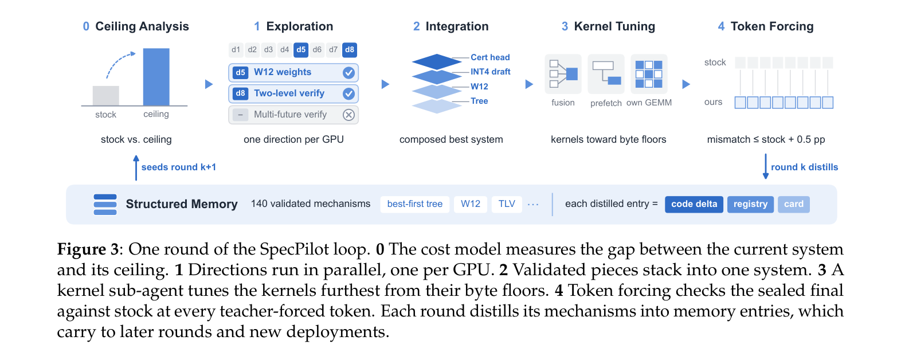
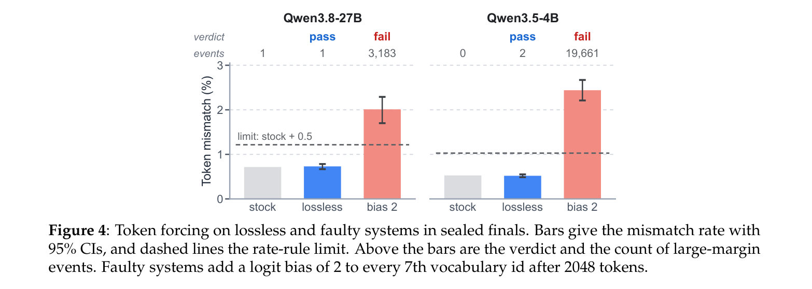
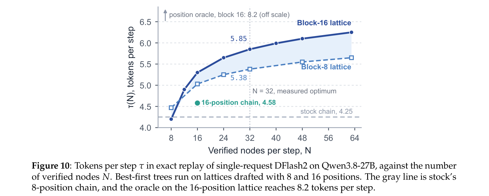
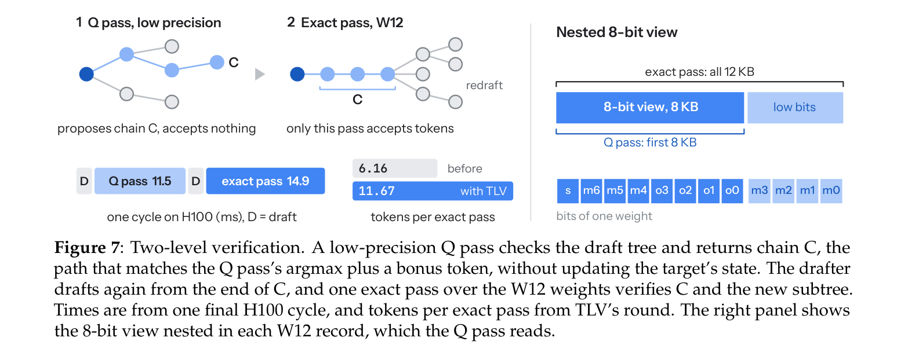
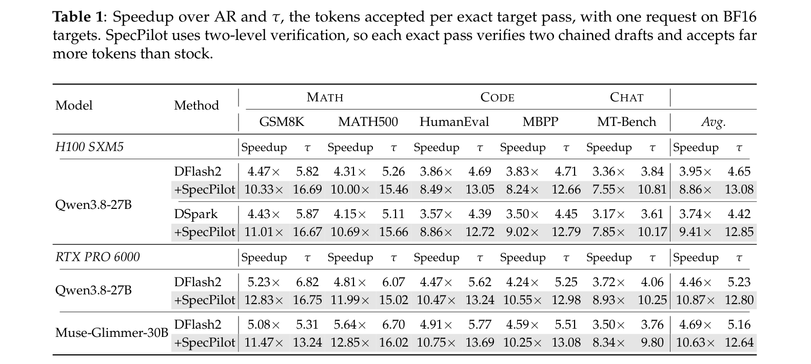

---
tags:
  - paper
  - collection/speculative-decoding
  - domain/model-systems
  - status/deep-review
  - topic/speculative-decoding-systems
  - method/agentic-systems-optimization
---

# SpecPilot：从一次验证的成本写起

> [!info] 文档关系
> - 文档类型：Paper
> - 领域入口：[README](../README.md)
> - 上位汇总：[投机推理方法演进](../surveys/evolution.md)
> - 图表证据：[图表清单](../evidence/specpilot-figure-inventory.md)

## 修订信息

- 当前文档版本：`1.1.0`；当前修订 ID：`rev-specpilot-narrative-20261119`；修订时间：`2026-11-19T19:45:00-07:00`。本次替代此前已发布文档；旧版审计 manifest 未找到，旧版哈希未能恢复，迁移问题记为 `SPEC-PILOT-MANIFEST-001`。按仓库迁移门禁，恢复旧 manifest 并补充 migration-resolution 前，canonical publication 保持 blocked。本修订重写了阅读路径与正文组织，结论仍以 arXiv v1 为依据。

- **`rev-specpilot-narrative-20261119`（1.1.0；2026-11-19；Codex）**：替代 `rev-specpilot-initial-20261116`。按问题、成本迁移、代理分工、方法与实验重排全文，并将关键公式和原文图表放回对应解释附近。依据是用户确认的叙事稿方向，以及 v1.8 narrative contract 对原文和图表的复核。
- **对结论的影响**：不改变论文结果判断；澄清实验分母、部署差异和搜索归因边界。

## 资料与阅读路径

依据论文 [arXiv:2611.02501v1](https://arxiv.org/abs/2611.02501v1) 及其 23 页 PDF（含附录）。官方代码仓库 `StargazerX0/SpecPilot` 已核验到 commit `78c42af4297bdd0b58020a491802817241a37331`；仓库包含六种部署的最终引擎及运行脚本，不含完整自主搜索轨迹或隔离控制器实现。本分析未独立运行 GPU 基准。未检索到该版本公开的 OpenReview 评审或作者回复。

论文首页作者顺序为 Kunjun Li、Wenhao Chai、Yihao Liang、Yuezhou Hu、Shuyao Xu、Yi Pan、William X. Zheng、Kannan Ramchandran、Kurt Keutzer、Jiantao Jiao。首页将前三位标为共同一作：Kunjun Li（University of California, Berkeley）、Wenhao Chai 与 Yihao Liang（均为 Princeton University）；通讯作者为 Jiantao Jiao（University of California, Berkeley；NVIDIA），由首页通讯作者标记及邮箱确认。其余作者的机构标记对应 University of California, Berkeley、Stanford University；这里不按邮箱推断个人机构。

原论文编号图表按论述位置嵌入；页码、裁剪框、完整 caption 与逐图 QA 见[图表清单](../evidence/specpilot-figure-inventory.md)。论文 Figure 3 已提供搜索流程总览，因此不另造算法图。

## 一次昂贵的核对只换回少量词

设想一台 GPU 正在回答一条请求。推测解码让较轻的 drafter 先提出几个 token，再让 target 读取权重，一次验证这些猜测；从开头连续猜对多少，系统就能向前推进多少。并行 drafter 还会给同一位置排出多个备选，但 stock——论文对随草稿器发布的现成推测解码系统的称呼，实验前又按对应 GPU 和负载调优——主要只验证一条链。链上早早猜错时，其他备选即使包含 target 想要的 token，也没能在这一轮派上用场。用户看到的是生成速度没有充分利用那次昂贵的验证。论文的问题从这里开始：既然 target 的权重已经读过，能否让这次读取覆盖更多有希望的路径？（§1、§2.1、§5.1）

单请求的测量给了这种想法具体依据。H100 上，target 的矩阵计算从一行扩到 64 行，耗时只从 17.88 ms 增至 18.58 ms；第一轮优化后，读取目标权重仍占一步实测时间的约 80%。原文这里写的是 row（行），不是 raw（原始值）。一次 target 验证中，每个候选 token／树节点占一行，对应 GEMM 输入矩阵的 M 维；batch size 数的是同时在途的请求，一条请求可以贡献多行，多个请求的行数也会累加。单请求下多验证一些候选的边际成本不大；可当 GPU 同时服务许多请求，每条请求都带着自己的 attention、循环状态和 prompt 处理工作，验证行数增加，计算也随之增加。并行 drafter DFlash2 的 stock 实现在 FP8 Qwen3.8-27B 上，相对 AR（autoregressive decoding，逐 token 自回归解码）的加速，从单请求的 3.40 倍降至 24 条请求时的 1.89 倍。两种负载面对的是同一套推测解码，却没有同一个最省时的验证办法。（§2.1、§3.1、Figure 2）

图中三组结果把后续优化的出发点放在一起：单请求受权重流量限制，batch 下逐请求验证的额外工作会侵蚀加速，而只看任务准确率又可能漏掉错误输出。

在讨论优化之前，作者先给 lossless（无损）划出边界。drafter 可以提议，最终提交的每个 token 却必须落在 target 使用精确权重验证过的路径上，并等于该次验证的 argmax。论文将这次决定输出的计算称为 exact pass（精确验证）。低精度计算可以帮忙挑路，但不能代替 exact pass 批准输出。这里的“相同”也不是跨一切 GPU kernel 的逐位恒等：不同的 GEMM 或 tree attention 会改变浮点累加顺序，概率几乎相等的两个 token 可能交换名次，stock 与 AR 也有这种偏离。后文的正确性测试必须既容纳这种 near-tie（最高分几乎打平），又发现真正改坏输出的捷径。（§2.1、§3.3）

论文的背景部分还解释了为什么“把链换成 draft tree”并非直接套用一个现成算子。并行 drafter 给出的是各位置的备选及其分数，论文称为 lattice（候选格）；一条分支值不值得验证，要看这个 token 接在哪个父 token 后面，另一种 drafter DSpark 的相邻 token 打分尤其如此。树还得包含每个候选节点的祖先，target 才能按正确上下文验证。主要实验目标 Qwen3.8-27B 的 64 层中有 48 层采用 Gated DeltaNet（GDN，逐 token 更新固定大小状态的循环结构），分支各有自己的状态；若给 24 个树节点分别留完整快照，作者估计约需 18 GB。候选虽多，系统还得找出值得花验证预算的路径，并以可承受的显存处理这些路径。（§2.2–2.3、§4.2、Figure 6）

DSpark 的候选分数明确依赖父 token。对位置 $s$ 的候选 $y$，论文写成

$$
\ell_s(y)=\operatorname{base}_s(y)+\left\langle W_1[x_{s-1}],\,W_2[y]\right\rangle .
$$

其中 $\operatorname{base}_s(y)$ 是 drafter 主干网络给出的 logit，$x_{s-1}$ 是父 token；因此同一个 $y$ 换了父节点，分数也可能改变。GDN 的状态更新则是

$$
h_t=\alpha_t\bigl(I-\beta_t k_tk_t^{\top}\bigr)h_{t-1}+\beta_t k_tv_t^{\top},
\qquad o_t=h_t^{\top}q_t .
$$

树验证必须为每条候选路径得到自己的 $h_t$；这正是“保存每个节点快照”会迅速变贵、而 SpecPilot 改用路径重算的原因。（§2.2–2.3，式 1–2）

## 先量出损失，再决定改动方向

速度的两面在论文式（3）里写得很直白：相对 AR 的加速比，是一步提交的 token 数，除以这一步相当于多少次 AR 单步的耗时。若验证节点数为 $N$，则 $S(N)=\tau(N)/c(N)$，其中 $\tau$ 是本步接受并提交的 token 数，$c=T_{\mathrm{step}}/T_{\mathrm{AR}}$ 是相对耗时。多加节点若使 $\tau$ 增长得不如 $c$ 快，服务速度反而会下降。这解释了为什么论文同时量接受长度和运行时间，而不把其中一个当成最终目标。（§3.1，式 3）

$$
S(N)=\frac{\tau(N)}{c(N)},
\qquad
c(N)=\frac{T_{\mathrm{step}}(N)}{T_{\mathrm{AR}}} .
$$

这里 $T_{\mathrm{step}}(N)$ 包括 drafting、target verification 及调度开销；$T_{\mathrm{AR}}$ 是同一引擎执行一次自回归单步的时间。这个定义也说明了为什么“接受更多 token”本身不是速度提升：它必须超过新增验证工作的时间比例。

SpecPilot 每轮从当前引擎出发，把尚未取得的速度空间粗分为三块：在记录的 lattice 上，最好的一棵树还能多接受多少 token；已经剖析的 kernel 离按带宽和算力估出的 byte floor（由各内核的字节搬运量与计算量估出的耗时下限）有多远；一整步中还有多少时间落在剖析结果之外。论文式（4）将这三项相乘，作为寻找方向的参考。这个 ceiling（按当前假设估计的速度上限）有明确前提——一次草拟、一次 exact pass，而且“最好树”只在记录的 lattice 与节点预算内求得。它足够帮助判断下一轮先查候选、权重读取还是其他开销；后来的 two-level verification（TLV，两级验证）会改变“一次草拟”这个前提。（§3.1，式 4）

$$
\text{ceiling factor}
=\frac{\tau_{\mathrm{best}}}{\tau}
\cdot\frac{T_{\mathrm{prof}}}{T_{\mathrm{floor}}}
\cdot\frac{T_{\mathrm{step}}}{T_{\mathrm{prof}}} .
$$

第一项是把当前接受长度 $\tau$ 换成记录 lattice 和节点预算下 best-first tree 的 $\tau_{\mathrm{best}}$；第二项衡量已剖析 kernel 距离各自 byte floor 的倍数；第三项衡量剖析范围之外的额外时间。对一个 kernel 类，论文的 floor 取两种下限中的较大者：

$$
T_{\mathrm{floor},k}
=\max\!\left(\frac{\mathrm{FLOPs}_k}{0.60\,P_{\mathrm{peak}}},\;
\frac{\mathrm{Bytes}_k}{0.90\,B_{\mathrm{peak}}}\right),
\qquad
T_{\mathrm{floor}}=\sum_k T_{\mathrm{floor},k} .
$$

所以它是一个用于排序搜索方向的估计上限，不是对任意新算法的理论上界；TLV 改变了“一次 drafting、一次 exact pass”的假设后，原 ceiling 也要重新解释。

度量之后，搜索流程才把瓶颈交给不同代理处理。master agent（主代理）先根据成本模型挑出若干最值得尝试的方向，并估计每个方向的 headroom（预期可获得的收益）；探索阶段通常一张 GPU 对应一个方向，由 sub-agent（子代理）分别实现。补丁通过配置开关启用，默认行为仍复现 stock。子代理先用成本最低的证据筛查想法，例如在记录的 lattice 上做 exact replay、跑 kernel 微基准，或单 GPU 计时；只有扣除新增运行开销后仍预计至少有 3% 收益，才继续实现完整算法。想法是否值得留下，最终仍要看测得的机制，而不是代理对代码的解释。

这里的 controller（控制器）是独立于代理的测量脚本，代理可以调用，却不能修改。它让候选补丁和当前最佳系统处理相同请求，在两张 GPU 上成对运行并交换设备，以减少请求与硬件差异对比较的干扰；随后按统计门槛决定是否晋级。单个补丁的收益若不够显著，integration sub-agent（整合子代理）会把若干补丁叠到当前最佳版本上，再按同一规则测量，因为多个小改动合在一起可能才有价值。晋级后，kernel sub-agent（内核子代理）剖析整合版本，把时间花在离 byte floor（按搬运字节数和计算量估计的耗时下限）最远的内核上。每轮以 sealed final 收尾：在代理未见过的请求上重新计时，并对普通长度及最长 4096 token 的输出重做 token forcing；任一检查失败，最终版本就被拒绝。这样，论文里的“agent 分工”不是几个代理同时随意改代码，而是主代理分配方向、子代理并行探索、整合代理组合补丁、内核代理追逐剩余瓶颈，控制器独立裁决，最后再由封闭测试把关。（§3.2、Figure 3）

控制器的晋级规则也可以写成一个简单的不等式。若候选相对当前最佳的加速比为 $g$，其 95% 置信区间下界为 $g_{\mathrm{LB}}$，stock 与自身重复测量的噪声为 $\epsilon_{\mathrm{stock}}$，则无输出分歧时要求

$$
g_{\mathrm{LB}}>1.01+2\epsilon_{\mathrm{stock}} .
$$

论文在 H100 单请求设置中报告 $\epsilon_{\mathrm{stock}}<0.1\%$；若候选与当前最佳的输出发生分歧，则采用约 $3\%$ 的收益门槛。这个规则把“看起来更快”与“足以排除测量噪声”区分开来。（§3.2）

Figure 3 可以对照上面的角色分工来读：代理负责提出和实现改动，控制器负责测量晋级；每轮的验证结果随后进入 memory，供后续轮次和新部署复用。

输出检查使用作者称作 token forcing（将系统已生成的 token 强制喂回 target model，逐位置核对其预测）的过程：观察输出是否与 target model 的 argmax 不同，以及分数差距有多大。stock 本身约有 0.72% 的这类偏离，多数发生在 near-tie 处，所以 controller 先用它校准正常波动，再检查新系统的 mismatch rate（逐词不一致比例）和 large-margin events（分数差距明显超出近乎平手范围的事件）。任务准确率在这里太粗：作者后来人为注入一种 2048 token 之后才触发的 logit bias（对部分词表项的原始预测分数加固定偏置），任务分数没有清楚地区分它和正常系统，token forcing 却检出了大量异常。（§3.3、§6.2、Figure 4）

对第 $i$ 个被强制评分的位置，令 $y_i$ 为系统实际输出，$\hat y_i=\arg\max_y \log p(y\mid x_{<i})$ 为 scorer 在同一前缀下的贪心 token，则

$$
m_i=\mathbf{1}[y_i\ne\hat y_i],
\qquad
r_i=\log p(\hat y_i\mid x_{<i})-\log p(y_i\mid x_{<i}) .
$$

其中 $m_i$ 表示 mismatch，$r_i$ 是该 mismatch 的 log-probability margin。Phase 0 用 stock 首次偏离 AR 时观测到的最大 margin 向上取整得到 $\delta$；只有 $r_i>2\delta$ 的事件才计入 unexplained large-margin events。系统的 mismatch rate 是 $\sum_i m_i/n$，论文的 rate rule 要求它在 95% 置信度下不比 stock 高出 0.5 个百分点以上。（§3.3）

Figure 4 把两条判据放在同一张图里：柱形及置信区间对应 mismatch rate，虚线是 rate-rule 阈值，柱顶同时报告判定和 large-margin event 数。注入偏置在生成 2048 token 后才生效，因此这项长输出测试能暴露短任务准确率容易漏掉的问题；图支持的是该审计流程能发现论文构造的故障，不等于对所有实现错误的形式化证明。

每轮通过测试的改动并非只留一段总结。structured memory（结构化记忆）记录代码差量、依赖、配置选项、正确性条件和证据；新部署可据此复用，但还要重新调参和计时。论文称这份记忆已有 140 条机制。因此，后文的跨部署实验既检验这些代码改动能否搬过去，也检验搬过去之后是否还快。（§3.4、§5.3）

## 三轮搜索沿着变动的瓶颈前进

论文 §4 依次介绍 W12（lossless 12-bit weight format，无损 12 位权重格式）、tree verification、TLV 和 batch serving 机制；若按 §6.1 的 H100 单请求实际搜索轨迹看，它们的关系更清楚。stock 约为 184 tokens/s（每秒输出的 token 数）。第一轮，候选利用不足是最大缺口，于是代理先改验证树，速度升至约 270 tokens/s。树逐渐接近记录 lattice 允许的接受长度后，每轮反复读取的 target model 权重成为主要成本；下一轮转向 W12 和 kernel。等单次 exact pass 也逼近原成本估计的下限，第三轮又把一次 exact pass 前的草拟过程改成两段，最终约为 416 tokens/s。每轮的改动改变了下一轮的成本结构，搜索方向也跟着移动。（§6.1、Figure 8）

图中标出的机制与速度轨迹相互对应：先扩展树验证，再压缩权重流量，最后加入 TLV。读图时应把它看作同一部署上的累计搜索过程，而不是三项改动各自独立的消融结果。

第一轮的树从 drafter 给出的多个位置和备选中，按父子相接后的路径分数挑节点，而不只追随一个最高分词。论文在一个设置中把草拟长度扩到 16 个位置，让 target model 验证至多 32 个节点。对带循环状态的 target model，验证时从已提交状态沿候选路径重算，不为每个节点长期保留快照；确认接受的路径后才重放它并更新正式状态。作者还把状态更新整理成适合张量核运算的形式，以降低树验证本身的时间。exact replay 显示，原来的八位置链平均每步接受 4.25 token，16 位置 lattice 上的 32 节点树接受 5.85 token。这是树选得更好、候选用得更多的直接证据；把它放进实际引擎后，仍要扣掉构树和验证的运行成本。（§4.2、§6.4、Figure 6、Figure 10）

对一条从根到节点 $v$ 的路径 $P(v)$，best-first builder 使用

$$
\operatorname{score}(P(v))
=\sum_{(u\to w)\in P(v)}\log p(w\mid u) .
$$

然后保留得分最高的 $N$ 个节点，并补齐它们的祖先，因此保留下来的节点集合是 prefix-closed（前缀闭合）。这不是简单取每个位置的 marginal top-1：同一个候选接在不同父 token 后面，条件概率不同；而且没有祖先，target 无法按正确上下文验证。（§2.2、§4.2）

左侧示意图展示树相对贪心链的机会：链在首次猜错处停止，树还能沿其他候选继续；右侧则比较混合循环层上的两种验证 kernel。树带来更多可接受路径，但状态重算和验证 kernel 的开销仍需计入整轮时间。

Figure 10 是离线 exact replay：横轴是验证节点数 $N$，纵轴是每步接受 token 数 $\tau$。在该设置中，stock 的 8-position chain 平均接受 4.25 个 token；16-position lattice 上的 32-node tree 达到 5.85，oracle 参考线为 8.2。它隔离地说明候选树能从记录的 lattice 中找到更长的可接受路径，但 oracle 不可直接部署，replay 的 $\tau$ 也没有扣除真实构树与运行耗时。

第二个瓶颈是权重字节。W12 利用同一输出通道的大多数 BF16 权重指数集中在相邻 16 档的特点，把常见权重写成 1 位符号、4 位指数偏移和 7 位尾数。超出范围的值、零及非正规数进入稀疏例外表，加载时逐张量按位还原并检查。八个测试模型的平均用量约为每个权重 12.01–12.02 位；Qwen3.8-27B 被转换的层从 44.67 GB 降至 33.58 GB。系统没有先将整块权重解压到显存再计算，而是在矩阵乘内核的寄存器中还原它们，让解码穿插在权重读取过程中。这样，少搬字节的收益才有机会留到实际运行时间里。（§4.1、Figure 5、Table A2）

对输出通道 $n$，W12 先选取覆盖最多权重的 16-binade 窗口 $[E_n-15,E_n]$。窗口内权重的编码位数为

$$
\underbrace{1}_{\text{sign}}
 +\underbrace{4}_{e-(E_n-15)}
 +\underbrace{7}_{\text{mantissa}}
 =12\ \text{bits/weight} .
$$

窗口外权重、零和 denormal 进入 escape list，因此平均位宽略高于 12 bit（论文报告约 12.01–12.02）。W12 的 8-bit view 只保留 sign、指数偏移和高 3 位 mantissa，供 Q pass 读取；低 4 位 mantissa 留给 exact pass 恢复完整 BF16 位模式。（§4.1）

这张图也解释了 TLV 为什么能复用 W12 的 8-bit 视图：它由其中两组 plane 组成，供低精度 Q pass 读取；完整 W12 仍在最终 exact pass 中恢复并验证权重。

W12 的证据并不只来自 SpecPilot 的完整系统。作者把它放进不使用推测解码的 AR 路径，四个模型的单请求速度提高 1.19–1.28 倍，权重显存降低 14%–22%；这说明少读权重和内核中恢复本身能带来收益。具体内核选择仍受硬件影响：H100 上有界误差的输出层候选筛除把该层时延从 878 微秒降到 482 微秒，RTX PRO 6000 上同一招却比 BF16 输出层慢，最终改用 W12。可逆的是权重的存储与还原，浮点矩阵乘换了执行顺序之后的细微数值差别，仍由精确验证和逐词审计处理。（§4.1、§6.3、Figure 9）

这张图把系统级和内核级证据分开：一栏比较 H100 上单请求 SGLang 的 AR 解码速度，一栏比较 BF16 与 W12 的权重显存，另一栏比较冷 L2 条件下 W12 GEMM 与 cuBLAS 在不同 row 数的表现。因此它支持“W12 本身能降低权重成本”的机制判断；不能单独解释完整 SpecPilot 的总加速，因为完整结果还叠加了树、TLV 和调度改动。

到了第三轮，继续修树和 kernel 可挖的空间变小。TLV 先读取 W12 中已有的 8 位视图，运行 Q pass（论文对 low-precision verification pass，即低精度预验证前向的称呼）来检查 draft tree，得到一条有希望延续的路径；它暂不提交词，也不更新正式的缓存或循环状态。drafter 从该路径末端再猜一段，最后一次 exact pass 同时核对旧路径和新分支，只提交真正匹配的前缀。Q pass 只负责提议候选路径，最终仍由 exact pass 决定提交哪些 token。原文报告该视图与精确验证在约 98.7% 的位置上选出相同首词，这让它成为有用的引导信号。（§4.3、Figure 7）

图的关键是两个验证阶段承担不同职责：Q pass 帮助决定下一段草稿从哪里继续，只有最后的 exact pass 能提交 token。

多一次检查当然有代价。H100 的一轮测量包括两次各约 1.05 ms 的 draft、11.5 ms 的 Q pass、14.9 ms 的 exact pass 和约 1.6 ms 的衔接，总计约 30 ms；换来每次 exact pass 接受的 token 数从 6.16 增至 11.67。收益是否抵得过这一轮多花的时间，要用前面的速度分解来算。原成本模型把“一次草拟、一次精确验证”作为前提，因而第三轮找出的改动，也说明搜索流程不能把当前估计上限误认作不可突破的定理。（§4.3、§6.1、Figure A3）

TLV 的单轮吞吐可以直接代入式（3）：

$$
T_{\mathrm{TLV}}
=2T_{\mathrm{draft}}+T_Q+T_{\mathrm{exact}}+T_{\mathrm{glue}},
\qquad
S_{\mathrm{TLV}}
=\frac{\tau_{\mathrm{TLV}}}{T_{\mathrm{TLV}}/T_{\mathrm{AR}}} .
$$

按论文这组 H100 测量，$T_{\mathrm{TLV}}\approx2(1.05)+11.5+14.9+1.6=30.1\,$ms；代价是 $\tau$ 从 6.16 增至 11.67。这个写法把“每个 exact pass 接受更多 token”和“一个 TLV cycle 花费更久”放进同一个速度指标里。

## 并发一多，预算必须在请求之间分配

Batching 改变了单请求时的成本结构。这里的 batch size 是同时在途的请求数，而 shared node budget（共享节点预算）计的是这些请求合计送给 target 验证的树节点／矩阵行；权重读取能在请求间摊薄，每条请求增加的验证行却继续带来 attention 和状态计算。作者于是不再给每条请求固定一棵宽树，而是让全批共享节点预算，依路径分数挑选节点，同时保持每条请求自己的树前缀完整。FP8 Qwen3.8-27B 在 24 条请求下使用 192 个节点，因为此处尚落在目标矩阵乘的一个耗时台阶内；越过台阶，额外节点就可能贵得多。（§4.4）

若批内请求集合为 $\mathcal B$，请求 $b$ 分到 $N_b$ 个验证节点，则调度器满足

$$
\sum_{b\in\mathcal B}N_b\le N_{\mathrm{shared}},
\qquad
N_b\ \text{对应的节点集合必须包含该请求所需的全部祖先} .
$$

论文的 FP8 示例是 $|\mathcal B|=24$、$N_{\mathrm{shared}}=192$，即平均每请求最多 8 个节点，但实际分配仍按路径分数和前缀闭合约束决定。这里的共享预算是验证行总数，不是 batch size；前者直接影响 target GEMM 的 M 维，后者只是并发请求数。

同一思路还用在草拟长度和 prompt 处理上。系统根据每条请求最近的接受情况和草稿置信度，在 GPU 上选择 16、12 或 8 个草拟位置，避免整批 drafter GEMM 的 M 维（草稿行数）越过 256 行的有利台阶。这一 M 与 batch size 相关，却不是同一个量：17–24 条并发请求各自贡献的草稿行数会累加。新请求的短 prompt 只在本来需要等待时插进验证步骤，让同一次权重读取兼做 prefill（对输入 prompt 做前向计算，建立后续生成所需状态）；若所有短提示词都强行插入，反而失去这种便宜的“顺带处理”机会。整批的预算与时机由此成为调度的核心。（§4.4、§6.5）

§6.5 用收益反转验证了这个判断：单请求中有效的 24 节点树，在 FP8 批处理中慢了 14.9%；两级验证在 BF16 批处理中慢了 13%，因为低精度检查自身已接近普通一步成本。相反，共享节点预算相对等大小的逐请求树多接受约 6%–14% 的词；按请求调整草拟长度带来约 1.040 倍速度；只接纳原本要等待的短提示词带来约 3.5% 的提升，后一个数字来自未配对计时。论文所谓“按部署优化”，在这一节才显示出实质含义：同一改动的效益会随并发档位和数据精度换符号。（§6.5）

## 从最终速度回看机制与搜索

实验运行在固定版本的 SGLang v0.5.20 上，分别使用一张 H100 SXM5 或 RTX PRO 6000。四个 target 是 Qwen3.8-27B、Qwen3.5-4B、Gemma-4-12B 和 Muse-Glimmer-30B；对应使用 DFlash2、DSpark 或 EAGLE-3 drafter，而不是让每个模型搭配全部三种 drafter。请求来自 GSM8K、MATH500、HumanEval、MBPP 和 MT-Bench，覆盖数学、代码和对话；解码采用启用 thinking 的 greedy 模式。batch 客户端采用 closed-loop（固定数量的在途请求，完成一个再补一个），所以文中的 batch size 表示同时在途的请求数。stock 先按各 GPU 和负载调优，再作为对照。（§5.1）

收益的汇总口径也影响读表：作者先计算各 benchmark、各 batch size 下每请求输出速率的比值，再取几何平均，并对 benchmark 与 batch size 等权合并。Table 1、2 在开发请求上交错运行 AR、stock 和 SpecPilot，报告相对 AR 的 speedup；Table 3 在代理未见过的请求上做两次成对 sealed final，报告最终系统相对 stock 的 gain。Table 3 旁列出的 tokens/step 沿用 Table 1、2 的 $\tau$，不是在未见请求上另测的一组接受长度。两种 speedup 的分母与请求集都不同，不能直接把它们当成同一实验中的一组比值。（§5.1、Table 1–3）

更具体地说，Table 1 汇总单请求、BF16 target 的结果；Table 2 汇总 H100 batching 结果，Qwen3.8-27B 使用 FP8，并在 16/20/24 请求处平均，Qwen3.5-4B 使用 BF16 并在 24/28/32 请求处平均，Gemma-4-12B 使用 BF16 并在 16/32/48 请求处平均。两表同时给出相对 AR 的 speedup 和每次 exact target pass 接受的 $\tau$：前者看端到端速度，后者看一次精确验证换回多少 token。

单请求表中 RTX PRO 6000 的 Qwen3.8-27B/DFlash2 配置由 stock 的 4.46× AR speedup 提升到 10.87×；对应 H100 配置从 3.95× 到 8.86×。这些是开发请求上的 AR-relative 比较，不能直接当成对 stock 的倍率。

batch 表显示收益随模型精度和并发档位而变。Qwen3.8-27B FP8/DSpark 的平均 AR speedup 从 stock 的 1.94× 升到 3.93×，但 $\tau$ 只从 4.37 升到 5.42；在这组负载中，吞吐改善显然不只来自多接受 token，还涉及每轮成本。Gemma-4-12B/EAGLE-3 的 stock 平均只有 0.68× AR，优化后达到 2.09×；这是另一种起点，不能把 Qwen 的倍率推广到所有 batch 部署。

开发请求上的端到端收益还需要在未见请求上复核。Table 3 报告，RTX PRO 6000／Qwen3.8-27B／DFlash2 的 sealed gain 为 2.44×，H100 上的同一模型与 drafter 为 2.13×，H100／FP8 Qwen3.8-27B／DSpark batching 为 1.94×。这张表把开发集上的漂亮数字推进了一步：最终组合在新请求上仍快于调优后的 stock。（§5.2、Table 3）

Table 3 的 gain 是最终引擎与 stock 的整体比较。树、权重格式、kernel 和调度在这里共同起作用；哪些环节独立产生了收益，还要回看前面的 replay、AR 与微基准实验。

完整系统的速度之外，还有几组测量能追到具体环节。W12 单独放进 AR 仍能提速，较清楚地支持了权重表示及内核这一环；树的 exact replay 给出 accepted tokens 的变化；人为注入错误时，任务准确率的区间仍与正常系统重叠，而 token forcing 把故障系统的 mismatch rate 检出为 2.0% 和 2.4%，并发现大量大幅偏离事件。这几组实验分别针对“少读权重”“多用候选”“别把输出改坏”，比只展示最终加速更能解释系统在做什么。它们的测量对象并不相同，所以读图时要把接受词数、每轮耗时和最终每秒词数区分开。（§6.2–6.4、Figure 4、Figure 9–10）

因此，证据链有三个不同尺度：Figure 10 的 replay 检验候选树能否提高 $\tau$；Figure 9 的 AR 与 GEMM 测量检验 W12 是否单独减少权重成本；Table 1–3 检验把多种改动装回完整 serving system 后，端到端速度是否提升，并在未见请求上保留收益。Figure 4 则检查优化是否通过改变输出换速度。这些结果互相补充，但不能相互替代。

代理搜索本身的贡献更难单独量出。作者设置了一个没有成本模型的单代理对照，三轮后相对 stock 达到 1.34 倍，完整流程为 2.13 倍；对照中并行探索和寻找方向的方式也随之变化，因此这个实验显示完整搜索配置更有效，却不能把两者差额全记在式（4）名下。跨部署结果同样值得按过程读：DSpark 复用树、W12 和两级验证；RTX PRO 6000 因缺少 H100 使用的 wgmma（warp-group matrix multiply-accumulate，Hopper 架构的矩阵乘加指令）而重写相关 kernel；没有循环层的 Muse-Glimmer 不采用 GDN 状态处理。记忆在这里提供起点，收益仍取决于移植、重调和复测。（§5.3、§6.1）

相关工作中的草稿树、分级推测、批处理调度与无损权重压缩各有前例。SpecPilot 的新意集中在把成本诊断、并行代码搜索、独立测试和 structured memory 放在同一个循环里，并在不同负载下产出不同的最终引擎。它也有现实代价：论文附录记录 13 轮搜索共 164 小时、530 GPU 小时、486 次代码改动，其中 54 次得到推广。若某种部署长期运行，离线搜索成本可由之后的吞吐收益分摊；部署变化很快或流量很小时，这笔投入需要另算。论文测试覆盖指定模型、GPU、精度、贪心解码与并发档位，生产流量的尾延迟和采样解码仍需各自测量。（§7–8、Appendix D、Table A4）

回到开头那次昂贵的核对，论文最有解释力的结果不只是“核对更多候选”。第一轮让一次权重读取换回更多词；第二轮减少每次读取要搬的字节；第三轮让一次精确核对利用两次草拟；当请求并发后，又主动收紧每条请求的验证工作。这条随成本迁移而改变做法的线索，连接了系统设计和实验中那些看似分散的机制，也构成这篇论文最值得复用的研究思路。

## 来源与复现边界

来源为 arXiv v1（2026-11-02）；正文所引章节及编号图表均指该版本。作者、共同一作、通讯作者和机构依据论文首页标记核对。公式按原文语义排版；结果数字及 caption 对照正文、表格和附录。代码结论限于上述公开 commit 可见内容。
